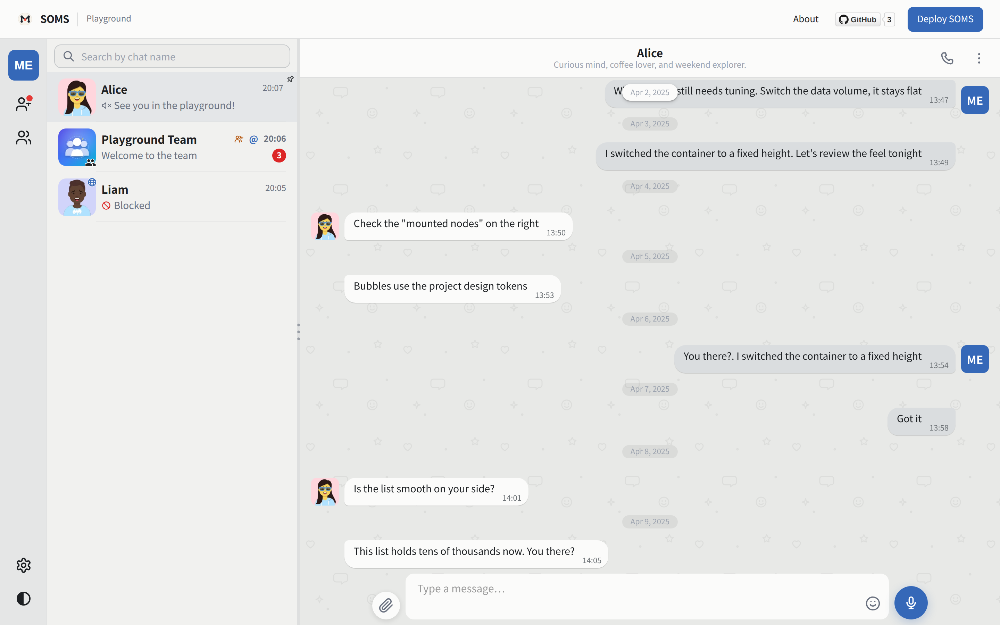

<p align="center">
  
</p>

<h1 align="center">SOMS</h1>

<p align="center">
  <strong>Simple Open Messaging Service</strong><br>
  A self-hosted, federated chat platform for the web and native devices.
</p>

<p align="center">
  <a href="https://github.com/hapood/simple-open-messaging-service/actions/workflows/ci.yml"></a>
  <a href="https://hapood.github.io/simple-open-messaging-service/"></a>
  <a href="LICENSE"></a>
  
  <a href="spec/v1/README.md"></a>
</p>

<p align="center">
  
</p>

<p align="center">
  <a href="https://hapood.github.io/simple-open-messaging-service/"><strong>Try the live playground</strong></a> — client-only demo.
</p>

> [!IMPORTANT]
> SOMS `0.1.0-alpha.1` and SOMFP `v1.0.0-draft.1` are currently available for **technical preview only**. Before beta, stable operation and upgrade compatibility are not guaranteed; APIs, the federation wire contract, and storage formats may change incompatibly. Use isolated test deployments with disposable data, not production or critical communications.

## Features

SOMS connects independently operated chat servers. Users can become friends, exchange messages
and rich media, form groups, and place calls across servers without a shared database or central
authority. The server, web client, and administration console are self-hosted.

### 🔄 Bulletproof Federation (Engineered for Self-Hosters)

Unlike protocols that assume enterprise data centers with 100% uptime, SOMS is built for the
reality of home servers, NAS devices, and dynamic IPs:

- **Zero-Loss Recoverable Pull Sync** — When a server goes offline for maintenance or network
  outages, it doesn't cause state divergence or CPU storms upon reconnect. Nodes catch up on
  missed messages, membership changes, and room states smoothly via cursor-based pull feeds.
- **First-Class Deletion & Recall (Tombstones)** — Message revocations and author deletions are
  treated as sequenced tombstones. Deletion feeds propagate reliably across peers, ensuring
  withdrawn messages are cleanly purged even if a peer server was offline at the moment of deletion.
- **Signed Server-to-Server Traffic** — Ed25519 HTTP message signatures, replay protection,
  and key continuity authenticate every cross-server interaction without central gatekeepers.
- **Open Protocol (SOMFP)** — SOMFP specifies friendship, messaging, group rosters, media,
  read positions, deletions, and call signaling. Complete contracts, schemas, and conformance
  suites live in [`spec/`](spec/README.md).

### 💬 Rich & Responsive Messaging

Enjoy the fluid speed of modern cloud messengers on your own hardware:

- **Rich Content Types** — Images, streaming video, voice audio, raw files with progress,
  quoted replies, @mentions, rich link previews, and customizable avatars.
- **NAS-Grade Media Delivery** — Stream large files and media directly from personal storage
  with verified content digests (SHA-256) and declared sizes.
- **In-Thread Substring Search** — Search conversation text, quoted replies, and media
  filenames with lightweight coordinate jumping, avoiding client-side decryption bottlenecks
  and mobile battery drain.
- **Reliable Multi-Device Sync** — Instant unread/read state, pinned threads, mute, and draft
  sync across every device you log into.
- **One-to-One Voice & Video** — Low-latency WebRTC calls with simple cross-server signaling
  and optional custom TURN credentials.

### 🛡️ Administration & Community Moderation

Keep your server healthy and your community safe with full administrative visibility:

- **In-App Message Reporting** — Users can report inappropriate or abusive content within
  conversations, creating an auditable review entry for server administrators.
- **Content Moderation Actions** — Administrators can inspect reported messages, dismiss
  spurious reports, or execute administrative deletions (tombstones) across the thread.
- **Enterprise-Grade Admin Console** — Role-based access control (RBAC), quota management,
  system audit logs, connection diagnostics, and federation peer controls.
- **Zero-Password & Modern Auth** — OTP and QR code sign-in, per-device session management
  with remote revocation, plus 2FA and WebAuthn hardware key support for administrators.
- **Streamlined Stack & Low Overhead** — Built on Fastify, Drizzle ORM, and PostgreSQL with
  zero external broker dependencies (no Redis or RabbitMQ required), running comfortably on
  entry-level NAS hardware and modest servers.

## Deployment

SOMS ships as a self-contained Docker stack with PostgreSQL, automatic migrations, the application,
and a Caddy TLS edge.

Use the [**Compose configuration generator**][gen] in the live playground. Choose **Public Server**
(`public`) or **LAN / NAS** (`nas`), fill in domains and credentials, then download
`docker-compose.yml`. All editable settings are grouped at the top of this single file. The
page also provides the DNS records and published ports for the selected mode.

The generator and deployment templates use
`ghcr.io/hapood/simple-open-messaging-service:latest`. The application container applies database
migrations during startup. Published images support Linux amd64 and arm64; `:latest` follows
published versions, including alpha releases. Select an explicit version tag to control upgrades.
The current source version is `0.1.0-alpha.1`; its release image becomes available only after the
corresponding release tag is published from `main`. See
[GitHub Releases](https://github.com/hapood/simple-open-messaging-service/releases) for availability
and release notes. The rolling `:dev` image is intended for development testing and never updates
`latest`.

After downloading:

```bash
mkdir -p soms && cd soms   # place docker-compose.yml here
# Create the configured data directory (default ./data) and ensure the container can write to it
mkdir -p -- ./data
docker compose up -d
docker compose logs -f app
```

- Public mode uses HTTPS on port 443; NAS mode uses one configurable port, defaulting to 7667.
- Create whichever data directory path was configured in the generator (the generator checklist displays the exact command) and ensure Docker has write permissions to it (the application container runs as non-root UID/GID `1000:1000`).
- Admin access defaults to public with mandatory login in public mode, and private source IPs only
  in NAS mode. Either mode lets you change that restriction.
- Configuration inputs, YAML preview, copy, and download show plaintext credentials. Keep the file
  private and out of version control.
- Changing credential values in the file does not rotate existing database or admin passwords.

See the [deployment guide](docs/deployment/deployment.md) for domains, DNS, configuration, and updates.

[gen]: https://hapood.github.io/simple-open-messaging-service/#/deploy

## Platform Status

The Angular client runs in the browser and is shared with the Tauri native applications.
Native platform availability is tracked separately below; planned applications are not yet available.

| Platform                | Status                | Delivery                                                  |
| ----------------------- | --------------------- | --------------------------------------------------------- |
| Web / PWA               | **Available (Alpha)** | Modern desktop and mobile browsers                        |
| Android                 | In development        | Tauri application with native calling and FCM integration |
| Windows / macOS / Linux | Planned               | Tauri desktop applications                                |
| iOS                     | Deferred              | Paused due to App Store distribution constraints          |

## Documentation

- [Documentation index](docs/README.md) — setup, deployment, architecture, APIs, federation, and operations.
- [Changelog](CHANGELOG.md) — changes in each release.

## License

SOMS is released under the [MIT License](LICENSE). Third-party software and asset notices are listed
in [THIRD_PARTY_NOTICES.md](THIRD_PARTY_NOTICES.md).

Copyright © 2026 [hapood](https://github.com/hapood).
