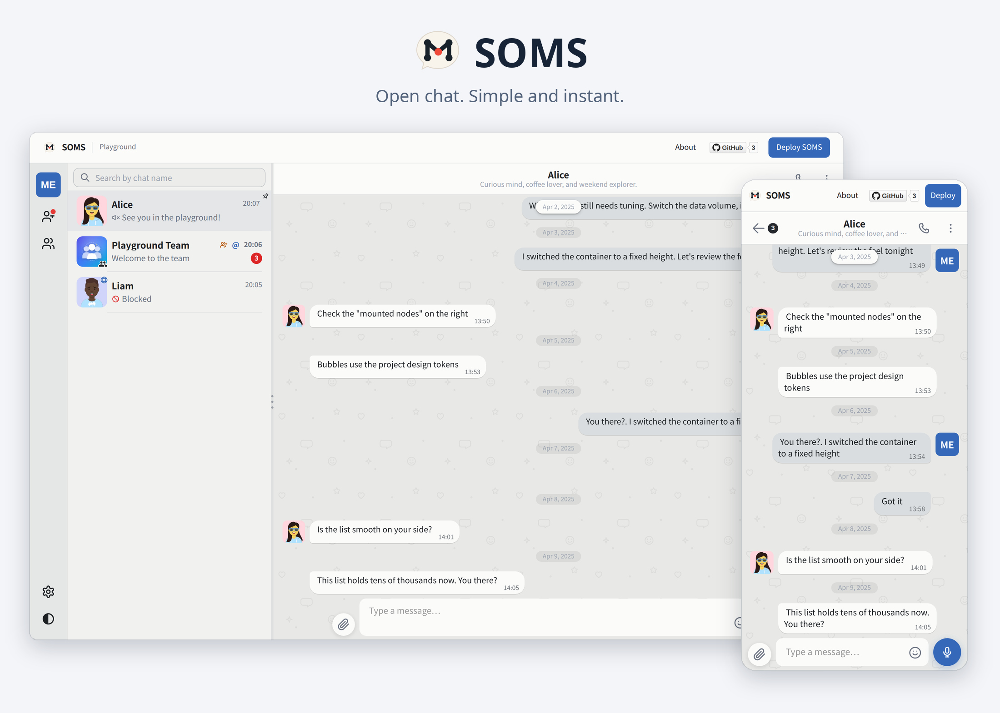

  

<h1 align="center">SOMS</h1>

  <strong>Simple Open Messaging Service</strong> 
  A lightweight, self-hosted federated chat platform — combining email-like cross-domain simplicity, full ownership of your chat data, and a clean foundation for future lightweight AI agents.

  
  
  
  
  

  

  
  &nbsp;
  
  &nbsp;
  
   
  Interactive in-browser simulation running local state. Official portal at <a href="https://soms.im/">soms.im</a>.

  <b>English</b> | <a href="README_zh.md">简体中文</a>

> [!NOTE]
>
> **Alpha Preview (`0.1.0-alpha.2` / `SOMFP v1.0.0-draft.2`):** Breaking changes to APIs, wire contracts, and storage schemas are expected before beta. Please use isolated test environments with disposable data—not production.

---

## Vision & Core Philosophy

SOMS is the reference implementation of **SOMFP** (_Simple Open Messaging Federation Protocol_). Our goal is to make federated communication as universal as email, as light as a single container on a home NAS, and open enough for you to truly own your conversations.

### 🌐 Federation as Simple as Email

Just enter `alice@example.com` to connect with friends and join multi-server group chats across independent domains—no central directory or shared database required. Server-to-server traffic runs over standard **HTTPS** with **Ed25519 request signatures**, keeping federation transparent, debuggable, and interoperable.

### ⚡ Featherweight Footprint (~160MB–200MB RAM)

Engineered from the ground up for personal servers, entry-level NAS devices, and residential broadband. SOMS runs as a single clean stack (Fastify + Drizzle ORM + PostgreSQL) with **zero external message brokers** (no Redis, Kafka, or RabbitMQ). If your home server reboots or loses connectivity, **durable pull sync** automatically catches up on all missed messages upon reconnect.

### 🗄️ Own Your Conversations & Digital Assets

Your messages, files, and media are long-term personal assets—not unreadable encrypted blobs trapped in complex key-gossip states. By deliberately avoiding heavy federation-layer E2EE, SOMS keeps your history stored cleanly on your own hardware in standard PostgreSQL and local storage, enabling **instant server-side full-text search**, effortless multi-device sync, and reliable self-managed backups.

---

## Key Features

- **Lean Native Clients (~34MB):** Built with Angular and Rust/Tauri (no bloated browser wrappers). Real-time read/unread sync across devices, 1:1 WebRTC voice/video calls, and native background push notifications on Android.
- **Rich, Expressive Messaging:** Images, streaming video, voice recordings, raw file transfers with progress tracking, quoted replies, `@mentions`, rich link cards, and custom avatars.
- **Built-In Moderation & Admin Console:** Role-based access control (RBAC), quota management, in-app message reporting, cross-server message recall (tombstones), and OTP/QR or WebAuthn authentication.

---

## Roadmap

- [x] Core `SOMFP` federation protocol, Ed25519 request signing, and durable pull sync
- [x] Cross-platform Web/PWA, Desktop (Tauri), and Android alpha clients
- [ ] **Polished UX & Effortless Deployment:** Ongoing refinements to client responsiveness and simplified one-click deployment templates for home NAS setups
- [ ] **Lightweight AI Agents & Workflows _(Planned)_:** Because messages are cleanly structured and accessible on your own node, future releases will introduce native bot/webhook bridges—turning your self-hosted chat into an active workspace where humans and lightweight AI agents collaborate seamlessly

---

## Quick Start & Deployment

SOMS ships as a self-contained Docker stack (`linux/amd64` & `linux/arm64`) bundling PostgreSQL, automatic database migrations, the SOMS server, and a Caddy TLS edge.

No manual YAML editing is required—use our interactive generator to create a ready-to-run `docker-compose.yml` tailored for either a **Public Server** or **LAN / NAS** setup:

👉 **[Launch the Docker Compose Generator](https://hapood.github.io/simple-open-messaging-service/#/deploy)**

For custom reverse proxies, DNS configuration, and upgrade steps, see the [Deployment Guide](docs/deployment/deployment.md).
