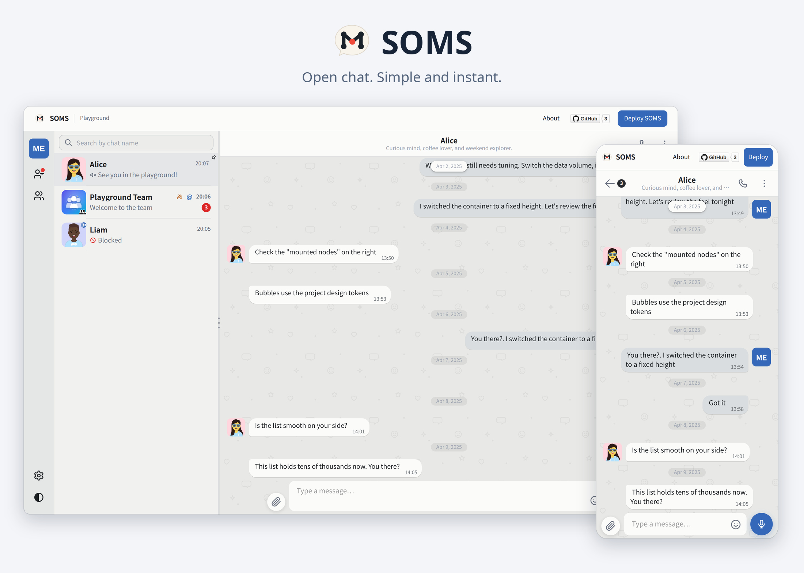

  

<h1 align="center">SOMS</h1>

  <strong>Simple Open Messaging Service</strong> 
  轻量级自托管联邦即时通讯平台 —— 兼具类似电子邮件的跨域简明体验、对聊天数据的完全掌控，并为未来接入轻量级 AI Agent 提供纯净的基础架构。

  
  
  
  
  

  

  
  &nbsp;
  
  &nbsp;
  
   
  浏览器内直接体验的本地交互式模拟环境。官方门户网站：<a href="https://soms.im/">soms.im</a>。

  <a href="README.md">English</a> | <b>简体中文</b>

> [!NOTE]
>
> **Alpha 预览阶段 (`0.1.0-alpha.2` / `SOMFP v1.0.0-draft.2`)：** 在进入 Beta 阶段前，API、网络协议契约和存储模式可能会有不兼容的破坏性变更。请在可丢弃测试数据的独立测试环境中试用，暂勿用于生产环境。

---

## 愿景与核心设计理念

SOMS 是 **SOMFP** (_Simple Open Messaging Federation Protocol_) 的参考实现。我们的目标是让联邦通信如电子邮件般普及通用，像家用 NAS 上的单个容器一样轻量，并且足够开放，让您能真正掌控自己的所有对话。

### 🌐 像电子邮件一样简单的联邦体验

只需输入 `alice@example.com` 即可添加好友，跨独立域名加入多服务器群聊 —— 无需中央目录服务或共享数据库。服务端间通信（S2S）基于标准 **HTTPS** 与 **Ed25519 请求签名**，让联邦机制透明、易于调试且具备高互操作性。

### ⚡ 极轻资源开销 (~160MB–200MB 内存)

专为个人服务器、入门级 NAS 设备及家庭宽带场景从零工程打造。SOMS 以单套纯净架构运行（Fastify + Drizzle ORM + PostgreSQL），**无需任何外部消息中间件**（零 Redis、Kafka 或 RabbitMQ 依赖）。即使家庭服务器重启或网络暂时中断，**持久拉取同步（Durable Pull Sync）** 也会在重新连接后自动补齐错过的所有消息。

### 🗄️ 真正掌控自己的对话与数字资产

您的聊天记录、文件和媒体内容是长期的个人资产 —— 而非困在复杂密钥流转（Key-gossip）状态中无法阅读的加密二进制块。通过在联邦层有意避开繁重的端到端加密（E2EE）负担，SOMS 将历史数据以标准结构妥善保存在您自己掌控的 PostgreSQL 与本地存储中，实现了**极速服务端全文检索**、无痛多设备同步以及可靠的自主备份。

---

## 核心特性

- **轻量原生客户端 (~34MB)：** 基于 Angular 与 Rust/Tauri 打造（绝非臃肿的浏览器套壳）。多端实时已读/未读同步、1 对 1 WebRTC 音视频通话，以及 Android 原生后台推送通知。
- **生动丰富的富媒体消息：** 高清图片、流式视频、语音留言、带进度的原文件传输、引用回复、`@提及`、富媒体链接卡片和自定义头像。
- **内置内容管理与管理员控制台：** 基于角色的访问控制（RBAC）、配额管理、应用内消息举报、跨服消息撤回（Tombstones），以及 OTP/二维码或 WebAuthn 身份认证。

---

## 路线图 (Roadmap)

- [x] 核心 `SOMFP` 联邦协议、Ed25519 请求签名与持久拉取同步
- [x] 跨平台 Web/PWA、桌面端 (Tauri) 与 Android Alpha 原生客户端
- [ ] **打磨用户体验与极致简便部署：** 持续优化客户端交互流畅度，为家用 NAS 场景提供更加极简的一键部署模板
- [ ] **轻量 AI Agent 与自动化工作流 _(计划中)_：** 得益于消息结构清晰且存放在您自己的节点上，未来版本将引入原生机器人/Webhook 桥接能力 —— 将您的自托管聊天服务打造成人类与轻量级 AI Agent 无缝协作的动态工作空间

---

## 快速上手与部署

SOMS 提供开箱即用的完整 Docker 栈（支持 `linux/amd64` 与 `linux/arm64`），打包了 PostgreSQL、自动数据库迁移、SOMS 后端服务以及 Caddy TLS 反向代理。

无需手动编写复杂的 YAML 文件 —— 使用交互式配置生成器，即可一键生成专为**公网服务器（Public Server）**或**局域网 / NAS**环境定制的 `docker-compose.yml`：

👉 **[启动 Docker Compose 配置生成器](https://hapood.github.io/simple-open-messaging-service/#/deploy)**

有关自定义反向代理、DNS 配置和升级步骤，请参阅 [部署文档](docs/deployment/deployment.md)。
