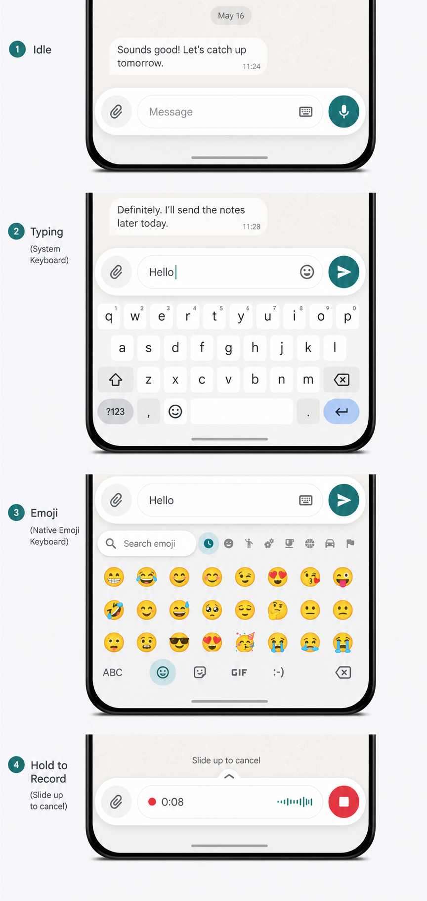

# Android native composer

## Goal

On Android Tauri, replace the Web chat input bar and custom Web emoji keyboard
with one native floating composer. The Web message timeline remains responsible
for rendering messages. Browser, PWA, and desktop behavior remains unchanged.

The Android composer follows Telegram's light floating composition while using
Material interaction and surface language: clear elevation, Material ripple,
48 dp touch targets, restrained corner radii, and theme-derived colors rather
than translucent iOS-style materials.



The concept image communicates hierarchy and state, not pixel-exact Android
widgets. The implementation dimensions below are authoritative.

## Layout contract

The native composer is an overlay owned by `MainActivity`, positioned immediately
above the current IME inset:

```text
Web message timeline
┌──────────────────────────────────────┐
│                                      │
│  JS-reserved composer padding        │
├──────────────────────────────────────┤
│  native floating composer            │  composerOccupiedHeight
├──────────────────────────────────────┤
│  system IME or native emoji surface  │  imeHeight
└──────────────────────────────────────┘
```

- Horizontal screen margin: 10 dp.
- Gap above the keyboard or safe-area boundary: 8 dp.
- One-line composer body: 56 dp.
- Surface corner radius: 28 dp.
- Input capsule corner radius: 24 dp.
- Minimum button target: 48 × 48 dp.
- Text input: one to five lines, then internally scrollable.
- Surface elevation: 3 dp idle, 6 dp while an attached menu is open.
- The composer and native emoji surface follow the same
  `WindowInsetsAnimation` progress as the system IME.

Native publishes `composerOccupiedHeight` whenever its measured height changes.
That value is the native component height only: it never includes the IME or
safe-area inset. A global bridge writes the composer and effective IME geometry
to root CSS variables; the Chat timeline moves by
`composer + max(IME, safe-area)`.

Android does not create `<app-chat-input>` or a spacer node. The global CSS
geometry contract moves the Web timeline while the native composer remains a
sibling overlay above the WebView.

## Upload architecture

All Tauri shells share the Rust `upload_stream_file` core for multipart,
progress, cancellation, authentication, and origin failover. Only source
discovery is platform-specific:

- desktop supplies an ordinary filesystem path;
- Android's picker opens a `content://` URI as a `ParcelFileDescriptor` and
  transfers descriptor ownership to Rust through JNI;
- Android voice recording supplies an app-private `.m4a` path directly;
- browser/PWA continues to use Angular HTTP because it has no Rust shell.

Unknown-length Android document-provider pipes are streamed chunked with
`total = 0`; ordinary files retain byte-accurate progress. File bytes never
cross the WebView or JavaScript bridge.

## Visual specification

Use Material theme attributes rather than hard-coded light colors:

| Element | Material role |
| --- | --- |
| Composer surface | `surfaceContainerHigh` |
| Input field | `surfaceContainerLowest` |
| Primary send button | `primaryContainer` / `onPrimaryContainer` |
| Idle icon buttons | `onSurfaceVariant` |
| Placeholder and timer secondary text | `onSurfaceVariant` |
| Recording indicator | `error` |
| Divider and input outline | `outlineVariant` |

Dark theme uses the same roles. Avoid blur, glass, gradients, permanent borders
around every icon, and oversized shadows.

Use Material Symbols Rounded or project-owned vector drawables. Do not use emoji
glyphs as action icons.

## Interaction states

### Idle

- Attachment button on the left.
- Empty native `EditText` in the center with the localized message placeholder.
- Keyboard/emoji toggle inside the trailing edge of the input field.
- Microphone button on the right.
- Tapping the field calls the retained native IME `show` path.

### Typing

- The microphone morphs into the send action once trimmed text is non-empty.
- Enter inserts a newline. Sending is an explicit button action on touch Android.
- The input grows to five lines without moving its bottom edge.
- Sending clears the native draft only after Web acknowledges that it accepted
  the send intent.

### Attachment

- Tapping the attachment button opens a Material modal bottom sheet.
- Initial actions: gallery and file. Additional actions can be added without
  changing composer geometry.
- Existing native upload selection and streaming remain the data path.
- The composer stays visible behind the sheet but is non-interactive.

### Native emoji keyboard

- Replaces the system IME in the same bottom slot.
- Keeps the native `EditText` focused and its selection authoritative.
- Provides recent and categorized emoji, an ABC return action, and backspace.
- Emoji inserts through the native editable API, not JavaScript selection
  reconstruction.
- The emoji panel height adopts the last usable system IME height, clamped to a
  minimum of 240 dp.

### Recording

- Press and hold starts recording after a short haptic confirmation.
- The input field becomes a timer and waveform/status surface.
- Sliding upward marks the gesture for cancellation; sliding left is reserved
  for a future lock-to-record mode and is not part of the first release.
- Releasing sends; releasing in the cancel region discards.
- Android lifecycle interruption, permission denial, and an incoming call cancel
  recording safely.

### Back and navigation

Back consumes one transient state in this order:

1. attachment bottom sheet;
2. native emoji keyboard;
3. system IME;
4. composer transient state;
5. existing Web navigation.

Entering a chat calls `showComposer(context)`. Leaving the active chat calls
`hideComposer()`. Route changes carry a monotonically increasing context ID so
late callbacks from the previous thread are ignored.

## JS to native API

Expose the following methods on the existing `SomsShell` bridge. JSON payloads
are versioned so native and OTA Web releases can fail closed when their contracts
do not match.

```ts
interface NativeComposerContext {
  version: 1;
  contextId: number;
  threadId: string;
  placeholder: string;
  initialDraft: string;
  sending: boolean;
  canRecord: boolean;
  canUpload: boolean;
  theme: 'light' | 'dark' | 'system';
}

interface SomsShell {
  showComposer(contextJson: string): void;
  updateComposer(patchJson: string): void;
  acknowledgeComposerAction(actionId: number, accepted: boolean): void;
  hideComposer(contextId: number): void;
}
```

`updateComposer` may update `placeholder`, `sending`, permissions, draft, reply
context, and theme without destroying or recreating the native view.

## Native to JS events

Native publishes a single ordered event stream:

```ts
type NativeComposerEvent =
  | {
      version: 1;
      contextId: number;
      sequence: number;
      kind: 'geometry';
      occupiedHeightPx: number;
    }
  | {
      version: 1;
      contextId: number;
      sequence: number;
      kind: 'draft';
      text: string;
      selectionStart: number;
      selectionEnd: number;
    }
  | {
      version: 1;
      contextId: number;
      sequence: number;
      kind: 'sendText';
      actionId: number;
      text: string;
    }
  | {
      version: 1;
      contextId: number;
      sequence: number;
      kind: 'pickAttachment';
      actionId: number;
      source: 'gallery' | 'file';
    }
  | {
      version: 1;
      contextId: number;
      sequence: number;
      kind: 'recording';
      phase: 'started' | 'cancelled' | 'completed' | 'failed';
      actionId: number;
      durationMs?: number;
      error?: string;
    };
```

Install `window.__SOMS_COMPOSER_EVENT__` before Angular bootstrap, following the
existing eager IME bridge pattern. Native retains the latest geometry snapshot
so a WebView reload can restore padding without a visible jump.

Send actions use acknowledgement rather than optimistic native clearing:

1. Native emits a unique `actionId`.
2. Web validates the current context and accepts or rejects the intent.
3. Web calls `acknowledgeComposerAction`.
4. Native clears the draft only when accepted.

This protects drafts from route races and transient bridge failures.

## Scope boundary for the first release

Include:

- plain-text drafts and multiline editing;
- system IME and native emoji switching;
- recent emoji;
- gallery/file selection through existing native uploads;
- hold-to-record and cancel;
- send acknowledgement;
- rotation, dark theme, accessibility, and process/WebView recreation.

Defer:

- native mention suggestions;
- native link-preview cards;
- reply banners;
- GIF/sticker search;
- lock-to-record;
- rich clipboard attachment review.

These deferred capabilities must either remain unavailable on Android in the
first release or receive explicit native designs before implementation. They
should not silently fall back to hidden Web controls.

## Acceptance checks

- No Web input controls or Web emoji grid are created on Android.
- Android creates neither the Web composer nor a spacer node.
- The Web timeline offset is `composer + max(IME, safe-area)`.
- Native composer height excludes both IME and safe-area insets.
- IME height is compensated exactly once.
- Composer, timeline, and IME remain visually joined throughout keyboard
  animations on API 30+.
- Android 8 fallback opens and closes without leaving an empty bottom gap.
- Draft and selection survive system IME ↔ emoji transitions.
- Returning from another thread cannot send into the previous thread.
- Back behavior follows the stated transient-state order.
- TalkBack announces every action and the recording state.
- Touch targets remain at least 48 dp in portrait and landscape.
- Rotation, app backgrounding, WebView reload, and process recreation restore a
  consistent visible/hidden state.
