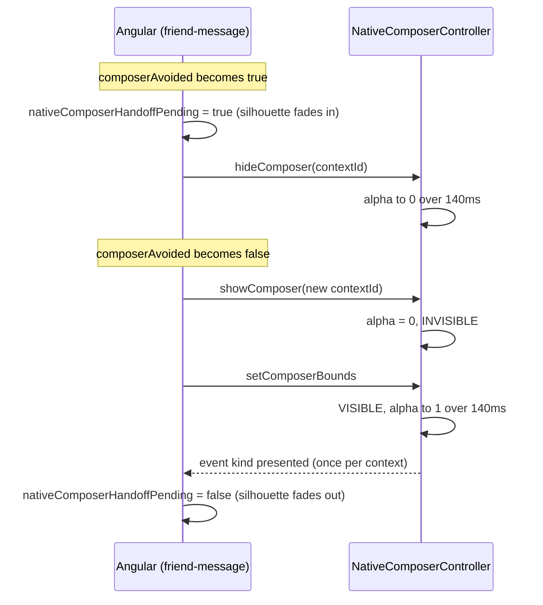

# Composer avoidance silhouette

## Goal

When a higher layer requires the chat composer to step aside (dialog, aside pane, media viewer,
fullscreen call, paste panel), the composer slot must not become an empty gap. A muted gray
composer silhouette occupies the same rectangle while the real composer is hidden. The switch is
an in-place opacity cross-fade, and it looks identical on the browser composer and the Android
native composer.

## Behavior

| Situation | Real composer | Silhouette |
| --- | --- | --- |
| Normal chat | visible | hidden |
| Composer avoided (see below) | fades out | fades in |
| Avoidance ends | fades in | fades out at the same moment |
| Multi-select mode | hidden | hidden (the selection bar owns the slot) |
| Blocked / read-only / quota paused / friendship ended | none | hidden (the banner or empty slot owns it) |
| Android cold start, before the chat is ready | not yet shown | hidden (no flash) |

"Avoided" is the `composerAvoided` computed in
[friend-message.component.ts](../../web/src/app/components/message-thread/friend-message.component.ts):

- Browser composer: any routed dialog, or `nativeComposerOccluded()`.
- Android native composer: a chatbox dialog for this thread, or `nativeComposerOccluded()`.

`nativeComposerOccluded()` covers aside panes, non-chatbox pane-stack entries, the fullscreen call
overlay and the paste panel. The browser template uses the same `composerAvoided` for its
`msg-composer--dialog-hidden` class, so the browser composer and the silhouette always switch
together.

## Visual specification

- Geometry: `position: absolute; inset-inline: 0; bottom: 0`, the same as `app-chat-input`.
  Height is `--soms-composer-height + --soms-safe-bottom`, which is the real composer height:
  - Browser: `ComposerGeometryService` keeps measuring the mounted (transparent) composer.
  - Native: `NativeComposerService.hideActive()` rejects the zero-height geometry emitted on hide,
    so the last real measurement, including multi-line drafts and quotes, is kept.
- It applies the same keyboard-lift transform as `.ci-input-bar`.
- Layering: `z-index: 3`, below the browser composer (`4`). It is `aria-hidden` and has
  `pointer-events: none`.
- Look: composer bar background and top border, a rounded gray input capsule that fills the
  height, and a 48px gray circular send button. The fill is the
  `--im-composer-placeholder-fill` token.
- It is never measured, so it does not affect `--soms-composer-height`, the content bottom
  reserve, or the virtual-scroll height model. All box values are integer pixels.

## Motion

Opacity only, with no translation, because both surfaces occupy the same rectangle.

| Side | Duration | Easing |
| --- | --- | --- |
| Web (silhouette and browser composer) | `--im-composer-fade-duration` = 140ms | `--app-ease-standard` = `cubic-bezier(0.2, 0, 0, 1)` |
| Android native composer | `COMPOSER_FADE_DURATION_MS` = 140 | `PathInterpolator(0.2, 0, 0, 1)` |

The two constants must change together. Each source states this requirement.

## Native hand-off protocol

Hiding is synchronous. Showing is not: `show()` keeps the native view `INVISIBLE` until Angular
publishes bounds through `setComposerBounds`, and bounds can be deferred by the reflow freeze.
If the silhouette faded out when `show()` was requested, the slot would be empty for that
interval. The silhouette's fade-out is therefore driven by a native fact:

- `presented` is emitted once per context, on the first frame of the fade-in. Later bounds
  updates do not emit it again.
- Only an avoidance hide sets `nativeComposerHandoffPending`. Thread switches, selection mode
  and banner states do not show the silhouette.
- The silhouette is visible on native when
  `bound && !selection && ready && (avoided || nativeHandoffPending)`, where `ready` means
  `interactionActive() && threadId !== undefined`. The pure rule lives in
  [composer-placeholder.ts](../../web/src/app/components/message-thread/composer-placeholder.ts).

Responsibility boundary: Kotlin reports a fact (`presented`) and executes the fade. The decision
to show the silhouette stays in the Web host that owns the chat surface.

## Tests

- [composer-placeholder.spec.ts](../../web/src/app/components/message-thread/composer-placeholder.spec.ts)
  covers web avoidance, banner states, selection mode, native cold start and the native hand-off
  bridge (`npm run test:unit --prefix web`).
- Manual Android checks:
  - Open a peer profile, a gallery and a chatbox dialog. Each time, the composer and the
    silhouette cross-fade in place with no empty frame and no vertical movement.
  - Close each layer. The silhouette stays until the native composer begins its fade-in.
  - With a multi-line draft, the silhouette matches the composer's height.
  - Cold-start into a chat. No gray flash appears before the native composer.
