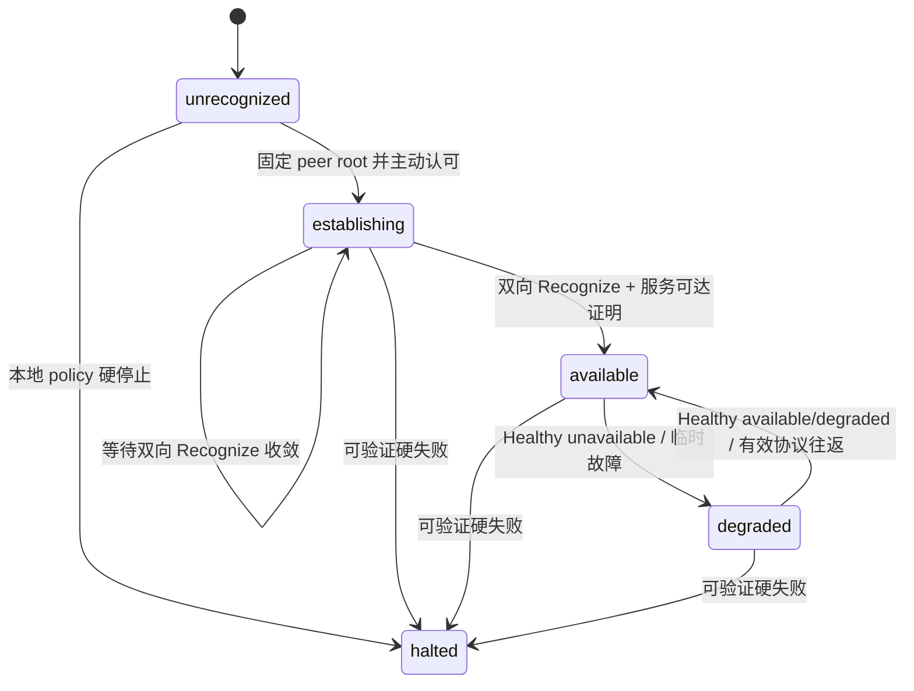
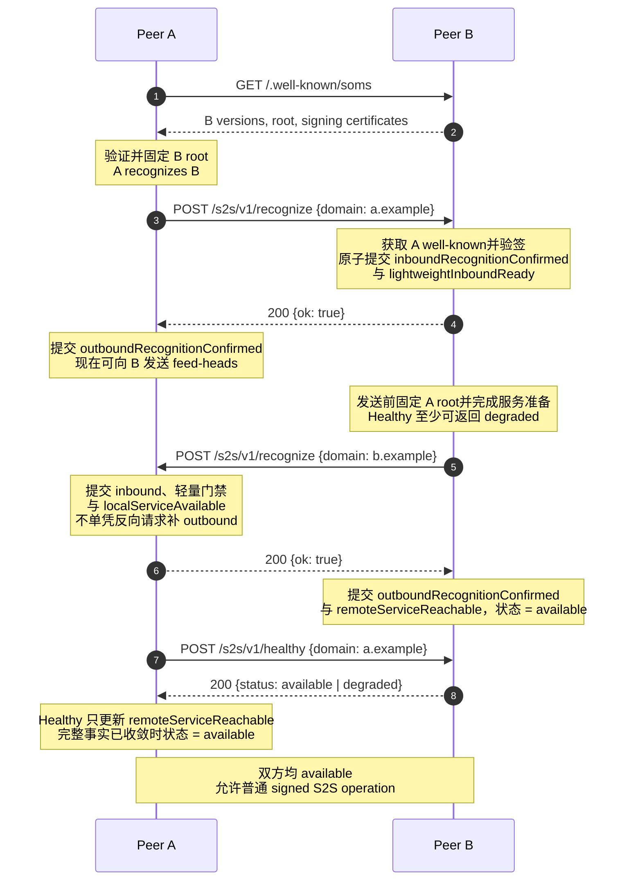
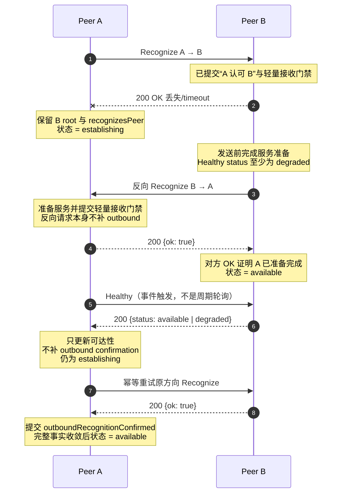

# SOMS Federation v1 服务器认可（Peer Recognition）

状态：`REVIEW`

Operations：

- `POST /s2s/v1/recognize`
- `POST /s2s/v1/healthy`

本文定义服务器认可（peer recognition）的方向语义、双向建立时序、身份固定、成功确认、失败处理，
以及健康查询（health query）的隐私保护行为。Federation 基础类型和响应封装由
[SOMS Federation Protocol v1](./protocol.md) 定义；HTTPS、发现、密钥证书和 HTTP Message Signature 由
[传输与安全](./transport-security.md)定义；错误分类由 [错误码注册表](./errors.md)定义。

规范词 `必须（MUST）`、`不得（MUST NOT）`、`应该（SHOULD）`、`不应该（SHOULD NOT）` 和
`可以（MAY）` 按 RFC 2119/RFC 8174 解释。

## 1. 核心语义（Core Semantics）

`A → B Recognize` 的唯一协议含义是：

> A 已通过 B 的 HTTPS well-known 验证并认可 B 当前的 Federation 身份，请求 B 持久记录“A 认可 B”。

B 返回 `OK` 的唯一协议含义是：

> B 已确认请求来自 A，并已持久提交“A 认可 B”这个方向事实。

一次 Recognize 只完成一个方向，不表示 B 认可 A，也不表示双方连接已经健康。B 为验证 A 的请求而读取
A 的 well-known 只是身份验证（authentication）；B 对 A 的认可必须（MUST）通过反向
`B → A Recognize` 明确表达。

完整建立由两个相反方向的 Recognize 组成：

```text
A recognizes B  ── B returns OK
B recognizes A  ── A returns OK
```

只有两个方向的认可、双方服务准备和 identity/policy 要求都收敛后，peer 才是 `available`。通常证据是两个
Recognize `OK`。如果第一个 `OK` 丢失，调用方可以（MAY）幂等重试原方向；Healthy 只能取得可达性证明，
不能代替丢失的 Recognize `OK`。反向 Recognize 也不提供该证明，因为
双方可能独立并发发起。请求方必须（MUST）幂等重试原方向 Recognize，直到收到有效 `OK` 或可认证的硬错误。
Recognize 不交换 feed cursor，不初始化业务 mirror，也不证明用户、群组或消息权限。

## 2. 操作概要（Operation Overview）

| 项目         | Recognize                         | Healthy                                        |
| ------------ | --------------------------------- | ---------------------------------------------- |
| Method       | `POST`                            | `POST`                                         |
| Path         | `/s2s/v1/recognize`               | `/s2s/v1/healthy`                              |
| Query        | 无；签名中的 `@query` 为 `?`      | 无；签名中的 `@query` 为 `?`                   |
| Request      | 裸 `DomainRequest` JSON           | 裸 `DomainRequest` JSON                        |
| Request auth | bootstrap signed                  | status signed                                  |
| Success      | HTTP `200`，裸 `RecognizeOk`      | HTTP `200`，裸 `HealthResult`                  |
| 幂等坐标     | `(signerDomain, recipientDomain)` | 无副作用查询                                   |
| 状态作用     | 提交一个方向的认可                | handler 无副作用；响应可供调用方更新远端可用性 |

```ts
interface DomainRequest {
  domain: Domain;
}

interface RecognizeOk {
  ok: true;
}

interface HealthResult {
  status: 'available' | 'degraded' | 'unavailable';
}
```

三个 object 都是 closed object：列出的字段全部必选，`null`、重复字段和未知字段均不允许。

## 3. 双向状态模型（Bidirectional State Model）

以下名称描述协议事实，不要求实现使用同名数据库字段：

| 协议事实                       | 含义                                   | 何时成立                                                                                              |
| ------------------------------ | -------------------------------------- | ----------------------------------------------------------------------------------------------------- |
| `recognizesPeer`               | 本方已验证并认可对方 root identity     | 本方发送 Recognize 前原子固定对方 root 时                                                             |
| `outboundRecognitionConfirmed` | 对方已提交“本方认可对方”               | 本方收到原方向 Recognize 的有效 `OK`                                                                  |
| `inboundRecognitionConfirmed`  | 本方已提交“对方认可本方”               | 本方成功处理入站 Recognize、返回 `OK` 前                                                              |
| `lightweightInboundReady`      | 本方已获准安全接受该 peer 的轻量请求   | 与 inbound confirmation 在返回 `OK` 前原子提交                                                        |
| `localServiceAvailable`        | 本方已准备好为该 peer 提供认可后的服务 | 发送反向 Recognize 前原子提交；接收反向 Recognize 时在返回 `OK` 前提交                                |
| `remoteServiceReachable`       | 已观察到对方服务和一次有效协议往返     | 有效 Healthy `available`/`degraded`、反向 Recognize 的 `OK`，或任一成功认证并处理的正常 S2S 请求/响应 |

peer 的 lifecycle 是以下 closed enum。它只表示对该 peer 的通信是否可自动继续，不把每个失败原因复制为
独立 lifecycle：

| 状态           | 精确定义                                                                                             |
| -------------- | ---------------------------------------------------------------------------------------------------- |
| `unrecognized` | 尚无可用的 pinned/recognition identity                                                               |
| `establishing` | 已固定并认可 peer，但双向 Recognize 或服务准备事实尚未收敛；只允许握手控制面和已按方向开放的轻量请求 |
| `available`    | 双向认可、服务准备、有效往返、identity、版本和 policy 全部有效，且没有未恢复的传输降级               |
| `degraded`     | 双向认可关系已建立，但当前可达性证明缺失，或发生可重试的传输/服务故障                                |
| `halted`       | 已有可验证的硬失败证据，自动 Recognize、Healthy 重试和数据面通信全部停止，等待本地管理员处理         |

节点必须（MUST）在 lifecycle 之外保留导致 `halted` 的原始证据和原因，例如目标 peer 返回的稳定 HTTP
error code、本地 policy block、pinned-root contradiction 或无共同版本。这些原因仍保留各自的 wire 错误和安全
含义，但不是 lifecycle 状态。实现可以（MAY）使用额外 pending 或诊断字段，但不得（MUST NOT）把 Healthy
的 `unavailable` 返回值持久化为同名 lifecycle。

Healthy 的 `available | degraded | unavailable` 是上述本地状态和查询权限的隐私投影，不是 lifecycle
状态集合。Healthy 只可以（MAY）为本地 `available`/`degraded` 升降级提供可达性证明，不得（MUST NOT）
提交或补造 recognition direction fact，也不得（MUST NOT）使本地 peer 进入 `halted`。普通 operation 也不得
（MUST NOT）仅按 `available`/`degraded` 标签授权：完整双向认可事实、pinned
identity、共同版本、policy 和 operation 业务授权均有效时，纯传输 `degraded` peer 仍可以（MAY）发送和接收
普通数据面。`establishing` peer 只能使用 `recognize`、`healthy` 和按方向开放的
`feed-heads`。

本地 `available` 按下式计算：

```text
available =
  outboundRecognitionConfirmed
  AND inboundRecognitionConfirmed
  AND localServiceAvailable
  AND remoteServiceReachable
  AND pinned identity is valid
  AND a common protocol version remains selected
  AND local policy permits federation traffic
  AND no unresolved transport degradation remains
```



状态转换必须（MUST）按下表处理；“重新计算”表示在同一事务中根据本节的 `available` 计算公式和当前 facts
得到下一状态：

| 事件                                                         | 前置状态                              | 本地事实变更                                                             | 下一状态与处理                      |
| ------------------------------------------------------------ | ------------------------------------- | ------------------------------------------------------------------------ | ----------------------------------- |
| 主动认可并固定 peer root                                     | `unrecognized`                        | 设置 `recognizesPeer`，保留待发送 Recognize                              | `establishing`                      |
| 成功处理入站 Recognize                                       | `establishing`/`available`/`degraded` | 设置 inbound confirmation 和 lightweight gate                            | 重新计算；不得单凭该请求补 outbound |
| 本方向收到 Recognize `OK`                                    | `establishing`                        | 设置 outbound confirmation                                               | 重新计算                            |
| Healthy 返回 `available`/`degraded`                          | `establishing`/`degraded`/`available` | 仅设置 remote reachable 并清除传输降级；不得补方向事实                   | 重新计算                            |
| Healthy 返回 `unavailable`、timeout 或非法响应               | `available`/`degraded`                | 清除 remote reachable，记录 transport degradation                        | `degraded`；不得进入 `halted`       |
| Healthy 返回 `unavailable`、timeout 或非法响应               | `establishing`                        | 保留未收敛方向事实，记录本次可达性失败                                   | 保持 `establishing`                 |
| 成功认证并处理正常 S2S 请求或确定响应                        | `available`/`degraded`                | 设置 remote reachable，清除纯传输降级；不得补 recognition direction fact | 重新计算                            |
| 网络失败、timeout 或 HTTP `503`                              | `available`/`degraded`                | 清除 remote reachable，保留 pin、方向事实和业务状态                      | `degraded`                          |
| Recognize 的可重试失败                                       | `establishing`                        | 保留 pin、已提交方向事实和待重试工作                                     | 保持 `establishing`                 |
| 来自目标 peer 的可认证硬错误响应，或本方独立验证的硬安全证据 | 非 `halted`                           | 保留原响应/证据和原因，清除运行时可达性，停止自动通信                    | `halted`                            |
| 本地管理策略硬停止                                           | 任意非 `halted` 状态                  | 记录本地 policy 原因，停止自动通信                                       | `halted`                            |

只有来自本次请求目标 peer（同一 hostname-verified TLS connection/authority）的 HTTP `409`，并携带本节注册的
fatal code，或本方独立验证的 pinned-root/版本/policy 硬冲突，才可以（MAY）触发 `halted`。来源不可验证的
proxy response、TLS/连接失败、timeout、HTTP `503`、malformed response 或 Healthy `unavailable` 都不得触发
`halted`；已建立的 peer 对这些可用性失败进入 `degraded`。

进入 `halted` 后，协议不定义自动恢复路径，也不规定管理界面、审批、重置或恢复操作。何时以及如何离开
`halted` 属于本地管理行为。在管理员明确处理前，实现不得（MUST NOT）自动重试 Recognize/Healthy、恢复数据面或替换
root pin。Healthy 对 `halted` 及其所有原因统一投影为 `unavailable`。

operation gate 与 lifecycle 分开计算：

| Operation 类别           | 必须（MUST）满足的 gate                                                                                             |
| ------------------------ | ------------------------------------------------------------------------------------------------------------------- |
| `recognize`              | bootstrap signed 和对应 admission；不要求已有 lifecycle                                                             |
| `healthy`                | status signed；失败统一投影为 `unavailable`                                                                         |
| `feed-heads`             | 该 signer 方向的 `lightweightInboundReady`                                                                          |
| 普通 recognized data     | pinned identity、双方 direction confirmation、共同版本、policy 和 operation 业务授权；纯传输 `degraded` 不关闭 gate |
| 已有活动 call 的终止收敛 | calls.md 定义的现有 binding/tombstone 规则；不得仅因 health cache 降级而阻止                                        |

发送 Recognize、加入重试队列、读取 well-known 或仅验证请求签名都不得（MUST NOT）提前设置对应的
confirmed fact。网络 socket 是否仍连接不是认可事实；短暂断线不得（MUST NOT）删除 identity pin 或方向事实，
但可以（MAY）把当前可用状态从 `available` 降为 `degraded`。

Recognize 发出后发生 timeout、DNS/TLS/connect failure、响应中断或可重试 server failure 时，本方已经完成的
`recognizesPeer` 事实保留，并保持 `establishing`；不得（MUST NOT）伪造 outbound confirmation。
`degraded` 仅用于已完成双向认可、但当前可达性受损的 peer；握手未收敛使用 `establishing`。

普通 feed、call、user、media 和 forward-bundle operation 使用 protocol.md 的 `recognized signed`
鉴权上下文，不以本地缓存的 `available` 标签作为协议门禁。本文所说的轻量请求严格指 `feed-heads`
feed-head hint：接收方在发送 Recognize `OK` 前必须（MUST）准备好接收该 signer 的 `feed-heads`；发送方
只有收到 `OK` 后才可以（MAY）向该方向发送 hint。hint 可丢失且不携带 durable payload，因此这个方向性
门禁不等于在握手未收敛时开放其他数据面。

`localServiceAvailable` 与本地 peer lifecycle 的 `available` 不是同一个量：前者表示“本服务器已经准备好”，
可以（MAY）在反向请求发出前成立；后者还要求成功确认远端。Healthy 接口返回本方当前 lifecycle 的隐私安全视图，
但 Healthy 的 `available` 和 `degraded` 都表示“认可关系存在且允许该签名 peer 查询”。

## 4. 身份验证、认可与固定（Identity Verification, Recognition, and Pinning）

### 4.1 发起方认可接收方

向 peer domain `B` 发送 Recognize 前，A 必须（MUST）：

1. 按 protocol.md 的 SRV、TLS 和 authority 规则定位 B。
2. 通过 hostname 验证成功的 HTTPS 获取 B 的 `/.well-known/soms`。
3. 选择最高共同主版本，并要求选中版本为路径中的 `1`。
4. 严格解码 `rootKey.ed25519` 为恰好 32 bytes。
5. 验证 B 至少一份当前有效的 root-authorized signing key certificate。
6. 在本地原子固定 B 的 root public key、记录 `recognizesPeer`，并把该 peer 的 lifecycle 设置为
   `establishing`，然后才构造和发送 HTTP request。

仅成功读取 well-known 不构成认可；只有调用方完成上述验证并作出本地认可决定后，才可以（MAY）发送
Recognize。对已固定 peer，再次读取的 root 必须（MUST）与 pin 逐字节相同。

第 6 步是主动发起方的必选提交边界。即使随后发生 timeout、连接重置或 HTTP `503`，该本地认可和
`establishing` 状态仍然成立。只有第 8 节定义的硬拒绝或安全失败才能使本次认可变为不可用；实现不得（MUST NOT）
把普通网络不确定性误判为拒绝或 identity loss。

### 4.2 接收方验证认可声明

B 收到 A 的 Recognize 后，必须（MUST）：

1. 从 HTTP Message Signature 的 `keyid` 提取 canonical signer domain A。
2. 要求 body 的 `domain` 与 A 完全相等；body 里的 `domain` 是认可声明者，不是接收方 B。
3. 通过 A 的 hostname-verified HTTPS well-known 验证 A 的 root、certificate 和请求签名。
4. 若已有 A 的 root pin 或先前认证记录，要求新取得的 root 与其逐字节相同。
5. 应用本地 admission policy，并检查 B 当前是否允许建立该 peer。

B 获取并验证 A 的 well-known 只证明“请求由 A 当前的 Federation signing key 发出”。在 B 的反向
Recognize 成功前，不得（MUST NOT）把这一步描述为“B 已经得到 A 对 B 的反向确认”。

### 4.3 根密钥与签名密钥连续性（Root and Signing Key Continuity）

`rootKey.ed25519` 必须（MUST）按 RFC 4648 padded base64 严格解码，拒绝非 canonical base64、非法
padding 和尾随数据，结果必须（MUST）恰好为 32 bytes。首次提交方向事实时，接收方必须（MUST）把该
root 与方向事实原子保存。

后续 root 不一致是 identity contradiction，不是 signing key rotation。节点必须（MUST）保留旧 pin，记录 identity
contradiction 原因，进入 `halted`、撤销 `available` 可用性并拒绝普通数据面。root 授权的 signing certificate 正常增加、
重叠、过期和移除不得（MUST NOT）清除已经确认的方向事实。

## 5. Recognize 请求与成功提交（Recognize Request and Successful Commit）

### 5.1 请求体

假设 A 向 B 发送请求，后续固定向量使用的精确业务 body bytes 为：

```text
{"domain":"a.example"}
```

`domain` 必须（MUST）是 protocol.md 定义的 canonical `Domain`，并必须（MUST）等于 HTTP signer domain。
接收方 domain 由已签名的 `@authority` 确定，协议版本由 `/s2s/v1` 确定，因此 body 不重复它们。

请求必须（MUST）按 protocol.md 的统一顺序构造：最终 compact JSON UTF-8 bytes → `Content-Digest` →
`Date`/签名参数 → RFC 9421 签名基串 → Ed25519 `Signature`。协议不要求 JSON object 一般采用 compact
serialization，但 digest 和签名必须（MUST）覆盖实际发送的精确 bytes；签名后不得（MUST NOT）重新序列化。

### 5.2 接收事务与 `OK`

所有验证和 policy 均成功后，B 必须（MUST）在返回响应前原子完成：

1. 固定或核对 A 的 root identity。
2. 提交 `inboundRecognitionConfirmed`，且保留首次确认时间。
3. 提交 `lightweightInboundReady`，使 A 在收到 `OK` 后立即发送的 `feed-heads` 不会被尚未就绪的
   admission gate 拒绝。
4. 确保反向 `B → A Recognize` 会被执行；崩溃恢复后也必须（MUST）能够继续该工作。
5. 如果 B 在处理请求前已经存在 `recognizesPeer(A)`，B 必须（MUST）在返回 `OK` 前设置
   `localServiceAvailable`。B 不得（MUST NOT）仅凭该入站请求设置 `outboundRecognitionConfirmed`：该请求
   可能是反向方向，也可能是双方独立发起的并发请求，不能证明 A 已提交 B 先前发送的 Recognize。

提交成功后返回一个 `RecognizeOk` closed JSON object。例如下面的格式化 JSON 是完整有效响应；空白和换行
不属于业务语义：

```http
HTTP/1.1 200 OK
Content-Type: application/json

{
  "ok": true
}
```

接收方必须（MUST）先按 `application/json` 解析 body，再要求结果是仅含一个 member `ok`、且其 JSON
boolean 值为 `true` 的 object。因此 `{"ok":true}` 和上面的格式化表示都有效；`{"ok":1}`、
`{"ok":true,"extra":null}`、`[true]`、空 body 和尾随非空白数据都无效。实现不得（MUST NOT）按原始
UTF-8 bytes、空白或 object member 排版判断成功。

不得（MUST NOT）在事务提交前返回 `OK`。A 只有收到 HTTP `200`、严格验证上述 `RecognizeOk` 结构且确认
响应来自与请求相同的 TLS connection/authority 后，才能原子设置
`outboundRecognitionConfirmed`。timeout 或网络错误不能代替该确认；握手中的 peer 保持 `establishing`，已经完成
双向认可的 peer 才进入 `degraded`。

response 不额外使用 detached signature；hostname-verified HTTPS 认证响应方，request 的 direction fact
已经由 B 的事务和固定响应语义确认。

### 5.3 反向 Recognize 的发送前准备（Preflight before Reverse Recognize）

B 成功提交 `A → B` 并返回第一次 `OK` 后，开始 `B → A` 前必须（MUST）先完成本地准备。发送 HTTP request
之前，B 必须（MUST）在一个事务中：

1. 作出并持久化 `recognizesPeer(A)`；验证时使用的 A root 成为固定身份锚。
2. 准备处理 A 随后可能到达的已授权请求，包括 `feed-heads` 接收路径所需的状态。
3. 设置 `localServiceAvailable`，使 A 随后的有效 Healthy 查询至少能够返回 `degraded`，而不是
   `unavailable`。
4. 持久记录反向 Recognize 待发送工作，使崩溃不会留下“服务已经准备、但永远不发送反向认可”的状态。

只有该事务提交后，B 才可以（MAY）发送反向 HTTP Recognize。`localServiceAvailable` 表示 B 已就绪，不表示
A 已收到反向请求；因此 B 在得到 A 的反向 `OK` 前仍不得（MUST NOT）假定 `remoteServiceReachable`。

## 6. 完整时序（Complete Sequence）



B 可以（MAY）复用为验证第一个请求而获取、仍在有效缓存期内的 A well-known；不要求为反向请求重复下载。
B 不得（MUST NOT）等待反向 Recognize 完成后才返回第一次 `OK`，否则两个对称实现可能互相等待。

### 6.1 第一次 `OK` 丢失后的恢复（Recovery after a Lost First OK）



如果 A 的第一次请求根本没有到达 B，B 不会因为该请求发起反向 Recognize；A 保持 `establishing` 并按第 8 节
重试。如果双方恰好独立发起 Recognize，上述规则仍按两个方向的幂等事实收敛。

## 7. 重试、重复和并发（Retries, Duplicates, and Concurrency）

Recognize 的业务幂等坐标是 `(signerDomain, recipientDomain)`，不需要 nonce。HTTP signature 的短时间窗限制
旧请求重放；operation 本身的幂等性保证时间窗内的重放不会重复产生认可副作用。

- 相同方向首次成功：提交方向事实并返回 `OK`。
- 相同 root identity 的重复请求：不得（MUST NOT）重置首次确认时间、cursor、mirror 或业务授权；返回同一
  `OK` 语义，并确保缺失的反向 Recognize 仍可继续。
- 同一 domain 携带不同 root：必须（MUST）按 identity mismatch 失败，不得（MUST NOT）覆盖 pin。
- 两个方向并发：可以（MAY）独立提交；每个方向只由自己的有效 `OK` 确认，不得（MUST NOT）仅因已经存在
  `recognizesPeer` 或收到 Healthy 结果而补齐 outbound fact。最终结果必须（MUST）与任一
  串行顺序相同。
- 响应丢失：接收方已经提交的方向事实保留；发送方保持 outbound 未确认并安全重试 Recognize。

每次 HTTP 重试使用相同 JSON 业务语义，但必须（MUST）重新生成 `Date`、`created`、`expires` 和
HTTP signature。因为 body 没有时间或 nonce，body bytes 和 `Content-Digest` 可以（MAY）保持不变。

## 8. 未返回 `OK` 与错误处理（Non-OK and Error Handling）

本节使用 A 表示 Recognize 请求方，B 表示接收方。B 负责验证请求、提交或拒绝方向事实并生成
HTTP 响应；A 只能根据已验证的响应或本方独立取得的安全证据更新本地状态。

### 8.1 接收方 B：验证、本地状态与响应

B 按第 4.2 节验证 A 的 Recognize。全部验证和 policy 成功时，B 必须（MUST）按第 5.2 节先提交
方向事实，再返回 HTTP `200` 和 `{"ok":true}`。否则 Recognize 使用通用 error envelope：

| B 观察到的条件                                           | HTTP | Stable code                               | B 的本地处理                                            |
| -------------------------------------------------------- | ---: | ----------------------------------------- | ------------------------------------------------------- |
| JSON/header/type malformed                               |  400 | `FEDERATION_MALFORMED`                    | 不提交新的方向事实                                      |
| 路径版本未启用或无共同版本                               |  409 | `FEDERATION_PROTOCOL_VERSION_UNSUPPORTED` | 记录版本原因并进入 `halted`；不提交新事实               |
| certificate 或 HTTP signature 无效                       |  401 | `FEDERATION_BAD_SIGNATURE`                | 不提交新的方向事实；不得仅因验签失败更换 root pin       |
| signer domain 与 body `domain` 不同                      |  401 | `FEDERATION_BINDING_VIOLATION`            | 不提交新的方向事实                                      |
| 本地策略阻止 A                                           |  409 | `FEDERATION_PEER_BLOCKED`                 | 记录 policy 原因并进入 `halted`；不提交新事实           |
| 通过 hostname-verified HTTPS 取得的 A root 与旧 pin 不同 |  409 | `FEDERATION_IDENTITY_MISMATCH`            | 保留旧 pin，记录 identity contradiction 并进入 `halted` |
| A 已因 identity contradiction 被停止                     |  409 | `FEDERATION_IDENTITY_MISMATCH`            | 保持 `halted`                                           |
| 请求过于频繁                                             |  503 | `RATE_LIMITED`                            | 不提交方向事实，按限流策略处理                          |
| well-known 暂时无法获取                                  |  503 | `INTERNAL`                                | 保留已有 pin 和 lifecycle；不判定 identity loss         |
| B 的本地身份材料不可用                                   |  503 | `FEDERATION_LOCAL_IDENTITY_LOST`          | 不提交新的方向事实                                      |
| 提交失败或临时内部错误                                   |  503 | `INTERNAL`                                | 不暴露未提交事实，保留先前已提交状态                    |

B 在返回任何 error 时不得（MUST NOT）因本次请求提交新的方向事实、轻量门禁或反向工作。更早成功的
幂等请求已提交的事实不因后续失败而回滚。HTTP 签名验证失败本身不是 root identity 已变更的证据；
只有通过 hostname-verified HTTPS 独立取得且与旧 pin 冲突的 root，才可以（MAY）触发 identity mismatch。
相同 pinned root 授权的 signing certificate 正常轮换不是 identity mismatch。

### 8.2 请求方 A：消费响应并更新本地状态

A 在 HTTP request 发出前已经处于 `establishing`，但不得（MUST NOT）仅根据“请求已经发出”推测
B 提交成功。A 必须（MUST）按下表处理结果：

| A 观察到的结果                                         | A 的本地状态                                   | A 的规定动作                                      |
| ------------------------------------------------------ | ---------------------------------------------- | ------------------------------------------------- |
| HTTP `200` + 有效 `{"ok":true}`                        | 设置 outbound confirmed；按完整 facts 重新计算 | 等待反向 Recognize；可向已返回 OK 的方向发送 hint |
| timeout、DNS/连接失败、TLS transport 中断、响应截断    | 保持 outbound 未确认和 `establishing`          | 退避后重试；不得（MUST NOT）撤销已固定 root       |
| HTTP `503`                                             | 保持 outbound 未确认和 `establishing`          | 保留 pin，按 code 的重试信息或本地策略退避        |
| HTTP `200` 但 body 非法或不是 `OK`                     | 保持 `establishing`                            | 记录协议响应错误；不得当成成功或紧密循环重试      |
| malformed、bad signature、binding violation            | 保留 lifecycle、pin 和已提交事实               | 停止原样自动重试，修正请求或实现后重新开始        |
| HTTP `409` + `FEDERATION_PROTOCOL_VERSION_UNSUPPORTED` | `halted`，保留版本原因                         | 停止自动通信；不得透明降级到其他版本              |
| HTTP `409` + `FEDERATION_PEER_BLOCKED`                 | `halted`，保留 remote-blocked 原因             | 停止自动通信                                      |
| HTTP `409` + `FEDERATION_IDENTITY_MISMATCH`            | `halted`，清除可达性并保留旧 pin               | fail closed，停止自动通信                         |
| A 本方直接验证出 B root 与 pin 不同                    | `halted`，保留独立安全证据                     | 不得（MUST NOT）按普通网络错误继续握手            |

可认证的 HTTP error response 不是一律触发 `halted`，必须（MUST）按 stable code 分类。`FEDERATION_MALFORMED`、
`FEDERATION_BAD_SIGNATURE`、`FEDERATION_BINDING_VIOLATION`、`RATE_LIMITED` 和通用 `INTERNAL` 只拒绝或延迟当前请求，
不会单独使 peer 进入 `halted`。仅上表三个 HTTP `409` + fatal code 组合以及 A 直接验证出的 pinned-root 安全冲突
才触发 `halted`。无法解析的 proxy body、TLS/连接失败、timeout 和 HTTP `503` 都不得触发 `halted`。
对于未知 HTTP status 或 status/code 冲突，A 必须（MUST）按 protocol.md 采用更安全动作，但不得（MUST NOT）
在没有 identity contradiction 时覆盖或删除 root pin。

### 8.3 响应丢失与反向 Recognize 收敛

有效 `OK` 会推进 A 的 outbound confirmation。B 随后发来的有效反向 Recognize 只触发 A 的服务准备和 Healthy
收敛，不能单独证明 B 已经提交前一方向。Healthy 只更新可达性；只有原方向幂等重试得到的有效 `OK` 才可以
（MAY）补齐因响应丢失而缺少的 outbound confirmation。

如果第一次 `A → B` 没有得到有效 `OK`，A 保持 `establishing`，不得（MUST NOT）进入 `available`。B 只有在请求
验证和提交成功后才能发起反向 Recognize；如果只是响应在提交后丢失，B 仍必须（MUST）继续反向流程。
反向 Recognize 本身不证明 B 已提交第一方向。A 必须（MUST）保留缺失的 outbound confirmation 并幂等重试原方向；
任何 Healthy 结果都不得（MUST NOT）补齐该事实。

如果第一次 `OK` 成功但反向 `B → A` 失败，已完成的方向事实必须（MUST）保留，双方保持 `establishing`。
B 根据错误类别重试反向请求或等待管理员处理；不得（MUST NOT）回滚第一次认可，也不得（MUST NOT）开放普通
数据面作为补偿。

### 8.4 黑名单（Blocklist）

实现可以（MAY）由管理员把 canonical peer domain 加入本地黑名单。黑名单必须（MUST）在提交新的入站
Recognize 之前检查；命中时返回 HTTP `409` 和 `FEDERATION_PEER_BLOCKED`，不得（MUST NOT）提交方向事实、
轻量接收门禁、反向工作或 service availability。

收到该明确错误的发起方必须（MUST）记录 remote-blocked 原因、进入 `halted` 并停止全部自动通信。Healthy 对
因 block 进入的 `halted` 仍统一返回 `unavailable`，不得（MUST NOT）暴露原因。何时与如何解除由本地管理员决定，
不属于 Federation v1 wire protocol。

黑名单拒绝的完整响应示例是：

```http
HTTP/1.1 409 Conflict
Content-Type: application/json

{"code":50009,"message":"peer blocked","data":null}
```

`message` 只供诊断，调用方必须（MUST）按 `code` 而不是文本识别明确拒绝。Recognize 处理时临时无法
取得 well-known 使本次操作失败，使用通用 `503 INTERNAL`；调用方保留原 pin 并按退避策略重试。

## 9. Healthy 查询与隐私（Health Query and Privacy）

Healthy 用于查询已知 peer 的可达性与隐私安全状态，不是业务保活（keepalive）。何时触发、首次延迟、
周期和停止条件属于本地实现；自动查询应该（SHOULD）采用有上限、带抖动（jitter）的退避，并不得
（MUST NOT）形成紧密轮询或流量放大。

A 查询 B 时发送：

```json
{ "domain": "a.example" }
```

请求使用与 Recognize 相同的 HTTP Message Signature profile，`domain` 同样必须（MUST）声明 signer A。

### 9.1 接收方 B：验证请求并生成隐私投影

B 只可以（MAY）使用已有的 pinned/recognition identity 尝试验证 Healthy。对于完全未知的 domain，B 不应
（SHOULD NOT）仅为回答查询而主动获取其 well-known，避免把接口变成任意 DNS/HTTP fetch oracle。对已有 pinned
identity 的 A，B 可以（MAY）按 signing key 轮换规则刷新 well-known，但不得（MUST NOT）因查询而替换 root pin。

B 只能返回以下三个 closed object 之一：

```json
{ "status": "available" }
```

```json
{ "status": "degraded" }
```

```json
{ "status": "unavailable" }
```

只有请求由 B 已固定的 A identity 验证成功，且 body binding 和查询权限有效时，B 才可以（MAY）返回
`available` 或 `degraded`：

- B 的本地 peer lifecycle 为 `available` 时返回 `available`。
- B 已经提交 `inboundRecognitionConfirmed(A)`，且 `localServiceAvailable=true`，但 B 自己的 outbound
  confirmation、远端往返或可恢复传输状态尚未收敛时返回 `degraded`。反向 Recognize 的发送方必须（MUST）
  在发送 HTTP request 前完成服务准备；如果最初 `A → B` 确已提交，A 随后的 Healthy 至少得到
  `degraded`。若双方只是独立并发发起且 B 尚未提交 `A → B`，B 必须（MUST）返回 `unavailable`。
- `available` 和 `degraded` 都证明 B 已提交“A 认可 B”的 inbound direction fact、识别 A 的 pinned identity、
  本次签名请求成功往返；差异只描述 B 自己观察到的连接状态。

以下情况必须（MUST）统一返回 HTTP `200` 和 `{"status":"unavailable"}`：

- peer/domain 不存在，或本方从未固定并认可该 identity；
- 签名无法由已有 identity 验证，验证所需的当前 signing certificate 无法取得，或 body domain 与 signer 不同；
- 请求方无权查询，或 B 已因任何原因将该 peer 置为 `halted`；
- reset in progress 或其他不可安全公开的身份/版本状态；
- 其他不能安全公开的本地连接状态。

对上述情况，接收方必须（MUST）返回完全相同的 `{"status":"unavailable"}`，不得（MUST NOT）通过 HTTP
status、错误码、额外字段或诊断信息泄露具体原因。
实现应该（SHOULD）尽量减少明显的响应时间差异，并必须（MUST）对 source、domain 和全局请求速率限流。
临时限流可以（MAY）返回通用 `503 RATE_LIMITED`；无法解析 HTTP/JSON shape 的请求可以（MAY）返回通用
`400 FEDERATION_MALFORMED`，这两者不表达任何 peer 是否存在。

上述 `unavailable` 只是对外隐私投影，不抹除 B 对真实本地原因的处理。例如，B 依据独立的 hostname-verified
HTTPS 证据确认 root 冲突时，仍必须（MUST）保留旧 pin，记录原因并进入 `halted`，但对 A 的 Healthy 响应仍为
`200 unavailable`。

### 9.2 请求方 A：消费 Healthy 结果

| A 观察到的结果                            | A 必须（MUST）采取的本地动作                                                                               |
| ----------------------------------------- | ---------------------------------------------------------------------------------------------------------- |
| 有效 `available` 或 `degraded`            | 仅设置 remote reachable 并清除纯传输降级；不得设置 outbound confirmed 或其他方向事实                       |
| 有效 `unavailable`                        | 已建立 peer 清除 remote reachable 并进入 `degraded`；`establishing` peer 保持原状态；均保留 pin 和方向事实 |
| timeout、网络错误、HTTP `503` 或非法 body | 与 `unavailable` 相同地处理可达性；不接受任何响应中的状态证明                                              |
| HTTP `400`、`401` 或其他意外 status       | 仅判定本次查询失败；不得仅因此改变 peer lifecycle                                                          |

A 收到有效 `available` 或 `degraded` 时，如果本方的双向认可事实已经独立完成，且 `localServiceAvailable`、identity、
版本和 policy 也全部有效，则原子升级为 `available`。B 返回 `degraded` 不阻止 A 升级，因为该值描述 B 自己的观察。
如果方向事实尚未收敛，A 必须（MUST）保持 `establishing` 并继续 Recognize，不得（MUST NOT）用 Healthy 跳过握手。

A 不得（MUST NOT）仅根据 `unavailable` 推断 B 观察到的真实原因，也不得（MUST NOT）仅因该结果把本地状态置为
`halted`。`halted` 需要第 8 节定义的来自目标 peer 的可认证、非可自动恢复 HTTP error，或 A 自己独立验证的
硬安全证据。

### 9.3 其他可达证明与收敛优化

除 Healthy 外，任一 recognized peer 发起的、成功认证并完成协议处理的正常 S2S 请求，以及本方发出请求后
收到并验证的成功或确定业务响应，都可以（MAY）作为 `remoteServiceReachable` 的新证明并清除纯传输降级。
业务拒绝只要证明对方正常处理了请求，也可以（MAY）恢复 reachability；malformed proxy response、网络错误、
不可验证响应和 `5xx` 不提供该证明。该规则不得（MUST NOT）补造尚未成立的 recognition direction fact。

当 B 发送反向 Recognize 并收到 A 的 `OK` 时，B 可以（MAY）不再额外调用 A 的 Healthy：A 在返回该反向
`OK` 前已经按第 5.2 节完成 `localServiceAvailable`，所以这个 `OK` 同时提供
`remoteServiceReachable` 的等价证明。A 因为第一次 `OK` 可能丢失，必须（MUST）继续幂等重试原方向 Recognize；
无论 B 的 Healthy 返回何种 status，都不能补齐 A 的 outbound confirmation。

## 10. 完整 HTTP 构造示例（Complete HTTP Construction Examples）

以下向量使用公开测试 signing private key
`ICEiIyQlJicoKSorLC0uLzAxMjM0NTY3ODk6Ozw9Pj8=`，绝不能部署为生产秘密；其 Ed25519 public key 是
`Kay64UG8yvCyLhqU000LxzYeUm0L/hLIl5S8kyKWbdc=`。对应的 `a.example` well-known v1 视图是：

```json
{
  "protocolVersions": [1],
  "rootKey": {
    "ed25519": "A6EHv/POEL4dcN0Y50vAmWfk1jCbpQ1fHdyGZBJVMbg="
  },
  "keys": [
    {
      "keyId": "a.example/key-1",
      "ed25519": "Kay64UG8yvCyLhqU000LxzYeUm0L/hLIl5S8kyKWbdc=",
      "notBefore": 1699990000000,
      "notAfter": 1800000000000,
      "authorizationSignature": "sfjYJ8fpmatbR3e2S0rflH8CgsPqBnDxvKoTrH2gwVXW00Xb8BNz4YA75j9pwF8beG8qV6DPalT4j7j2UAdkCw=="
    }
  ]
}
```

`authorizationSignature` 覆盖的精确证书声明（certificate statement）由
[传输与安全](./transport-security.md)第 1.3 节定义；上述 root、
certificate 和签名共同用于验证 root → signing key 的授权链。

### 10.1 Recognize

```http
POST /s2s/v1/recognize HTTP/1.1
Host: b.example
Content-Type: application/json
Date: Tue, 14 Nov 2023 22:13:20 GMT
Content-Digest: sha-256=:ql6fZSpA6M1OvKXaGAiuIhRzFGk6kl4vbchCRwe8ZYw=:
Signature-Input: sig1=("@method" "@path" "@query" "@authority" "date" "content-digest");created=1700000000;expires=1700000300;keyid="a.example/key-1";alg="ed25519"
Signature: sig1=:PtsaJMgwkw7G0O9yU/x0v19BkUcWqG0I8Mvm14wWt447gZ9jgYLAjjgsaZg4WIRAQepmOVNvc84Omf9xee5hAg==:

{"domain":"a.example"}
```

签名基串是：

```text
"@method": POST
"@path": /s2s/v1/recognize
"@query": ?
"@authority": b.example
"date": Tue, 14 Nov 2023 22:13:20 GMT
"content-digest": sha-256=:ql6fZSpA6M1OvKXaGAiuIhRzFGk6kl4vbchCRwe8ZYw=:
"@signature-params": ("@method" "@path" "@query" "@authority" "date" "content-digest");created=1700000000;expires=1700000300;keyid="a.example/key-1";alg="ed25519"
```

### 10.2 Healthy

相同 body 产生相同 `Content-Digest`，但 path 改变会产生不同签名：

```http
POST /s2s/v1/healthy HTTP/1.1
Host: b.example
Content-Type: application/json
Date: Tue, 14 Nov 2023 22:13:20 GMT
Content-Digest: sha-256=:ql6fZSpA6M1OvKXaGAiuIhRzFGk6kl4vbchCRwe8ZYw=:
Signature-Input: sig1=("@method" "@path" "@query" "@authority" "date" "content-digest");created=1700000000;expires=1700000300;keyid="a.example/key-1";alg="ed25519"
Signature: sig1=:Jv1eXss7aa+STTFpi1gXoyJWoF6gzWPutSQWxTPL6zkzD9uwF/HTxkPnLKlIJrjirq+Y4i7iUr5oEM/CN6/MDg==:

{"domain":"a.example"}
```

## 11. 管理边界（Administrative Boundary）

普通网络失败、服务重启、SRV 变化或同一 pinned root 下的 signing key 轮换不得（MUST NOT）使 peer 进入
`halted`，也不得（MUST NOT）删除 pin、方向事实、cursor、mirror 或授权。

`halted` 之后的诊断、审批、恢复、重置或重新认可流程都属于本地管理行为，Federation v1 不定义其端点、
交互或自动化策略。唯一的协议安全底线是：在管理员明确处理前不得（MUST NOT）自动恢复通信，且任何新 root
都不得（MUST NOT）自动继承旧 identity 的认可事实或业务授权。
