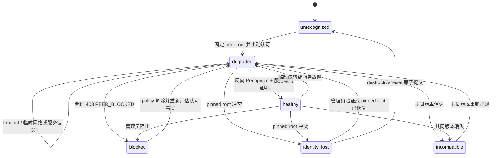
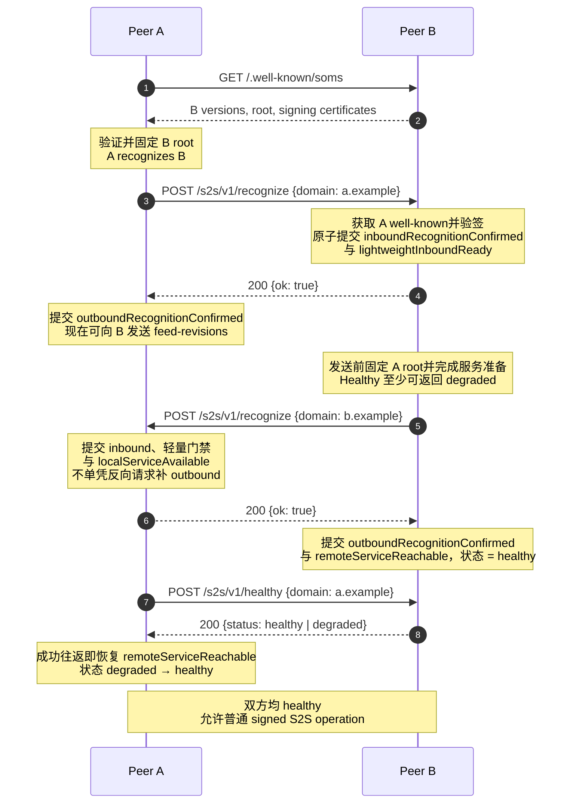
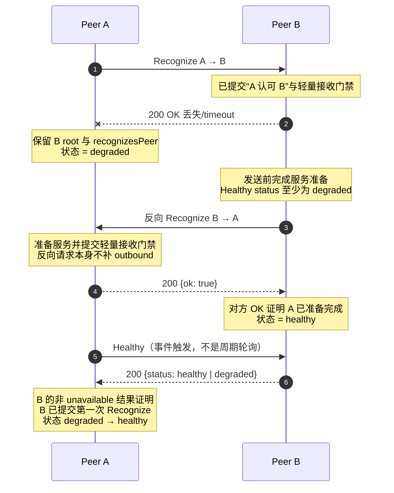

# SOMS Federation v1 Peer Recognition

状态：`REVIEW`

Operations：

- `POST /s2s/v1/recognize`
- `POST /s2s/v1/healthy`

本文定义服务器认可（peer recognition）的方向语义、双向建立时序、身份固定、成功确认、失败处理，
以及健康查询（health query）的隐私保护行为。Federation 基础类型和响应封装由
[SOMS Federation Protocol v1](./protocol.md) 定义；HTTPS、发现、密钥证书和 HTTP Message Signature 由
[传输与安全](./transport-security.md)定义；错误分类由 [错误码注册表](./errors.md)定义。

规范词 `必须（MUST）`、`不得（MUST NOT）`、`应该（SHOULD）`、`不应该（SHOULD NOT）` 和
`可以（MAY）` 按 RFC 2119/RFC 8174 解释。

## 1. 核心语义（Core Semantics）

`A → B Recognize` 的唯一协议含义是：

> A 已通过 B 的 HTTPS well-known 验证并认可 B 当前的 Federation 身份，请求 B 持久记录“A 认可 B”。

B 返回 `OK` 的唯一协议含义是：

> B 已确认请求来自 A，并已持久提交“A 认可 B”这个方向事实。

一次 Recognize 只完成一个方向，不表示 B 认可 A，也不表示双方连接已经健康。B 为验证 A 的请求而读取
A 的 well-known 只是身份验证（authentication）；B 对 A 的认可必须（MUST）通过反向
`B → A Recognize` 明确表达。

完整建立由两个相反方向的 Recognize 组成：

```text
A recognizes B  ── B returns OK
B recognizes A  ── A returns OK
```

只有两个方向的认可、双方服务准备和 identity/policy 要求都收敛后，peer 才是 `healthy`。通常证据是两个
Recognize `OK`；如果第一个 `OK` 丢失，调用方可以（MAY）幂等重试原方向，或者在收到反向 Recognize 后
查询 Healthy。按第 9 节返回的 `healthy` 或 `degraded` 明确证明响应方已经提交查询方对应的 inbound
recognition fact，因此可以（MAY）作为丢失 `OK` 的等价证据。反向 Recognize 本身不提供该证明，因为双方
可能独立并发发起。
Recognize 不交换 feed cursor，不初始化业务 mirror，也不证明用户、群组或消息权限。

## 2. Operation 概要（Operation Overview）

| 项目         | Recognize                         | Healthy                                        |
| ------------ | --------------------------------- | ---------------------------------------------- |
| Method       | `POST`                            | `POST`                                         |
| Path         | `/s2s/v1/recognize`               | `/s2s/v1/healthy`                              |
| Query        | 无；签名中的 `@query` 为 `?`      | 无；签名中的 `@query` 为 `?`                   |
| Request      | 裸 `DomainRequest` JSON           | 裸 `DomainRequest` JSON                        |
| Request auth | bootstrap signed                  | recognition-status signed                      |
| Success      | HTTP `200`，裸 `RecognizeOk`      | HTTP `200`，裸 `HealthResult`                  |
| 幂等坐标     | `(signerDomain, recipientDomain)` | 无副作用查询                                   |
| 状态作用     | 提交一个方向的认可                | handler 无副作用；响应可供调用方更新远端可用性 |

```ts
interface DomainRequest {
  domain: Domain;
}

interface RecognizeOk {
  ok: true;
}

interface HealthResult {
  status: 'healthy' | 'degraded' | 'unavailable';
}
```

三个 object 都是 closed object：列出的字段全部必选，`null`、重复字段和未知字段均不允许。

## 3. 双向状态模型（Bidirectional State Model）

以下名称描述协议事实，不要求实现使用同名数据库字段：

| 协议事实                       | 含义                                   | 何时成立                                                                   |
| ------------------------------ | -------------------------------------- | -------------------------------------------------------------------------- |
| `recognizesPeer`               | 本方已验证并认可对方 root identity     | 本方发送 Recognize 前原子固定对方 root 时                                  |
| `outboundRecognitionConfirmed` | 对方已提交“本方认可对方”               | 本方收到 Recognize `OK`；或收到第 9 节定义的、证明该 inbound fact 的 Healthy 结果 |
| `inboundRecognitionConfirmed`  | 本方已提交“对方认可本方”               | 本方成功处理入站 Recognize、返回 `OK` 前                                   |
| `lightweightInboundReady`      | 本方已获准安全接受该 peer 的轻量请求   | 与 inbound confirmation 在返回 `OK` 前原子提交                             |
| `localServiceAvailable`        | 本方已准备好为该 peer 提供认可后的服务 | 发送反向 Recognize 前原子提交；接收反向 Recognize 时在返回 `OK` 前提交     |
| `remoteServiceReachable`       | 已观察到对方服务和一次有效协议往返     | 有效 Healthy `healthy`/`degraded`、反向 Recognize 的 `OK`，或任一成功认证并处理的正常 S2S 请求/响应 |

peer 的内部 lifecycle 是以下 closed enum；实现可以（MAY）使用额外内部 pending 字段，但不得（MUST NOT）
把 Healthy 的 `unavailable` 返回值持久化为另一个同名 lifecycle：

| 状态                | 精确定义                                                                                         |
| ------------------- | ------------------------------------------------------------------------------------------------ |
| `unrecognized`      | 尚无可用的 pinned/recognition identity                                                           |
| `degraded`          | 已固定并认可 peer，但方向确认或服务证明尚未收敛，或者已建立关系发生纯传输/服务可用性故障          |
| `healthy`           | 双向认可、服务准备、有效往返、identity、版本和 policy 全部有效，且没有未恢复的传输降级             |
| `blocked`           | 本地管理员策略阻止，或已收到对端可验证的明确 blocked 拒绝                                        |
| `identity_lost`     | 当前发现的 root 与 pinned root 冲突                                                               |
| `incompatible`      | 当前不存在共同启用的 Federation 主版本                                                           |

Healthy 的 `healthy | degraded | unavailable` 是上述内部状态和查询权限的隐私投影，不是 lifecycle
状态集合。普通 operation 也不得（MUST NOT）仅按 `healthy`/`degraded` 标签授权：完整双向认可事实、pinned
identity、共同版本、policy 和 operation 业务授权均有效时，纯传输 `degraded` peer 仍可以（MAY）发送和接收
普通数据面。握手尚未收敛的 `degraded` peer 只能使用 `recognize`、`healthy` 和按方向开放的
`feed-revisions`。

本地 `healthy` 按下式计算：

```text
healthy =
  outboundRecognitionConfirmed
  AND inboundRecognitionConfirmed
  AND localServiceAvailable
  AND remoteServiceReachable
  AND pinned identity is valid
  AND a common protocol version remains selected
  AND local policy permits federation traffic
  AND no unresolved transport degradation remains
```



状态转换必须（MUST）按下表处理；“重新计算”表示在同一事务中根据本节的 `healthy` 计算公式和当前 facts
得到下一状态：

| 事件 | 前置状态 | 原子事实变更 | 下一状态与处理 |
| ---- | -------- | ------------ | -------------- |
| 主动认可并固定 peer root | `unrecognized` | 设置 `recognizesPeer`，保留待发送 Recognize | `degraded` |
| 成功处理入站 Recognize | `degraded`/`healthy` | 设置 inbound confirmation 和 lightweight gate | 重新计算；不得单凭该请求补 outbound |
| 本方向收到 Recognize `OK` | `degraded` | 设置 outbound confirmation | 重新计算 |
| Healthy 返回 `healthy`/`degraded` | `degraded`/`healthy` | 设置 outbound confirmation、remote reachable，清除纯传输降级 | 重新计算 |
| 成功认证并处理正常 S2S 请求或确定响应 | `degraded`/`healthy` | 设置 remote reachable，清除纯传输降级；不得补 recognition direction fact | 重新计算 |
| timeout、连接中断或可重试服务故障 | `healthy`/`degraded` | 清除当前 remote reachable 证明并记录 transport degradation | `degraded`；保留 pin、方向事实和业务状态 |
| 本地或对端明确 block | 任意非 reset 状态 | 记录 block 原因，停止被阻止的业务流量 | `blocked` |
| block 解除 | `blocked` | 清除对应 policy 原因，保留 pin 和方向事实 | `degraded`，取得新可用性证明后重新计算 |
| pinned root contradiction | 任意已 pinned 状态 | 保留旧 pin，清除运行时可用性 | `identity_lost` |
| 管理员验证原 pinned root 恢复 | `identity_lost` | 保留原方向事实，更新有效 signing certificate 缓存 | `degraded`，取得新可用性证明后重新计算 |
| 共同版本消失 | `degraded`/`healthy` | 保留 pin、方向事实、cursor 和 mirror | `incompatible` |
| 共同版本重新出现 | `incompatible` | 选择共同版本，保留原 durable facts | `degraded`，取得新可用性证明后重新计算 |
| destructive reset 完成 | `identity_lost` 或管理员允许的状态 | 按第 11 节删除旧身份关联状态 | `unrecognized` |

内部 lifecycle 名称不要求成为数据库枚举，但对应的外部行为是规范性的。普通数据面在 `blocked`、
`identity_lost`、`incompatible` 下必须（MUST）分别使用错误注册表规定的稳定结果；不得（MUST NOT）用一个
通用 untrusted 状态抹平 caller action。Healthy 仍将这些原因统一投影为 `unavailable`，不向状态查询者泄露
具体原因。


operation gate 与 lifecycle 分开计算：

| Operation 类别 | 必须（MUST）满足的 gate |
| -------------- | ----------------------- |
| `recognize` | bootstrap signed 和对应 admission；不要求已有 lifecycle |
| `healthy` | status signed；失败统一投影为 `unavailable` |
| `feed-revisions` | 该 signer 方向的 `lightweightInboundReady` |
| 普通 recognized data | pinned identity、双方 direction confirmation、共同版本、policy 和 operation 业务授权；纯传输 `degraded` 不关闭 gate |
| 已有活动 call 的终止收敛 | calls.md 定义的现有 binding/tombstone 规则；不得仅因 health cache 降级而阻止 |

发送 Recognize、加入重试队列、读取 well-known 或仅验证请求签名都不得（MUST NOT）提前设置对应的
confirmed fact。网络 socket 是否仍连接不是认可事实；短暂断线不得（MUST NOT）删除 identity pin 或方向事实，
但可以（MAY）把当前可用状态从 `healthy` 降为 `degraded`。

Recognize 发出后发生 timeout、DNS/TLS/connect failure、响应中断或可重试 server failure 时，本方已经完成的
`recognizesPeer` 事实保留，并将连接置为 `degraded`；不得（MUST NOT）伪造 outbound confirmation。
`degraded` 在这里表示“握手认可成功但服务受限”，不是需要删除 peer 或重新选择身份的错误。

普通 feed、call、user、media 和 forward-bundle operation 使用 protocol.md 的 `recognized signed`
鉴权上下文，不以本地缓存的 `healthy` 标签作为协议门禁。本文所说的轻量请求严格指 `feed-revisions`
revision hint：接收方在发送 Recognize `OK` 前必须（MUST）准备好接收该 signer 的 `feed-revisions`；发送方
只有收到 `OK` 后才可以（MAY）向该方向发送 hint。hint 可丢失且不携带 durable payload，因此这个方向性
门禁不等于在握手未收敛时开放其他数据面。

`localServiceAvailable` 与本地 peer lifecycle 的 `healthy` 不是同一个量：前者表示“本服务器已经准备好”，
可以（MAY）在反向请求发出前成立；后者还要求成功确认远端。Healthy endpoint 返回本方当前 lifecycle 的隐私安全视图，
但 `healthy` 和 `degraded` 都表示“认可关系存在且允许该签名 peer 查询”。

## 4. 身份验证、认可与固定（Identity Verification, Recognition, and Pinning）

### 4.1 发起方认可接收方

向 peer domain `B` 发送 Recognize 前，A 必须（MUST）：

1. 按 protocol.md 的 SRV、TLS 和 authority 规则定位 B。
2. 通过 hostname 验证成功的 HTTPS 获取 B 的 `/.well-known/soms`。
3. 选择最高共同主版本，并要求选中版本为路径中的 `1`。
4. 严格解码 `rootKey.ed25519` 为恰好 32 bytes。
5. 验证 B 至少一份当前有效的 root-authorized signing key certificate。
6. 在本地原子固定 B 的 root public key、记录 `recognizesPeer`，并把该 peer 的服务状态设置为
   `degraded`，然后才构造和发送 HTTP request。

仅成功读取 well-known 不构成认可；只有调用方完成上述验证并作出本地认可决定后，才可以（MAY）发送
Recognize。对已固定 peer，再次读取的 root 必须（MUST）与 pin 逐字节相同。

第 6 步是主动发起方的必选提交边界。即使随后发生 timeout、连接重置、`429` 或临时 `5xx`，该本地认可和
`degraded` 状态仍然成立。只有第 8 节定义的硬拒绝或安全失败才能使本次认可变为不可用；实现不得（MUST NOT）
把普通网络不确定性误判为拒绝或 identity loss。

### 4.2 接收方验证认可声明

B 收到 A 的 Recognize 后，必须（MUST）：

1. 从 HTTP Message Signature 的 `keyid` 提取 canonical signer domain A。
2. 要求 body 的 `domain` 与 A 完全相等；body 里的 `domain` 是认可声明者，不是接收方 B。
3. 通过 A 的 hostname-verified HTTPS well-known 验证 A 的 root、certificate 和请求签名。
4. 若已有 A 的 root pin 或先前认证记录，要求新取得的 root 与其逐字节相同。
5. 应用本地 admission policy，并检查 B 当前是否允许建立该 peer。

B 获取并验证 A 的 well-known 只证明“请求由 A 当前的 Federation signing key 发出”。在 B 的反向
Recognize 成功前，不得（MUST NOT）把这一步描述为“B 已经得到 A 对 B 的反向确认”。

### 4.3 Root 与 signing key 连续性

`rootKey.ed25519` 必须（MUST）按 RFC 4648 padded base64 严格解码，拒绝非 canonical base64、非法
padding 和尾随数据，结果必须（MUST）恰好为 32 bytes。首次提交方向事实时，接收方必须（MUST）把该
root 与方向事实原子保存。

后续 root 不一致是 identity contradiction，不是 signing key rotation。节点必须（MUST）进入
`identity_lost`、撤销 `healthy` 可用性并拒绝普通数据面。root 授权的 signing certificate 正常增加、
重叠、过期和移除不得（MUST NOT）清除已经确认的方向事实。

## 5. Recognize 请求与成功提交（Recognize Request and Successful Commit）

### 5.1 请求体

假设 A 向 B 发送请求，后续固定向量使用的精确业务 body bytes 为：

```text
{"domain":"a.example"}
```

`domain` 必须（MUST）是 protocol.md 定义的 canonical `Domain`，并必须（MUST）等于 HTTP signer domain。
接收方 domain 由已签名的 `@authority` 确定，协议版本由 `/s2s/v1` 确定，因此 body 不重复它们。

请求必须（MUST）按 protocol.md 的统一顺序构造：最终 compact JSON UTF-8 bytes → `Content-Digest` →
`Date`/签名参数 → RFC 9421 签名基串 → Ed25519 `Signature`。协议不要求 JSON object 一般采用 compact
serialization，但 digest 和签名必须（MUST）覆盖实际发送的精确 bytes；签名后不得（MUST NOT）重新序列化。

### 5.2 接收事务与 `OK`

所有验证和 policy 均成功后，B 必须（MUST）在返回响应前原子完成：

1. 固定或核对 A 的 root identity。
2. 提交 `inboundRecognitionConfirmed`，且保留首次确认时间。
3. 提交 `lightweightInboundReady`，使 A 在收到 `OK` 后立即发送的 `feed-revisions` 不会被尚未就绪的
   admission gate 拒绝。
4. 确保反向 `B → A Recognize` 会被执行；崩溃恢复后也必须（MUST）能够继续该工作。
5. 如果 B 在处理请求前已经存在 `recognizesPeer(A)`，B 必须（MUST）在返回 `OK` 前设置
   `localServiceAvailable`。B 不得（MUST NOT）仅凭该入站请求设置 `outboundRecognitionConfirmed`：该请求
   可能是反向方向，也可能是双方独立发起的并发请求，不能证明 A 已提交 B 先前发送的 Recognize。

提交成功后返回一个 `RecognizeOk` closed JSON object。例如下面的格式化 JSON 是完整有效响应；空白和换行
不属于业务语义：

```http
HTTP/1.1 200 OK
Content-Type: application/json

{
  "ok": true
}
```

接收方必须（MUST）先按 `application/json` 解析 body，再要求结果是仅含一个 member `ok`、且其 JSON
boolean 值为 `true` 的 object。因此 `{"ok":true}` 和上面的格式化表示都有效；`{"ok":1}`、
`{"ok":true,"extra":null}`、`[true]`、空 body 和尾随非空白数据都无效。实现不得（MUST NOT）按原始
UTF-8 bytes、空白或 object member 排版判断成功。

不得（MUST NOT）在事务提交前返回 `OK`。A 只有收到 HTTP `200`、严格验证上述 `RecognizeOk` 结构且确认
响应来自与请求相同的 TLS connection/authority 后，才能原子设置
`outboundRecognitionConfirmed`。timeout 或网络错误只把已认可连接置为 `degraded`，不能代替该确认。

response 不额外使用 detached signature；hostname-verified HTTPS 认证响应方，request 的 direction fact
已经由 B 的事务和固定响应语义确认。

### 5.3 反向 Recognize 的发送前准备（Preflight before Reverse Recognize）

B 成功提交 `A → B` 并返回第一次 `OK` 后，开始 `B → A` 前必须（MUST）先完成本地准备。发送 HTTP request
之前，B 必须（MUST）在一个事务中：

1. 作出并持久化 `recognizesPeer(A)`；验证时使用的 A root 成为固定身份锚。
2. 准备处理 A 随后可能到达的已授权请求，包括 `feed-revisions` 接收路径所需的状态。
3. 设置 `localServiceAvailable`，使 A 随后的有效 Healthy 查询至少能够返回 `degraded`，而不是
   `unavailable`。
4. 持久记录反向 Recognize 待发送工作，使崩溃不会留下“服务已经准备、但永远不发送反向认可”的状态。

只有该事务提交后，B 才可以（MAY）发送反向 HTTP Recognize。`localServiceAvailable` 表示 B 已就绪，不表示
A 已收到反向请求；因此 B 在得到 A 的反向 `OK` 前仍不得（MUST NOT）假定 `remoteServiceReachable`。

## 6. 完整时序（Complete Sequence）



B 可以（MAY）复用为验证第一个请求而获取、仍在有效缓存期内的 A well-known；不要求为反向请求重复下载。
B 不得（MUST NOT）等待反向 Recognize 完成后才返回第一次 `OK`，否则两个对称实现可能互相等待。

### 6.1 第一次 `OK` 丢失后的恢复（Recovery after a Lost First OK）



如果 A 的第一次请求根本没有到达 B，B 不会因为该请求发起反向 Recognize；A 保持 `degraded` 并按第 8 节
重试。如果双方恰好独立发起 Recognize，上述规则仍按两个方向的幂等事实收敛。

## 7. 重试、重复和并发（Retries, Duplicates, and Concurrency）

Recognize 的业务幂等坐标是 `(signerDomain, recipientDomain)`，不需要 nonce。HTTP signature 的短时间窗限制
旧请求重放；operation 本身的幂等性保证时间窗内的重放不会重复产生认可副作用。

- 相同方向首次成功：提交方向事实并返回 `OK`。
- 相同 root identity 的重复请求：不得（MUST NOT）重置首次确认时间、cursor、mirror 或业务授权；返回同一
  `OK` 语义，并确保缺失的反向 Recognize 仍可继续。
- 同一 domain 携带不同 root：必须（MUST）按 identity mismatch 失败，不得（MUST NOT）覆盖 pin。
- 两个方向并发：可以（MAY）独立提交；每个方向只由自己的 `OK` 或第 9 节定义的远端 inbound-fact 证明
  确认，不得（MUST NOT）仅因已经存在 `recognizesPeer` 而补齐 outbound fact。最终结果必须（MUST）与任一
  串行顺序相同。
- 响应丢失：接收方已经提交的方向事实保留；发送方保持 outbound 未确认并安全重试 Recognize。

每次 HTTP 重试使用相同 JSON 业务语义，但必须（MUST）重新生成 `Date`、`created`、`expires` 和
HTTP signature。因为 body 没有时间或 nonce，body bytes 和 `Content-Digest` 可以（MAY）保持不变。

## 8. 未返回 `OK` 与错误处理（Non-OK and Error Handling）

发送方在 HTTP request 发出前已经处于 `degraded` 认可状态，但不得（MUST NOT）仅根据“请求已经发出”推测
对方提交成功。有效 `OK` 会推进 outbound confirmation；对方随后发来的有效反向 Recognize 只触发服务准备
和 Healthy 收敛，不能单独证明对方已经提交前一方向。有效 Healthy `healthy`/`degraded` 或原方向幂等重试
得到的 `OK` 才可以（MAY）补齐因响应丢失而缺少的 outbound confirmation。

| 结果                                                         | 发送方状态                                           | 规定动作                                                 |
| ------------------------------------------------------------ | ---------------------------------------------------- | -------------------------------------------------------- |
| HTTP `200` + 有效 `{"ok":true}`                              | 保持 `degraded`，设置 outbound confirmed             | 等待反向 Recognize；允许向已返回 OK 的方向发送 hint      |
| timeout、DNS/连接失败、TLS transport 中断、响应截断          | 保持未确认和 `degraded`                              | 退避后重试；不得（MUST NOT）撤销已固定 root              |
| `429 RATE_LIMITED`                                           | 保持未确认和 `degraded`                              | 遵守 `Retry-After` 或 jitter backoff                     |
| `500`/`503` 可重试错误                                       | 保持未确认和 `degraded`                              | 保留 pin，退避重试                                       |
| HTTP `200` 但 body 非法或不是 `OK`                           | 保持 `degraded`                                      | 记录协议响应错误；不得（MUST NOT）当成成功或紧密循环重试 |
| malformed、bad signature、binding violation                  | 保留 lifecycle 和已提交事实，记录本次明确协议拒绝     | 停止原样自动重试，修正实现或请求后重新开始               |
| version unsupported、明确 `404`/`405`                        | `incompatible`                                      | 刷新 well-known；不得（MUST NOT）把 v1 请求降级解释      |
| blocked/forbidden                                            | `blocked`                                           | 停止自动重试，等待管理员或策略改变                       |
| identity mismatch/lost                                       | 清除运行时 healthy，但保留旧 pin                     | fail closed，等待原身份恢复或 destructive reset          |
| TLS hostname/certificate 验证失败或本地发现 root 与 pin 不同 | 不建立首次认可，或进入 identity/security unavailable | 不得（MUST NOT）按普通网络错误继续握手                   |

“明确硬拒绝”只包括：可验证的 `400`/`401`/`403`/`409`/`423` JSON error envelope、明确表明 v1 operation
不存在的 `404`/`405`，以及本方直接验证出的 TLS hostname 或 pinned-root 安全冲突。无法解析的 proxy body、
timeout、连接中断、`429` 和可重试 `5xx` 都不是对认可关系的明确否定，必须（MUST）保留 `degraded`。
对于未知 HTTP status 或 status/code 冲突，发送方必须（MUST）按 protocol.md 采用更安全动作，但不得
（MUST NOT）在没有 identity contradiction 时覆盖或删除 root pin。

如果第一次 `A → B` 没有得到有效 `OK`，A 保持 `degraded`，不得（MUST NOT）进入 healthy。B 只有在请求
验证和提交成功后才能发起反向 Recognize；如果只是响应在提交后丢失，B 仍必须（MUST）继续反向流程。
反向 Recognize 本身不证明 B 已提交第一方向。A 必须（MUST）保留缺失的 outbound confirmation，并按第 9 节
查询 B；B 返回 `healthy`/`degraded` 时才补齐，返回 `unavailable` 或查询失败时继续幂等重试原方向。

如果第一次 `OK` 成功但反向 `B → A` 失败，已完成的方向事实必须（MUST）保留，双方保持 `degraded`。
B 根据错误类别重试反向请求或等待管理员处理；不得（MUST NOT）回滚第一次认可，也不得（MUST NOT）开放普通
数据面作为补偿。

Recognize 使用通用 error envelope，稳定映射如下：

| 条件                                | HTTP | Stable code                               | 处理                       |
| ----------------------------------- | ---: | ----------------------------------------- | -------------------------- |
| JSON/header/type malformed          |  400 | `FEDERATION_MALFORMED`                    | 修正后重新构造             |
| 路径版本未启用或无共同版本          |  400 | `FEDERATION_PROTOCOL_VERSION_UNSUPPORTED` | 刷新发现并停止该版本       |
| certificate 或 HTTP signature 无效  |  401 | `FEDERATION_BAD_SIGNATURE`                | 不提交方向事实             |
| signer domain 与 body `domain` 不同 |  401 | `FEDERATION_BINDING_VIOLATION`            | 不提交方向事实             |
| 本地策略阻止 peer                   |  403 | `FEDERATION_PEER_BLOCKED`                 | 等待管理员改变策略         |
| 已固定 domain 出现不同 root         |  409 | `FEDERATION_IDENTITY_MISMATCH`            | fail closed，不采用新 root |
| peer 已处于 `identity_lost`         |  423 | `FEDERATION_PEER_IDENTITY_LOST`           | 等待恢复或 reset           |
| 请求过于频繁                        |  429 | `RATE_LIMITED`                            | 按响应退避                 |
| well-known 暂时无法获取             |  503 | `FEDERATION_KEY_FETCH_FAILED`             | 保留已有状态并退避         |
| 本方身份材料不可用                  |  503 | `FEDERATION_LOCAL_IDENTITY_LOST`          | 等待本方管理员恢复         |
| 提交失败或临时内部错误              |  500 | `INTERNAL`                                | 保留未确认状态并退避       |

接收方在返回任何 error 时不得（MUST NOT）提交新的方向事实或开放数据面。已经由更早成功请求提交的幂等事实
不因后续失败请求而回滚。

### 8.1 黑名单（Blocklist）

实现可以（MAY）由管理员把 canonical peer domain 加入本地黑名单。黑名单必须（MUST）在提交新的入站
Recognize 之前检查；命中时返回 HTTP `403` 和 `FEDERATION_PEER_BLOCKED`，不得（MUST NOT）提交方向事实、
轻量接收门禁、反向工作或 service availability。

收到该明确错误的发起方必须（MUST）记录 remote-blocked 状态、停止自动 Recognize/Healthy 重试并停止全部
数据面。解除本地或远端黑名单都不自动建立认可；管理员或正常业务流程必须（MUST）重新触发 Recognize。
Healthy 对 blocked 状态仍统一返回 `unavailable`，不得（MUST NOT）暴露黑名单原因。

黑名单拒绝的完整响应示例是：

```http
HTTP/1.1 403 Forbidden
Content-Type: application/json

{"code":50009,"message":"peer blocked","data":null}
```

`message` 只供诊断，调用方必须（MUST）按 `code` 而不是文本识别明确拒绝。临时 key-fetch failure 采用同一
error envelope，例如 HTTP `503`、`code=50006`；它保留 `degraded` 并按退避策略重试。

## 9. Healthy 查询与隐私（Health Query and Privacy）

Healthy 可以（MAY）由管理员显式诊断、反向 Recognize 后的立即收敛、进入 `degraded` 后的事件驱动恢复，
或者实现自行选择的低频健康检查触发。具体首次延迟、周期和停止条件属于本地实现；实现必须（MUST）使用
per-peer 与全局限速、带 jitter 的退避和并发合并，不得（MUST NOT）形成紧密轮询或流量放大。Healthy
不是业务 keepalive；没有待恢复状态时，实现应该（SHOULD）使用保守周期。

A 查询 B 时发送：

```json
{ "domain": "a.example" }
```

请求使用与 Recognize 相同的 HTTP Message Signature profile，`domain` 同样必须（MUST）声明 signer A。
但 B 只可以（MAY）使用已有的 pinned/recognition identity 验证 Healthy；对于完全未知的 domain，不应
（SHOULD NOT）仅为回答查询而主动获取其 well-known，避免把接口变成任意 DNS/HTTP fetch oracle。

B 只能返回以下三个 closed object 之一：

```json
{ "status": "healthy" }
```

```json
{ "status": "degraded" }
```

```json
{ "status": "unavailable" }
```

请求必须（MUST）先由 B 已固定的 A identity 验证，且 body binding 和查询权限必须（MUST）有效。验证成功后：

- B 的本地 peer lifecycle 为 `healthy` 时返回 `healthy`。
- B 已经提交 `inboundRecognitionConfirmed(A)`，且 `localServiceAvailable=true`，但 B 自己的 outbound
  confirmation、远端往返或可恢复传输状态尚未收敛时返回 `degraded`。反向 Recognize 的发送方必须（MUST）
  在发送 HTTP request 前完成服务准备；如果最初 `A → B` 确已提交，A 随后的 Healthy 至少得到
  `degraded`。若双方只是独立并发发起且 B 尚未提交 `A → B`，B 必须（MUST）返回 `unavailable`。
- `healthy` 和 `degraded` 都证明 B 已提交“A 认可 B”的 inbound direction fact、识别 A 的 pinned identity、
  本次签名请求成功往返；差异只描述 B 自己观察到的连接状态。

以下情况必须（MUST）统一返回 HTTP `200` 和 `{"status":"unavailable"}`：

- peer/domain 不存在，或本方从未固定并认可该 identity；
- 签名无法由已有 identity 验证，或 body domain 与 signer 不同；
- 请求方无权查询或被 blocked；
- root identity lost、reset in progress 或没有共同协议版本；
- 其他不能安全公开的本地连接状态。

不得（MUST NOT）通过 `404`、`401`、`403`、不同 stable code、额外字段或诊断 message 区分上述情况。
实现应该（SHOULD）尽量减少明显的响应时间差异，并必须（MUST）对 source、domain 和全局请求速率限流。
限流可以（MAY）返回通用 `429 RATE_LIMITED`；无法解析 HTTP/JSON shape 的请求可以（MAY）返回通用
`400 FEDERATION_MALFORMED`，这两者不表达任何 peer 是否存在。

调用方收到有效 `healthy` 或 `degraded` 时，必须（MUST）设置 `outboundRecognitionConfirmed`，并把这次
成功签名往返作为 `remoteServiceReachable` 的证明；如果本方的双向认可、`localServiceAvailable`、identity、
版本和 policy 也全部有效，则原子清除纯传输降级并升级为 `healthy`。对方返回 `degraded` 不阻止本方升级，
因为它描述对方自己的观察。

除 Healthy 外，任一 recognized peer 发起的、成功认证并完成协议处理的正常 S2S 请求，以及本方发出请求后
收到并验证的成功或确定业务响应，都可以（MAY）作为 `remoteServiceReachable` 的新证明并清除纯传输降级。
业务拒绝只要证明对方正常处理了请求，也可以（MAY）恢复 reachability；malformed proxy response、网络错误、
不可验证响应和 `5xx` 不提供该证明。该规则不得（MUST NOT）补造尚未成立的 recognition direction fact。

timeout、网络错误、非 `200`、非法 body 或 `unavailable` 必须（MUST）使调用方保持或进入 `degraded`，但
不得（MUST NOT）删除 pin 或已提交方向事实。有效的明确拒绝、identity conflict 或版本不兼容则按第 8 节
进入 blocked、identity_lost、incompatible 或断开状态，不得（MUST NOT）仅标记为普通网络降级。

当 B 发送反向 Recognize 并收到 A 的 `OK` 时，B 可以（MAY）不再额外调用 A 的 Healthy：A 在返回该反向
`OK` 前已经按第 5.2 节完成 `localServiceAvailable`，所以这个 `OK` 同时提供
`remoteServiceReachable` 的等价证明。A 因为第一次 `OK` 可能丢失，仍在返回反向 `OK` 后查询 B；只有 B
确实提交了第一次 `A → B` 时才返回至少 `degraded`，从而安全补齐 A 的 outbound confirmation。独立并发
发起且第一次请求未到达时返回 `unavailable`，A 继续重试原方向。

## 10. 完整 HTTP 构造示例（Complete HTTP Construction Examples）

以下向量使用公开测试 signing private key
`ICEiIyQlJicoKSorLC0uLzAxMjM0NTY3ODk6Ozw9Pj8=`，绝不能部署为生产秘密；其 Ed25519 public key 是
`Kay64UG8yvCyLhqU000LxzYeUm0L/hLIl5S8kyKWbdc=`。对应的 `a.example` well-known v1 视图是：

```json
{
  "protocolVersions": [1],
  "rootKey": {
    "ed25519": "A6EHv/POEL4dcN0Y50vAmWfk1jCbpQ1fHdyGZBJVMbg="
  },
  "keys": [
    {
      "keyId": "a.example/key-1",
      "ed25519": "Kay64UG8yvCyLhqU000LxzYeUm0L/hLIl5S8kyKWbdc=",
      "notBefore": 1699990000000,
      "notAfter": 1800000000000,
      "authorizationSignature": "sfjYJ8fpmatbR3e2S0rflH8CgsPqBnDxvKoTrH2gwVXW00Xb8BNz4YA75j9pwF8beG8qV6DPalT4j7j2UAdkCw=="
    }
  ]
}
```

`authorizationSignature` 覆盖的精确 certificate statement 由 protocol.md 第 4.3 节定义；上述 root、
certificate 和签名共同用于验证 root → signing key 的授权链。

### 10.1 Recognize

```http
POST /s2s/v1/recognize HTTP/1.1
Host: b.example
Content-Type: application/json
Date: Tue, 14 Nov 2023 22:13:20 GMT
Content-Digest: sha-256=:ql6fZSpA6M1OvKXaGAiuIhRzFGk6kl4vbchCRwe8ZYw=:
Signature-Input: sig1=("@method" "@path" "@query" "@authority" "date" "content-digest");created=1700000000;expires=1700000300;keyid="a.example/key-1";alg="ed25519"
Signature: sig1=:PtsaJMgwkw7G0O9yU/x0v19BkUcWqG0I8Mvm14wWt447gZ9jgYLAjjgsaZg4WIRAQepmOVNvc84Omf9xee5hAg==:

{"domain":"a.example"}
```

签名基串是：

```text
"@method": POST
"@path": /s2s/v1/recognize
"@query": ?
"@authority": b.example
"date": Tue, 14 Nov 2023 22:13:20 GMT
"content-digest": sha-256=:ql6fZSpA6M1OvKXaGAiuIhRzFGk6kl4vbchCRwe8ZYw=:
"@signature-params": ("@method" "@path" "@query" "@authority" "date" "content-digest");created=1700000000;expires=1700000300;keyid="a.example/key-1";alg="ed25519"
```

### 10.2 Healthy

相同 body 产生相同 `Content-Digest`，但 path 改变会产生不同签名：

```http
POST /s2s/v1/healthy HTTP/1.1
Host: b.example
Content-Type: application/json
Date: Tue, 14 Nov 2023 22:13:20 GMT
Content-Digest: sha-256=:ql6fZSpA6M1OvKXaGAiuIhRzFGk6kl4vbchCRwe8ZYw=:
Signature-Input: sig1=("@method" "@path" "@query" "@authority" "date" "content-digest");created=1700000000;expires=1700000300;keyid="a.example/key-1";alg="ed25519"
Signature: sig1=:Jv1eXss7aa+STTFpi1gXoyJWoF6gzWPutSQWxTPL6zkzD9uwF/HTxkPnLKlIJrjirq+Y4i7iUr5oEM/CN6/MDg==:

{"domain":"a.example"}
```

## 11. Reset 与重新认可（Reset and Re-recognition）

普通网络失败、服务重启、SRV 变化或 signing key 轮换不得（MUST NOT）要求重新 Recognize。原 pinned root
恢复后可以（MAY）保留两个方向的确认事实并恢复 healthy。

只有管理员授权的 destructive reset 可以（MAY）删除 root pin、方向事实、cursor、mirror 和关联授权，
并允许同一 domain 使用新的 root 重新开始双向 Recognize。reset 必须（MUST）可崩溃恢复，且不得
（MUST NOT）让新 root 自动继承旧身份的业务授权。
