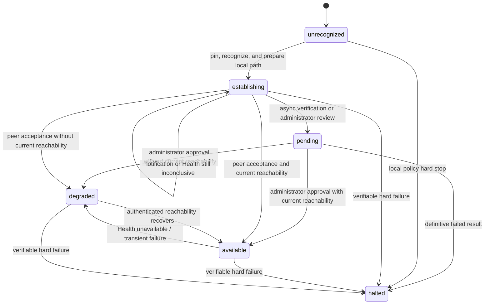

# Simple Open Messaging Federation Protocol v1 Peer Recognition

Status: `RELEASE CANDIDATE` (`v1.0.0-rc.0`)

Operations:

- `POST /s2s/v1/recognize`
- `GET /s2s/v1/health`

This document defines the directional semantics and bidirectional establishment timing of peer recognition, identity pinning, success confirmation, failure handling, and the privacy-preserving behavior of health queries. [Simple Open Messaging Federation Protocol v1](./protocol.md) defines shared Federation types and response envelopes; [Transport and Security](./transport-security.md) defines HTTPS, discovery, key certificates, and HTTP Message Signatures; the [Stable Error Registry](./errors.md) defines error classification.

The key words `MUST`, `MUST NOT`, `SHOULD`, `SHOULD NOT`, and `MAY` are to be interpreted as described in RFC 2119 and RFC 8174.

## 1. Core semantics

The protocol meaning of `A → B Recognize` is:

> A has validated and recognized B's current Federation identity through B's HTTPS well-known document and asks B to recognize A and prepare to receive A's traffic.

The sole protocol meaning of B returning `recognized` is:

> B has authenticated A, recognized A's pinned identity, and prepared to receive A's Federation traffic.

Recognize is a prompt notification, not an indispensable proof channel. A
valid `recognized` result and a valid positive Health response from B provide
A with the same protocol evidence that B recognizes A and is prepared to
receive from A. Neither proves user, group, message, or operation-specific
authorization. A `pending` result is only a receipt that B accepted the
recognition attempt for asynchronous validation or local review; it is not
identity, domain-control, signature, namespace, or peer-acceptance evidence.

For A to send ordinary data to B, two recognition decisions and current
reachability are required:

```text
A recognizes B  ── A validates and pins B's identity and prepares its local path
B recognizes A  ── A receives B's Recognize recognized result, B's Recognize, or positive Health
```

After A's local recognition decision commits but before B's acceptance is
known, A is `establishing`. Once B's acceptance is proven, A is `available`
while current authenticated reachability exists and `degraded` while it does
not. A lost Recognize `recognized` result does not require another Recognize if positive
Health supplies the same B-acceptance evidence. Recognize does not exchange
feed cursors or initialize business mirrors.

Recognize is also the arrival operation for domain re-binding. A server whose
public domain has changed calls Recognize, signed from the new domain, on
peers that still hold its pinned root identity. The recipient resolves the
signer by root identity rather than by domain alone and discloses the
namespace it holds for the caller. Section 4.4 defines the arrival and its
verification; Section 11 keeps its activation administrative.

## 2. Operation overview

| Item                   | Recognize                                              | Health                                                                      |
| ---------------------- | ------------------------------------------------------ | --------------------------------------------------------------------------- |
| Method                 | `POST`                                                 | `GET`                                                                       |
| Path                   | `/s2s/v1/recognize`                                    | `/s2s/v1/health`                                                            |
| Query                  | None; signed `@query` is `?`                           | None; signed `@query` is `?`                                                |
| Request                | Closed empty object or sender-assigned local namespace | Zero-byte body                                                              |
| Request auth           | bootstrap signed                                       | status signed                                                               |
| Success                | HTTP `200`, bare `RecognizeResult`                     | HTTP `200`, bare `HealthResult`                                             |
| Idempotency coordinate | `(signerDomain, recipientDomain)`                      | No new identity may be pinned by the query                                  |
| State effect           | Commits local recognition and receive readiness        | A positive result confirms responder acceptance and may update reachability |

Both operations carry the `S2S-Root-Key` header required by [Transport and Security, Section 3.3](./transport-security.md#33-signed-request-headers); it names the root the sender claims and signs under, and never enters the signature base.

```ts
type EmptyRequest = Record<string, never>;

/** The positive namespace the sender's local store has allocated for the
    recipient's identity epoch; stable within the epoch. */
interface SenderAssignedLocalNamespaceRequest {
  namespaceId: PositiveSafeInteger;
}

type RecognizeRequest = EmptyRequest | SenderAssignedLocalNamespaceRequest;

type RecognizeResult =
  | {
      ok: true;
      status: 'pending';
      message?: string;
    }
  | {
      ok: true;
      status: 'recognized';
      peerAssignedLocalNamespaceId: PositiveSafeInteger;
    }
  | {
      ok: false;
      status: 'failed';
      code: SafeInteger;
      message: string;
    };

type HealthResult =
  | {
      status: 'available' | 'degraded';
      peerAssignedLocalNamespaceId: PositiveSafeInteger;
    }
  | {
      status: 'unavailable';
    };
```

The objects listed here are closed. Every listed field is required; duplicate and unknown fields are forbidden.

The request member `namespaceId` carries the sender-assigned local namespace:
the positive namespace the sender's local store has allocated for the
recipient's identity epoch. The recipient records it as the retained
`peerAssignedLocalNamespaceId` for the sender and uses it to recognize its own
subjects in the sender's traffic; it is never a namespace id of the recipient's
own store.

`peerAssignedLocalNamespaceId` is the positive namespace the responder's local
store has allocated for the caller's identity epoch. The responder uses
exactly this value as the wire `namespaceId` whenever it serializes the
caller's own subjects, and the caller retains it per recipient: it identifies
the caller's local identities as mirrored in the responder's store
([protocol.md Section 6.2.1](./protocol.md#local-subject-marker-and-namespace-interpretation))
and selects receipt and self-subject processing there. The value changes only
when the responder's recognition of the caller is re-established after the
previous identity epoch is retired.

`RecognizeResult.status` distinguishes the recognition attempt outcome.
`recognized` is the only success result that carries peer-acceptance evidence
and discloses `peerAssignedLocalNamespaceId`. `pending` means the responder
has accepted the attempt for asynchronous validation or local review,
including a rotation or re-binding arrival awaiting administrator approval.
A `pending` result MUST
NOT include `peerAssignedLocalNamespaceId`, carries no identity or acceptance
evidence, and the caller MUST NOT begin ordinary traffic from it. `failed`
reports a durable result of an earlier accepted asynchronous recognition
attempt; `code` is from the stable federation error registry and `message` is
diagnostic only.

`HealthResult` discloses `peerAssignedLocalNamespaceId` only together with
`available` or `degraded`, where the responder already discloses recognition;
the privacy-preserving `unavailable` result carries no namespace.

## 3. Recognition and reachability state model

These are distinct protocol facts, regardless of how a node represents them
internally:

| Protocol fact        | Meaning                                                                                   | Valid evidence                                                                                                          |
| -------------------- | ----------------------------------------------------------------------------------------- | ----------------------------------------------------------------------------------------------------------------------- |
| Local recognition    | This node has validated and pinned the peer's root identity and prepared its receive path | A committed local recognition decision; never merely reading well-known                                                 |
| Peer acceptance      | The peer recognizes this node and is prepared to receive its Federation traffic           | The peer's valid Recognize `recognized` result, its valid Recognize request, or its valid Health `available`/`degraded` |
| Current reachability | Authenticated communication with the pinned peer is currently possible                    | A valid authenticated request, positive Health, Recognize `recognized`, or another definitive protocol response         |

The peer lifecycle is this closed abstract protocol model. Its labels state only
whether communication with the peer may continue automatically and do not
require an implementation to store one same-named enum or to duplicate every
failure cause as a lifecycle value:

| State          | Exact definition                                                                                                                                                           |
| -------------- | -------------------------------------------------------------------------------------------------------------------------------------------------------------------------- |
| `unrecognized` | No usable pinned/recognition identity exists.                                                                                                                              |
| `establishing` | Local recognition and receive-path preparation have committed, but peer acceptance has not yet been proven. Identity validation before that commit remains `unrecognized`. |
| `pending`      | Validation or administrator review has not yet produced peer acceptance. This state cannot authorize ordinary traffic and is not peer-acceptance evidence.                 |
| `available`    | Local recognition and peer acceptance are both proven, and current authenticated reachability exists without unresolved transport degradation.                             |
| `degraded`     | Local recognition and peer acceptance are both proven, but current reachability is absent or a retryable transport or service failure occurred.                            |
| `halted`       | Verifiable hard-failure evidence exists; automatic Recognize, Health retries, and data-plane communication stop pending local administrator action.                        |

Recognize delivery is not a separate admission condition. Both nodes being
`degraded` means each has locally recognized the other and has evidence of the
other's acceptance; restoring authenticated reachability can make ordinary
traffic possible without repeating recognition.

A node MUST retain outside the lifecycle the original evidence and reason causing `halted`, such as a stable HTTP error from the target peer, a local policy block, pinned-root contradiction, or absence of a common version. Each cause retains its distinct wire error and security meaning but is not a lifecycle state. A node MAY retain diagnostic text for `pending`, but the text has no wire semantics. An implementation MUST NOT persist Health's `unavailable` result as a same-named lifecycle state.

Health's `available | degraded | unavailable` is a privacy projection of the
responder's acceptance and receive readiness for the requester, not a copy of
either server's bilateral peer lifecycle. A valid `available` or `degraded` response supplies
peer-acceptance evidence equivalent to Recognize `recognized` and current reachability
evidence. It MUST NOT cause the requester to enter `halted`. An ordinary
operation MUST NOT authorize solely from a lifecycle label. Admission also
requires valid identity, version, policy, and business authorization.

Local `available` is calculated as:

```text
available =
  local recognition and prepared receive path
  AND peer acceptance
  AND current authenticated reachability
  AND pinned identity is valid
  AND a common protocol version remains selected
  AND local policy permits federation traffic
  AND no unresolved transport degradation remains
```



Externally observable transitions MUST be equivalent to this table. A node
MUST make each fact change and resulting admission decision externally
indivisible; an intermediate state cannot authorize traffic.

| Event                                                                          | Prior state                               | Protocol effect                                                                                                                                                                                                             | Next state                                                         |
| ------------------------------------------------------------------------------ | ----------------------------------------- | --------------------------------------------------------------------------------------------------------------------------------------------------------------------------------------------------------------------------- | ------------------------------------------------------------------ |
| Commit local recognition and receive-path preparation                          | `unrecognized`                            | Pin and recognize the peer; acceptance remains unknown                                                                                                                                                                      | `establishing`                                                     |
| Accept Recognize for asynchronous validation                                   | Any non-`halted`                          | No identity, namespace, reachability, or acceptance evidence is disclosed                                                                                                                                                   | Existing state, or `pending` when review is required               |
| Process a valid inbound Recognize to `recognized`                              | Any non-`halted`                          | Recognize the signer locally and accept its explicit recognition of the recipient                                                                                                                                           | `available` when reachability is current                           |
| Receive valid Recognize `recognized` or positive Health                        | `establishing` / `degraded` / `available` | Accept the peer's recognition and receive-readiness assertion; refresh reachability                                                                                                                                         | `available`                                                        |
| Health returns `unavailable`, or the Health response is invalid or unreachable | `establishing` / `available` / `degraded` | Retain recognition evidence; mark reachability absent                                                                                                                                                                       | `establishing` if peer acceptance is unknown, otherwise `degraded` |
| Outbound Health receives `401 FEDERATION_BAD_SIGNATURE`                        | `establishing` / `available` / `degraded` | Retain pins and acceptance evidence; mark current authenticated reachability absent; do not assume refreshing the recipient's well-known repairs its cache of the local key; do not retry the same signed request unchanged | `establishing` if peer acceptance is unknown, otherwise `degraded` |
| Authenticated protocol communication succeeds                                  | `establishing` / `available` / `degraded` | Refresh reachability without creating acceptance evidence                                                                                                                                                                   | `establishing` if acceptance is unknown, otherwise `available`     |
| Network failure, timeout, or HTTP `503`                                        | `establishing` / `available` / `degraded` | Retain pins and acceptance evidence; mark reachability absent                                                                                                                                                               | `establishing` if acceptance is unknown, otherwise `degraded`      |
| Verifiable hard-security or policy failure                                     | Any non-`halted`                          | Retain the original security evidence and stop automatic communication                                                                                                                                                      | `halted`                                                           |

Only an HTTP `409` carrying a fatal code in the Stable Error Registry from the target peer of this request, over the same hostname-verified TLS connection and authority, or a locally validated hard pinned-root, version, or policy conflict MAY trigger `halted`. An unauthenticated proxy response, TLS or connection failure, timeout, HTTP `503`, malformed response, or Health `unavailable` MUST NOT trigger `halted`; those failures preserve acceptance evidence and affect only reachability.

After entering `halted`, the protocol defines no automatic recovery path or administration, approval, reset, or recovery interface. When and how to leave `halted` is local administration. Before explicit administrator action, an implementation MUST NOT automatically retry Recognize or Health, resume the data plane, or replace the root pin. Health projects `halted` and every cause of it uniformly as `unavailable`.

Operation gates are calculated separately from lifecycle:

| Operation class                                     | Required gate                                                                                                                                                                                                                                                              |
| --------------------------------------------------- | -------------------------------------------------------------------------------------------------------------------------------------------------------------------------------------------------------------------------------------------------------------------------- |
| `recognize`                                         | bootstrap signed and its admission rule; no existing lifecycle required                                                                                                                                                                                                    |
| `health`                                            | status signed; common authentication failures use the stable error registry; authenticated status/privacy failures project as `unavailable`                                                                                                                                |
| `feed-heads`                                        | The recipient's local recognition and prepared lightweight receive path, with a valid signer identity                                                                                                                                                                      |
| Ordinary recognized data sent by the local node     | Local recognition and prepared path, peer acceptance proven by valid Recognize `recognized`, inbound Recognize, or positive Health, current authenticated reachability without unresolved degradation, compatible version and policy, and operation-specific authorization |
| Ordinary recognized data received from the peer     | The recipient's local recognition and prepared path, valid signer identity, compatible version and policy, and operation-specific authorization; the sender's earlier Recognize delivery is not a separate receive gate                                                    |
| Termination convergence for an existing active call | Existing binding and tombstone rules in calls.md; health-cache degradation alone cannot block it                                                                                                                                                                           |

Sending Recognize, reading well-known, or merely validating a request signature MUST NOT create peer-acceptance evidence. A connected network socket is not a recognition fact. A transient disconnect MUST NOT delete an identity pin or acceptance evidence, although it MAY change current availability from `available` to `degraded`.

After Recognize is sent, a timeout, DNS/TLS/connect failure, interrupted
response, or retryable server failure retains local recognition and any
previously proven peer acceptance. With acceptance still unknown, the peer
remains `establishing`; with acceptance proven, it is `degraded` until
reachability recovers. Uncertain delivery does not itself prove acceptance.

Ordinary feed, call, user, media, and forward-bundle operations use the
`recognized signed` context from protocol.md. A sender MUST have local
recognition, peer acceptance, and current reachability. A receiver uses its
own local recognition decision and valid signer identity; it MUST NOT require
the requester's earlier Recognize notification before accepting otherwise
authorized traffic. A valid authenticated request refreshes reachability but
does not by itself prove peer acceptance to its recipient.

Local receive readiness is distinct from lifecycle `available`: the former
means this server can receive from a locally recognized signer; the latter
additionally requires peer acceptance and current reachability for its own
ordinary outbound traffic. Both positive Health results mean that the
requester's identity is pinned and locally recognized by the responder and
the responder's receive path is prepared.

## 4. Identity verification, recognition, and pinning

### 4.1 The initiator recognizes the recipient

Before sending Recognize to peer domain `B`, A MUST:

1. Locate B using the SRV, TLS, and authority rules in [Transport and Security, Section 2](./transport-security.md#2-network-discovery-transport-and-signature-security).
2. Fetch B's `/.well-known/somfp` over HTTPS with successful hostname verification.
3. Select the highest common major version and require the selected version to be `1`, matching the request path.
4. Strictly decode every `roots[].ed25519` to exactly 32 bytes, require the group to contain at least one currently valid root, and select B's claimed root: the `S2S-Root-Key` the request will carry, which MUST byte-equal a currently valid group entry.
5. Validate at least one currently valid signing-key certificate for B authorized by the claimed root under [Transport and Security, Section 1.3](./transport-security.md#13-root-authorized-signing-key-certificate).
6. Atomically pin B's claimed root public key, make the local recognition decision, and prepare the local receive path before constructing and sending the HTTP request. If B's acceptance is not yet proven, the committed lifecycle is `establishing`; an already accepted peer retains its `available` or `degraded` lifecycle according to current reachability.

Successfully reading well-known alone does not constitute recognition. The caller MAY send Recognize only after completing these checks and making the local recognition decision. For an already pinned peer, the newly read group MUST still contain the pin byte for byte; a rotation of B's root is completed only through the flow of Section 4.5, never by A re-pinning on its own.

Step 6 is the mandatory commit boundary for the initiator. Local recognition,
receive readiness, and the `establishing` state remain valid even if the subsequent
operation times out, the connection resets, or the server returns HTTP `503`.
Only a hard rejection or security failure defined in Section 8 can make this
recognition unavailable. An implementation MUST NOT misclassify ordinary
network uncertainty as rejection or identity loss.

### 4.2 The recipient validates the recognition claim

After receiving A's Recognize request, B MUST satisfy the following checks.
These are recognition-specific requirements, not an alternative validation
order; [Transport and Security, Section 3.5](./transport-security.md#35-validation-order-and-failure-boundaries)
governs request validation:

- Extract canonical signer domain A from the HTTP Message Signature `keyid`, and A's claimed root from the `S2S-Root-Key` header.
- Require the body to be one of the two closed shapes of Section 5.1: the empty JSON object `{}` or the sender-assigned local namespace.
- Accept the attempt into the recognition verifier, or reject before entry using the common error envelope when the request is malformed, locally rate-limited, or cannot be queued.
- Before producing `recognized`, use A's hostname-verified HTTPS well-known document to validate A's root group, certificate, and request signature; the claimed root MUST byte-equal a currently valid `roots` entry and MUST authorize the request's certificate.
- If a root pin or prior authenticated record exists for A, resolve the signer by root identity under Section 4.4 before allocating any new peer or namespace.
- Apply local admission policy and verify that B currently permits establishing this peer.

B MAY return `pending` immediately after accepting the attempt into the
verifier; at that point B may not yet have validated A's well-known document,
request signature, root continuity, the sender-assigned local namespace, or admission policy. A
`pending` result therefore proves none of those facts and carries no namespace.
Validating A's well-known document and the request's HTTP signature proves
that the request was signed with A's currently authorized Federation signing
key under A's claimed root. B's subsequent atomic pinning,
policy decision, and receive-path preparation establish B's local recognition
of A. A learns that B accepts A only from B's valid `recognized` result, B's
Recognize, or B's valid `available` or `degraded` Health result.

### 4.3 Root and signing-key continuity

Every root public key — in `roots`, in `keys[].root`, in `S2S-Root-Key`, and in a sealed challenge — MUST be strictly decoded as RFC 4648 padded base64. Non-canonical base64, invalid padding, and trailing data MUST be rejected, and the result MUST be exactly 32 bytes. When first recognizing the signer, the recipient MUST atomically store the claimed root with that recognition decision; the pin is one root public key, never the whole group.

On every later well-known read of an established peer, the pinned root MUST remain present in the fetched `roots` group byte for byte, and the receiver MUST keep authenticating requests only against certificates authorized by the pinned root. A group that no longer contains the pin is an identity contradiction, not rotation: the node MUST retain the old pin, record the identity-contradiction reason, enter `halted`, revoke `available`, and reject the ordinary data plane. The sole exception is a root rotation completed through Section 4.5, which requires proof of possession of the pinned root's private key. Normal addition, overlap, expiration, and removal of root-authorized signing certificates MUST NOT clear recognition or acceptance evidence.

### 4.4 Root-identity resolution, domain re-binding, and rotation arrivals

A recipient MUST resolve a Recognize signer by root identity before creating
any new peer record or namespace. The claimed root obtained from
`S2S-Root-Key` and validated against the signer's fetched well-known group
under Section 4.1 rules is compared byte-for-byte with every pinned,
unretired root. A receiver MUST hold at most one unretired namespace per root
key, so the match is unique whenever it exists. The resolution outcomes are:

- No pinned root matches the claimed root and the signer domain is unknown:
  ordinary first recognition under Section 4.2; the recipient allocates the
  peer-assigned namespace and discloses it in the response.
- No pinned root matches the claimed root, and the fetched group also does
  not contain any pinned, unretired root of this signer domain: identity
  mismatch under Section 8.
- No pinned root matches the claimed root, but the fetched group contains a
  currently valid root `R` that matches a pinned, unretired namespace of this
  signer: a root rotation arrival; resolve it under Section 4.5 before any
  other outcome. The Recognize interface itself is unchanged by rotation:
  the body remains one of the two closed shapes and carries no
  rotation-specific member.
- The claimed root matches the pinned root and the match is bound to the
  signer domain: ordinary idempotent re-recognition; the disclosed
  `peerAssignedLocalNamespaceId` is the matched namespace's id.
- The claimed root matches the pinned root, and the unique match `N` is bound
  to a different domain: a domain re-binding arrival.

For a domain re-binding arrival, the recipient MUST additionally:

1. Rely on the hostname-verified well-known fetch already performed for
   signature validation as the proof of control over the new domain.
2. When the request carries the `namespaceId` member, require it to equal
   the `peerAssignedLocalNamespaceId` recorded on the matched namespace —
   the sender-assigned local namespace that identity disclosed for the
   recipient in a prior epoch. A conflicting value is an identity
   contradiction: the caller presents the pinned key together with a
   relationship coordinate inconsistent with the one it assigned before, and
   the recipient fails closed with `FEDERATION_IDENTITY_MISMATCH`. An absent
   value is not an identity failure; the recipient records the arrival with
   the sender-assigned local namespace noted absent. A caller MUST include
   the member whenever its local store has allocated a namespace for the
   recipient.
3. Reject with `FEDERATION_DOMAIN_CONFLICT` when the signer domain is bound to
   another peer or is under review for another peer.
4. Record review state for the matched peer and signer domain together with an
   audit fact. Until administrator approval, the arrival MUST NOT disclose a
   namespace, commit peer acceptance, change ordinary data-plane admission, or
   activate the re-binding.
5. Return `RecognizeResult` with `status: 'pending'` while review is open.
   After approval, a later Recognize attempt for the same signer may return
   `recognized` with the peer-assigned namespace. After rejection, a later
   Recognize attempt returns `failed` with `FEDERATION_DOMAIN_CHANGE_REJECTED`.

Administration of a recorded re-binding is local (Section 11): approval
re-binds the pinned identity to the new domain; rejection MUST surface to the
peer as a `failed` Recognize result carrying
`FEDERATION_DOMAIN_CHANGE_REJECTED` on a later arrival for that domain.

A domain re-binding arrival proves three facts together: possession of the
pinned root-authorized signing key, control of the new domain's discovery
endpoint, and — when the `namespaceId` member is present — retention of the
stable sender-assigned local namespace. Key possession without the well-known
fetch does not establish domain control; domain control without the key
cannot match a pin.

### 4.5 Root rotation arrival

A root rotation arrival is a Recognize whose claimed root is not pinned,
while the fetched well-known group still contains the currently valid pinned
root of the same signer. Publication of the successor root alone establishes
nothing (Transport and Security, Section 1.5), and the Recognize interface
carries no rotation-specific member: continuity is judged from what the
arrival already presents — a request authenticated under a
successor-root-authorized certificate that the hostname-verified well-known
fetch validates, and a fetched group that still contains the root the
recipient has pinned.

The recipient resolves a rotation arrival as follows:

1. Authenticate the request under the bootstrap rules of Section 4.1: the
   claimed successor root must be a currently valid entry of the fetched
   group, and the signing certificate must be authorized by it and valid.
2. Match the fetched group against the local pins: exactly one pinned,
   unretired root of the matched namespace must appear in the group as a
   currently valid entry. No match is an ordinary identity mismatch under
   the rules already given, not a rotation.
3. When the request carries the `namespaceId` member, the Section 4.4
   coordinate-consistency rule applies unchanged, and
   `FEDERATION_DOMAIN_CONFLICT` still applies when the signer domain is
   bound to another peer or under review for another peer.
4. Record a rotation review for the matched namespace — the claimed root,
   the fetched group snapshot, and the signer domain together, as one
   review fact — and return `pending`. An incoherent arrival (a group
   without the pin, a certificate not authorized by the claimed root)
   never reaches this step; it fails authentication or resolves as an
   identity mismatch under the rules already given.
5. Until administrator approval, the recipient MUST keep authenticating the
   signer only against the pinned root's certificates, MUST NOT disclose a
   namespace, and MUST NOT commit acceptance. Ordinary signed requests
   claiming the successor root fail authentication with HTTP `401` for the
   same reason. After approval, the matched namespace's identity epoch is
   retired and replaced in one indivisible local commit: the pin is swapped
   to the claimed root, the domain binding is updated to the arrival
   domain, and a new identity epoch with a new peer-assigned namespace
   begins while recognition facts, cursors, mirrors, and authorizations
   carry over; a later Recognize may then return `recognized` with the new
   `peerAssignedLocalNamespaceId`. After rejection, a later Recognize
   attempt returns `failed` with `FEDERATION_ROOT_CHANGE_REJECTED`; the pin
   is retained, successor-root traffic stays unauthenticated, and the
   relationship continues only through the predecessor epoch or an explicit
   local reset.

A rotation arrival for a signer with no pinned root is not a rotation: it
is ordinary first recognition under Section 4.2.

The continuity evidence available to a rotation review is: control of a
signing key authorized by the successor root, plus publication of a group
that chains the successor to the still-pinned predecessor, both obtained
from the signer's domain over hostname-verified TLS. It is deliberately not
an on-the-wire proof of possession of the predecessor root's private key;
the recipient's administration verifies that separately, when it chooses,
through the generic sealed-challenge service of Section 12 — the responder
proves continued possession of any retained key, including the pinned
predecessor root, by opening a challenge sealed under it. Approval of a
rotation SHOULD be supported by such a predecessor-key check or an
out-of-band confirmation when a domain compromise is plausible. A server
whose predecessor private key is compromised MUST rotate and have each peer
approve the rotation, after which signatures under the predecessor are
worthless even though the key leaked. Administration of a recorded rotation
is local (Section 11).

## 5. Recognize request and successful commit

### 5.1 Request body

For a request from A to B, the exact application body bytes used by the fixed vector below are:

```text
{}
```

The body is one of two closed objects: the empty object for a sender whose
local store has not allocated a namespace for the recipient; the
sender-assigned local namespace

```text
{"namespaceId":7}
```

carrying the namespace id A's local store allocated for B's identity epoch.
The Recognize body carries no rotation-specific member: a sender that has
rotated its root sends the same two shapes, claims and signs under the
successor root, and the recipient resolves the rotation arrival under
Section 4.5.

A MUST include the `namespaceId` member whenever its local store holds such an
allocation; B validates it under Section 4.4 when present and MUST NOT treat
its absence alone as an identity failure. The signer domain is
established by the validated `keyid`, the recipient domain by the signed
`@authority`, the protocol version by `/s2s/v1`, and the claimed root by the
`S2S-Root-Key` header; the body repeats none of them.

The recipient adopts a first-time disclosure by storing it as the
`peerAssignedLocalNamespaceId` for the sender; it MUST NOT substitute a
namespace id of its own store when the member is absent.

The request MUST be constructed in the common order defined in
[Transport and Security, Section 3](./transport-security.md#3-request-construction-overview):
final JSON UTF-8 bytes, `Content-Digest`, `Date` and signature parameters,
RFC 9421 signature base, then Ed25519 `Signature`. The protocol does not generally require compact serialization for JSON objects, but the digest and signature MUST cover the exact bytes sent. The body MUST NOT be serialized again after signing.

### 5.2 Recipient commit boundary and recognition result

After all validation and policy checks succeed, B MUST atomically complete the following before returning a response:

1. Pin or verify A's root identity.
2. Apply B's local admission policy and commit `recognizesPeer(A)`.
3. Prepare B's receive path and commit `localServiceAvailable`.
4. Accept A's explicit recognition of B in this request.
5. Prepare B's lightweight receive path.
6. Persist A's currently published certificate set authorized by the pinned root as A's local certificate state, in the same indivisible commit. This persisted set is the only key material a subsequent inbound Health from A may authenticate against, because inbound Health authentication MUST NOT initiate well-known discovery.
7. Treat the authenticated request as current reachability evidence and set B's peer lifecycle to `available`.

These steps apply only to a `recognized` result. A `pending` result MUST NOT
execute them before responding; a domain re-binding arrival (Section 4.4) or
an unapproved root rotation arrival (Section 4.5) MUST NOT disclose the
peer-assigned namespace or create acceptance evidence until administrator
approval.

The first bootstrap Recognize establishes B's local recognition of A and A's
recognition of B together. B therefore has both recognition decisions and
current reachability in the same externally indivisible commit. A later
duplicate MUST NOT reset the first recognition time or business state.

After a successful commit, return the closed `recognized` variant of
`RecognizeResult`. The formatted JSON below is a complete valid response;
whitespace and line breaks have no application semantics:

```http
HTTP/1.1 200 OK
Content-Type: application/json

{
  "ok": true,
  "status": "recognized",
  "peerAssignedLocalNamespaceId": 7
}
```

Requester A MUST parse B's response body as `application/json`, then require
one of the exact closed `RecognizeResult` variants in Section 2. For
`recognized`, the members are exactly `ok` (JSON Boolean `true`), `status`
(`recognized`), and `peerAssignedLocalNamespaceId` (a `PositiveSafeInteger`).
For `pending`, the members are exactly `ok` (JSON Boolean `true`), `status`
(`pending`), and optional diagnostic `message` string; `peerAssignedLocalNamespaceId`
MUST NOT appear. For `failed`, the members are exactly `ok` (JSON Boolean
`false`), `status` (`failed`), `code`, and `message`. A missing or mistyped
member, an unknown extra member, `[true]`, an empty body, and trailing
non-whitespace data are invalid. An implementation MUST NOT determine success
from the raw UTF-8 bytes, whitespace, or object-member layout.

B MUST NOT return `recognized` before making all required effects durably
recoverable as one externally indivisible commit. A may adopt B's acceptance
evidence only after receiving HTTP `200`, strictly validating the
`recognized` response shape above, and confirming that the response came from
the same TLS connection and authority as the request. A `pending` result adopts
no acceptance, exposes no namespace, and only tells A to retry recognition with
backoff. A `failed` result adopts no acceptance and is classified by its stable
`code`. A timeout or a network error cannot substitute for acceptance evidence,
but a later valid positive Health result can. A peer with acceptance still
unknown remains `establishing` and may retry recognition.

The response does not use an additional detached signature. Hostname-verified
HTTPS authenticates the responder, while B's indivisible durable commit and the
fixed response semantics confirm B's acceptance of A.

### 5.3 Optional reverse notification

B MAY send `B → A Recognize` as a prompt reverse notification after returning
the first `recognized` result, but MUST NOT wait for it before responding. Its
absence or lost response is not a separate admission failure. The first request
and `recognized` result already give both peers the reciprocal acceptance
evidence needed for ordinary traffic, subject to current reachability and
business authorization. Health can provide the same acceptance evidence after
an uncertain response. B SHOULD send a reverse Recognize after administrator
approval promotes a pending domain re-binding to an accepted relationship.

## 6. Complete sequence

```mermaid
sequenceDiagram
    participant A as Peer A
    participant B as Peer B

    A->>B: GET /.well-known/somfp
    B-->>A: B versions, root group, signing certificates
    Note over A: Pin and recognize B; prepare receive path<br/>status = establishing
    A->>B: POST /s2s/v1/recognize {}
    Note over B: Authenticate A; pin and recognize A<br/>A's request asserts A recognizes B<br/>status = available
    B-->>A: 200 {ok: true, status: "recognized", peerAssignedLocalNamespaceId: 7}
    Note over A: recognized proves B accepts A<br/>status = available
    Note over A,B: Ordinary signed traffic may start<br/>subject to authorization
```

B MAY reuse A's validated well-known document for an optional reverse request.
B MUST NOT wait for reverse Recognize before returning the first `recognized`
result, because two symmetric implementations could otherwise wait for each
other.

### 6.1 Recovery after a lost first `recognized` result

```mermaid
sequenceDiagram
    participant A as Peer A
    participant B as Peer B

    A->>B: Recognize A → B
    Note over B: Recognize A and prepare receive path<br/>A's notification proves A recognizes B
    B--xA: 200 recognized lost or timed out
    Note over A: B acceptance still unknown<br/>status = establishing
    A->>B: Authenticated Health
    B-->>A: 200 {status: available | degraded, peerAssignedLocalNamespaceId: 7}
    Note over A: Positive Health proves B accepts A<br/>status = available; no Recognize retry needed
```

If A's first request never reached B, B does not initiate reverse Recognize
because of that request. If B has not independently recognized A, Health
returns `unavailable`; A remains `establishing` and MAY retry Recognize with
bounded backoff. If both parties independently initiate Recognize, the same
recognition decisions converge without requiring two `recognized` responses.

## 7. Retries, duplicates, and concurrency

The application-level idempotency coordinate for Recognize is `(signerRootKey, recipientDomain)`; no nonce is required. The short HTTP-signature time window limits replay of old requests, while operation idempotency prevents replays within that window from duplicating recognition side effects.

- First `pending`: accept the attempt for asynchronous validation or review without creating acceptance evidence or disclosing a namespace.
- First `recognized`: commit local recognition, receive readiness, and the requester's explicit recognition assertion before returning the result.
- Duplicate request with the same root identity: MUST NOT reset the first-recognition time, cursor, mirror, or application authorization; return the current `pending`, `recognized`, or `failed` result for that attempt.
- Domain re-binding arrival duplicates: idempotent. A repeated arrival while the same target is under review returns `pending` without resetting prior recognition facts; a newer arrival from a different domain replaces the pending target if local policy permits.
- Same domain with a different root: MUST fail as an identity mismatch and MUST NOT replace the pin.
- Concurrent Recognize and Health: MAY commit independently. A valid `recognized` result and a valid positive Health result are equivalent peer-acceptance evidence; the final recognition and reachability state MUST equal a valid serial ordering.
- Lost response: retain facts already committed by the recipient. The sender MAY obtain peer acceptance through positive Health or safely retry Recognize while acceptance remains unknown.

Each HTTP retry uses the same JSON application semantics but MUST regenerate `Date`, `created`, `expires`, and the HTTP signature. The body contains neither time nor nonce, so its bytes and `Content-Digest` MAY remain unchanged across retries.

A rotation review that is already open stays pending; a repeated rotation arrival re-enters the same review idempotently. Rotation arrivals fail closed on ordinary authentication errors without halting the peer: they are one attempt's outcome, not an identity contradiction.

## 8. Pending, failed, and error handling

In this section, A is the Recognize requester and B is the recipient. B validates the request, commits or rejects reciprocal recognition, and generates the HTTP response. A may adopt B's acceptance only from a validated response or independently verified evidence.

### 8.1 Recipient B: validation, local state, and response

B validates A's Recognize under Section 4.2 either synchronously before the
response or asynchronously after returning `pending`. When all validation and
policy checks succeed and B is ready to accept A, B MUST commit the recognition
effects under Section 5.2 before returning HTTP `200` with `status:
'recognized'`. When validation, review, or admission is still incomplete, B
returns HTTP `200` with `status: 'pending'`. When an earlier asynchronous
attempt has reached a definitive recognition failure, B returns HTTP `200` with
`status: 'failed'`, the stable `code`, and a diagnostic `message`.

A request that cannot be parsed, accepted into the recognition verifier,
queued, or processed as a recognition attempt uses the common error envelope:

| Condition observed by B                                                   | HTTP | Stable code                               | B's local action                                                                                          |
| ------------------------------------------------------------------------- | ---: | ----------------------------------------- | --------------------------------------------------------------------------------------------------------- |
| Malformed JSON, header, or type                                           |  400 | `FEDERATION_MALFORMED`                    | Do not commit new recognition effects                                                                     |
| Path version disabled or no common version                                |  409 | `FEDERATION_PROTOCOL_VERSION_UNSUPPORTED` | Record the version reason and enter `halted`; do not commit a new fact                                    |
| Invalid certificate or HTTP signature                                     |  401 | `FEDERATION_BAD_SIGNATURE`                | Do not commit recognition effects; do not replace a root pin merely because signature verification failed |
| Recognize body is not one of the two closed shapes of Section 5.1         |  400 | `FEDERATION_MALFORMED`                    | Reject the malformed request without committing recognition effects                                       |
| Local policy blocks A                                                     |  409 | `FEDERATION_PEER_BLOCKED`                 | Record the policy reason and enter `halted`; do not commit a new fact                                     |
| A root obtained through hostname-verified HTTPS differs from its old pin  |  409 | `FEDERATION_IDENTITY_MISMATCH`            | Retain the old pin, record an identity contradiction, and enter `halted`                                  |
| A is already halted for an identity contradiction                         |  409 | `FEDERATION_IDENTITY_MISMATCH`            | Remain `halted`                                                                                           |
| Arrival sender-assigned local namespace conflicts with the recorded value |  409 | `FEDERATION_IDENTITY_MISMATCH`            | Retain the pin, record the identity contradiction, and enter `halted`                                     |
| Arrival signer domain bound to or pending on another peer                 |  409 | `FEDERATION_DOMAIN_CONFLICT`              | Record no re-binding; retain all pins, recognition, and lifecycle                                         |
| Administration rejected the pending re-binding for this domain            |  409 | `FEDERATION_DOMAIN_CHANGE_REJECTED`       | Retain the current binding; keep returning the rejection until cleared by local administration            |
| Administration rejected the pending root rotation for this signer         |  409 | `FEDERATION_ROOT_CHANGE_REJECTED`         | Retain the current pin; keep returning the rejection until cleared by local administration                |
| Request rate is too high                                                  |  503 | `RATE_LIMITED`                            | Do not commit recognition effects; apply rate-limit policy                                                |
| Well-known is temporarily unavailable                                     |  503 | `INTERNAL`                                | Retain any existing pin and lifecycle; do not infer identity loss                                         |
| B's local identity material is unavailable                                |  503 | `FEDERATION_LOCAL_IDENTITY_LOST`          | Do not commit new recognition effects                                                                     |
| Commit failure or transient internal error                                |  503 | `INTERNAL`                                | Do not expose uncommitted facts; retain previously committed state                                        |

When returning any error envelope or `failed` result, B MUST NOT create
acceptance evidence or open the lightweight gate because of this request.
Facts committed by an earlier successful idempotent request are not rolled back
by a later failure. HTTP signature failure alone is not evidence that the root
identity changed. Only a root independently obtained through hostname-verified
HTTPS that conflicts with the existing pin MAY trigger identity mismatch.
Normal rotation of signing certificates authorized by the same pinned root is
not identity mismatch.

### 8.2 Requester A: consuming the response and updating local state

A has committed local recognition and is `establishing` if B's acceptance is not yet known. A MUST NOT infer that B accepted A merely because Recognize was sent. A MUST handle the result as follows:

| Result observed by A                                                  | Recognition and reachability effect                                                   | Required action                                                                 |
| --------------------------------------------------------------------- | ------------------------------------------------------------------------------------- | ------------------------------------------------------------------------------- |
| HTTP `200` with valid `status: 'recognized'`                          | Adopt B's acceptance and current reachability; become `available` if other gates hold | Ordinary traffic may begin subject to authorization                             |
| Timeout, DNS/connect failure, TLS interruption, or truncated response | Acceptance remains unknown unless already proven; reachability is absent              | Retain the pin; obtain a positive Health result or retry Recognize with backoff |
| HTTP `503`                                                            | Same as a retryable transport failure                                                 | Retain the pin and back off                                                     |
| HTTP `200` with valid `status: 'pending'`                             | Do not adopt acceptance, reachability, or namespace evidence                          | Retry Recognize with bounded backoff; keep the ordinary data plane closed       |
| HTTP `200` with valid `status: 'failed'`                              | Do not adopt acceptance; classify by stable `code`                                    | Apply the code's retry, halt, or administration rule                            |
| HTTP `200` with an invalid body                                       | Do not adopt acceptance from this response                                            | Record a protocol-response error; do not retry tightly                          |
| Malformed, bad signature, or binding violation                        | Retain pin and previously proven acceptance                                           | Stop identical automatic retries until corrected                                |
| HTTP `409` + `FEDERATION_PROTOCOL_VERSION_UNSUPPORTED`                | `halted`; retain version reason                                                       | Stop automatic communication; do not downgrade                                  |
| HTTP `409` + `FEDERATION_PEER_BLOCKED`                                | `halted`; retain remote-blocked reason                                                | Stop automatic communication                                                    |
| HTTP `409` + `FEDERATION_IDENTITY_MISMATCH`                           | `halted`; retain old pin                                                              | Fail closed and stop automatic communication                                    |
| HTTP `409` + `FEDERATION_DOMAIN_CONFLICT`                             | Retain pins and the current binding                                                   | Stop re-binding attempts for that domain; local administration decides          |
| HTTP `409` + `FEDERATION_DOMAIN_CHANGE_REJECTED`                      | `halted`; retain the rejection reason                                                 | Stop automatic communication                                                    |
| HTTP `409` + `FEDERATION_ROOT_CHANGE_REJECTED`                        | `halted`; retain the rejection reason                                                 | Stop automatic communication                                                    |
| A directly verifies that B's root differs from its pin                | `halted`; retain independent security evidence                                        | Do not treat the contradiction as a network error                               |

An authenticated HTTP error response does not always trigger `halted`; it MUST be classified by stable code. `FEDERATION_MALFORMED`, `FEDERATION_BAD_SIGNATURE`, `FEDERATION_BINDING_VIOLATION`, `RATE_LIMITED`, and generic `INTERNAL` reject or delay only the current request and do not independently halt the peer. Only the fatal HTTP `409` and code combinations above, plus a pinned-root conflict directly verified by A, trigger `halted`; `FEDERATION_DOMAIN_CONFLICT` retains the current binding instead. An unparseable proxy body, TLS or connection failure, timeout, or HTTP `503` MUST NOT trigger `halted`. For an unknown HTTP status or a status/code conflict, A MUST follow the classification rules in the [Stable Error Registry](./errors.md#http-layer), but MUST NOT replace or delete a root pin without an identity contradiction.

### 8.3 Lost responses and recognition convergence

If A's Recognize reached B and B committed `recognized` but the response was
lost, B has already accepted A.
A remains `establishing` while B's acceptance is unknown to A. A valid
positive Health response from B supplies the same acceptance evidence as
the lost `recognized` result; no additional Recognize notification is required. An optional
reverse Recognize from B also supplies that evidence.

If the request never reached B and B has not independently recognized A,
Health returns `unavailable` and cannot manufacture acceptance. A MAY retry
the original Recognize with bounded backoff. Existing pins and acceptance
evidence MUST survive uncertain delivery and temporary network failures.

### 8.4 Blocklist

An implementation MAY allow an administrator to add a canonical peer domain to
a local blocklist. The blocklist MUST be checked before committing a new inbound
Recognize. On a match, return HTTP `409` with `FEDERATION_PEER_BLOCKED` and MUST
NOT create acceptance evidence, open the lightweight receive gate, or expose
service availability.

An initiator receiving this explicit error MUST record a remote-blocked reason, enter `halted`, and stop all automatic communication. Health still returns the uniform `unavailable` projection for a peer halted by blocking and MUST NOT expose the reason. The local administrator determines whether and how to remove the block; that decision is outside the Federation v1 wire protocol.

A complete blocklist rejection response is:

```http
HTTP/1.1 409 Conflict
Content-Type: application/json

{"code":50009,"message":"peer blocked","data":null}
```

`message` is diagnostic only. The caller MUST identify the explicit rejection by `code`, not by text. If well-known is temporarily unavailable while processing Recognize, fail the operation with generic `503 INTERNAL`; the caller retains its existing pin and retries with backoff.

## 9. Health query and privacy

Health queries the reachability and privacy-safe status of a known peer; it is not an application keepalive. Trigger timing, initial delay, cadence, and stopping conditions are local concerns. Automatic queries SHOULD use bounded, jittered backoff and MUST NOT create tight polling or traffic amplification.

When A queries B, its Health request has no query and exactly zero body bytes. It MUST NOT send
`Content-Type`; `Content-Digest` is the fixed digest of the empty byte string.
The authenticated `keyid` identifies signer A directly. A successful response
MUST include `Cache-Control: no-store`.

### 9.1 Recipient B: validating the request and producing the privacy projection

B MUST validate the Health request with the common parsing, digest, certificate-validity, `keyid` selection, root-key resolution, and signature-verification rules defined in transport-security.md, resolving the signer by the request's `S2S-Root-Key` against already available pinned identity and certificate state. Health MUST NOT emit any error envelope: a request that fails size bounds, parsing, the signature profile, digest validation, root or certificate resolution, or signature verification — and, after successful authentication, every signer whose local peer relationship is not recognized, prepared, authorized, or safely disclosable — uniformly receives HTTP `200` with `unavailable`. This uniform projection is deliberate: Health answers reveal neither whether a signer is known nor why a request failed. Inbound Health authentication MUST NOT initiate well-known discovery merely to answer the query, even for a known peer. Health processing MUST NOT replace the root pin because of the query.

B MUST return exactly one of the following closed objects:

```json
{ "status": "available", "peerAssignedLocalNamespaceId": 7 }
```

```json
{ "status": "degraded", "peerAssignedLocalNamespaceId": 7 }
```

```json
{ "status": "unavailable" }
```

Only when the request validates against A's identity pinned and locally
recognized by B, B's ordinary and lightweight receive paths are prepared,
and query authorization is valid, MAY B return `available` or `degraded`. The response projects B's
readiness to receive A and B's reachability observation at request admission;
it does not require B to have already received A's reciprocal acceptance:

- Return `available` when B is prepared to receive from A and has current authenticated reachability evidence for A.
- Return `degraded` when B is prepared to receive from A but current reachability was absent at admission. The authenticated Health request itself may refresh B's reachability after this projection is captured.
- Both results prove B recognizes A's pinned identity and is prepared to receive A's traffic, including lightweight hints. A MUST consume either as peer-acceptance evidence equivalent to B's Recognize `recognized` result.

The `peerAssignedLocalNamespaceId` disclosure is the same value B's Recognize
response carries for A: the namespace B's local store holds for A's identity
epoch. A positive Health result therefore also refreshes A's retained value,
including after B re-established A's identity under a new epoch.

The following cases MUST uniformly return HTTP `200` with `{"status":"unavailable"}`:

- The authenticated signer is not locally recognized by B, or B has not prepared the receive path for that identity.
- The requester lacks query authorization, or B has placed the peer in `halted` for any reason.
- A reset is in progress, or another identity or version state cannot safely be disclosed.
- Any other local connection state that cannot safely be disclosed.

For all cases above, the recipient MUST return exactly the same unavailable object and MUST NOT disclose the specific reason through HTTP status, error code, additional fields, or diagnostics. Implementations SHOULD minimize obvious response-timing differences and MUST rate-limit by source, domain, and globally. Temporary rate limiting MAY return generic `503 RATE_LIMITED`; this transport-level protection is the only non-`200` response Health may produce, and it does not indicate whether a peer exists.

This `unavailable` result is only an external privacy projection; it does not erase B's handling of the actual local cause. For example, if B confirms a root conflict using independent hostname-verified HTTPS evidence, B still MUST retain the old pin, record the reason, and enter `halted`, while returning `200 unavailable` to A's Health query.

### 9.2 Requester A: consuming a Health result

| Result observed by A                                                    | Protocol action A MUST take                                                                                                                                                                         |
| ----------------------------------------------------------------------- | --------------------------------------------------------------------------------------------------------------------------------------------------------------------------------------------------- |
| Valid `available` or `degraded`                                         | Adopt B's acceptance and prepared receive path, refresh reachability and the retained `peerAssignedLocalNamespaceId`, and become `available` if local recognition, version, and policy remain valid |
| Valid `unavailable`                                                     | Treat current reachability as absent; retain pins and acceptance evidence. Remain `establishing` if acceptance is unknown, otherwise become or remain `degraded`                                    |
| Timeout, network error, HTTP `503`, invalid body, or any other response | Treat reachability like `unavailable`; adopt no assertion from the response                                                                                                                         |

A receiving valid `available` or `degraded` MUST recognize that B accepts A
and is prepared to receive A's Federation traffic. This is the same
peer-acceptance evidence as valid Recognize `recognized`; a previously lost `recognized` result does
not require an idempotent notification retry after this Health result.

A MUST NOT infer B's actual reason from `unavailable`, nor enter `halted`
solely because of that result: every authentication, disclosure, and
transient failure projects to the same word by design. A later Health retry
requires a newly constructed request; a failed signed request MUST NOT be
retried unchanged after its signature window has passed. Refreshing A's copy
of B's well-known does not directly refresh B's copy of A's signing keys.
B's copy of A's signing keys is maintained by the certificate set persisted
at recognition time (Section 5.2), by B's outbound Health overlap refresh,
and by other ordinary discovery refreshes; B does not initiate well-known
discovery while authenticating A's inbound Health request. `halted` requires
either an authenticated, non-automatically-recoverable HTTP error from the
target peer as defined in Section 8 or hard security evidence independently
verified by A.

### 9.3 Other reachability evidence and convergence optimization

In addition to Health, every request whose signer is successfully authenticated
against a pinned, locally recognized, and receive-ready peer MUST serve as fresh
evidence of `remoteServiceReachable`, regardless of whether later shape or
operation-specific business authorization succeeds. Recognize, Health,
`feed-heads`, and ordinary operations all qualify. A first bootstrap Recognize
qualifies atomically once its identity validation, pinning, recognition
decision, and receive-path preparation succeed. A validated success or
definitive application response to
a locally initiated request also supplies reachability evidence. An
unauthenticated request, malformed or unverifiable response, network error, or
`5xx` provides no such evidence. This general reachability rule alone MUST NOT
invent peer acceptance. The positive Health assertion defined in Section 9.2
is the explicit acceptance path; ordinary authenticated communication supplies
reachability alone.

When B sends an optional reverse Recognize and receives A's valid
`recognized` result, B MAY omit an additional Health call: that result already
proves A's acceptance and current reachability. When the first `recognized`
result is lost, A MAY instead rely on B's positive Health result for the same
acceptance evidence.

## 10. Complete HTTP construction examples

The following vectors use the public test signing private key `ICEiIyQlJicoKSorLC0uLzAxMjM0NTY3ODk6Ozw9Pj8=`, which MUST NEVER be deployed as a production secret. Its Ed25519 public key is `Kay64UG8yvCyLhqU000LxzYeUm0L/hLIl5S8kyKWbdc=`. The public test root private key `AAECAwQFBgcICQoLDA0ODxAREhMUFRYXGBkaGxwdHh8=` produces the root `A6EHv/POEL4dcN0Y50vAmWfk1jCbpQ1fHdyGZBJVMbg=`; the rotation example additionally uses the public test root private key `QEFCQ0RFRkdISUpLTE1OT1BRUlNUVVZXWFlaW1xdXl8=` producing `JUO5L/EJVRFHatyDadtt3JM2ZaEZeN2hQE7hBmypVZ0=`. The corresponding `a.example` well-known v1 view before a rotation is:

```json
{
  "protocolVersions": [1],
  "roots": [
    {
      "ed25519": "A6EHv/POEL4dcN0Y50vAmWfk1jCbpQ1fHdyGZBJVMbg=",
      "notBefore": 1699990000000,
      "notAfter": 1899990000000
    }
  ],
  "keys": [
    {
      "keyId": "a.example/key-1",
      "ed25519": "Kay64UG8yvCyLhqU000LxzYeUm0L/hLIl5S8kyKWbdc=",
      "root": "A6EHv/POEL4dcN0Y50vAmWfk1jCbpQ1fHdyGZBJVMbg=",
      "notBefore": 1699990000000,
      "notAfter": 1899990000000,
      "authorizationSignature": "xyJJS+reShl4dW0H10b0KXCD40MuXk9L9fsuwSU051gU2ldnijgi7jVbqF5e+759z4cUY3BG+864jdV/DIsJAw=="
    }
  ]
}
```

The exact certificate statement covered by `authorizationSignature` is defined in Section 1.3 of [Transport and Security](./transport-security.md). The root group, certificate, and signature above jointly validate the root-to-signing-key authorization chain.

### 10.1 Recognize

```http
POST /s2s/v1/recognize HTTP/1.1
Host: b.example
Content-Type: application/json
Date: Tue, 14 Nov 2023 22:13:20 GMT
S2S-Root-Key: A6EHv/POEL4dcN0Y50vAmWfk1jCbpQ1fHdyGZBJVMbg=
Content-Digest: sha-256=:RBNvo1WzZ4oRRq0W9+hknpT7T8If536DEMBg9hyq/4o=:
Signature-Input: sig1=("@method" "@path" "@query" "@authority" "date" "content-digest");created=1700000000;expires=1700000300;keyid="a.example/key-1";alg="ed25519"
Signature: sig1=:MOF5zofzJLLbgs7+YeV1dcKqDbyXOrOEgMMeTNU4Dob8dySVVT4uhIVxwvhMBOvsVEXZOgMrej4yjQw5QG3jCQ==:

{}
```

The signature base is:

```text
"@method": POST
"@path": /s2s/v1/recognize
"@query": ?
"@authority": b.example
"date": Tue, 14 Nov 2023 22:13:20 GMT
"content-digest": sha-256=:RBNvo1WzZ4oRRq0W9+hknpT7T8If536DEMBg9hyq/4o=:
"@signature-params": ("@method" "@path" "@query" "@authority" "date" "content-digest");created=1700000000;expires=1700000300;keyid="a.example/key-1";alg="ed25519"
```

The sender-assigned local namespace form signs its exact application bytes with the same construction; only `Content-Digest` and `Signature` differ:

```http
POST /s2s/v1/recognize HTTP/1.1
Host: b.example
Content-Type: application/json
Date: Tue, 14 Nov 2023 22:13:20 GMT
S2S-Root-Key: A6EHv/POEL4dcN0Y50vAmWfk1jCbpQ1fHdyGZBJVMbg=
Content-Digest: sha-256=:D2Dirv2ieU6TqH1QtCKAsLuuBEgc1On+avtIs6HDfFA=:
Signature-Input: sig1=("@method" "@path" "@query" "@authority" "date" "content-digest");created=1700000000;expires=1700000300;keyid="a.example/key-1";alg="ed25519"
Signature: sig1=:MuXuFcG0O0ZIkUtnSaawevEt4zjzgyosKBY2Jzko6ZGf98oeVS2GEDMoeVUlK6pMmbsVWbQgNh6tXh2x2azDBQ==:

{"namespaceId":7}
```

A successful ordinary response body is:

```json
{ "ok": true, "status": "recognized", "peerAssignedLocalNamespaceId": 7 }
```

A pending response body is:

```json
{ "ok": true, "status": "pending", "message": "verification in progress" }
```

A rotation arrival is an ordinary-shape Recognize under the successor root; its resolution (Section 4.5) is invisible on the wire. After the rotation switch the publisher keeps only successor-authorized certificates in `keys[]` — removing the predecessor-authorized certificates is the revocation channel — while the predecessor root entry stays in `roots` so peers can still resolve the chain to their pin. The publisher's group during the rotation transition is:

```json
{
  "protocolVersions": [1],
  "roots": [
    {
      "ed25519": "A6EHv/POEL4dcN0Y50vAmWfk1jCbpQ1fHdyGZBJVMbg=",
      "notBefore": 1699990000000,
      "notAfter": 1899990000000
    },
    {
      "ed25519": "JUO5L/EJVRFHatyDadtt3JM2ZaEZeN2hQE7hBmypVZ0=",
      "notBefore": 1699995000000,
      "notAfter": 1999990000000
    }
  ],
  "keys": [
    {
      "keyId": "a.example/key-2",
      "ed25519": "1CwF+0mIZPnj4dAFuy/aabG6Ro+sbcKMZQEoDqEG3oM=",
      "root": "JUO5L/EJVRFHatyDadtt3JM2ZaEZeN2hQE7hBmypVZ0=",
      "notBefore": 1699995000000,
      "notAfter": 1999990000000,
      "authorizationSignature": "eHQbhwHzj6WTsBFz3+DbHrCdX2bZZe2ZqtZGdShx95VehKEZ6J/Rddsi9WM6ZLXSDOOF1V/ewyV4WZzzAVWDCg=="
    }
  ]
}
```

The additional public test signing private key for `key-2` is the 32 ASCII bytes `SOMFP-TEST-SIGNING-KEY-2-PRIVATE`, which MUST NEVER be deployed as a production secret. A complete rotation-arrival Recognize claims and signs under the successor root with the ordinary empty body:

```http
POST /s2s/v1/recognize HTTP/1.1
Host: b.example
Content-Type: application/json
Date: Tue, 14 Nov 2023 22:13:20 GMT
S2S-Root-Key: JUO5L/EJVRFHatyDadtt3JM2ZaEZeN2hQE7hBmypVZ0=
Content-Digest: sha-256=:RBNvo1WzZ4oRRq0W9+hknpT7T8If536DEMBg9hyq/4o=:
Signature-Input: sig1=("@method" "@path" "@query" "@authority" "date" "content-digest");created=1700000000;expires=1700000300;keyid="a.example/key-2";alg="ed25519"
Signature: sig1=:s4ZNPXgRlXNeLtD9O+FZfjCPaYsUJrS/4Xp4ezUCztsjlYLBH7S6HvPJ7dUA8dmqlP7QzjMUVFebZvw/EGdKBw==:

{}
```

The recipient authenticates `key-2` against the fetched group, finds its pinned root `A6EHv/POEL4dcN0Y50vAmWfk1jCbpQ1fHdyGZBJVMbg=` still present in `roots`, records a rotation review for the matched namespace, and answers:

```json
{ "ok": true, "status": "pending", "message": "root rotation review opened" }
```

Ordinary traffic signed under `key-2` stays unauthenticated (HTTP `401`) until the recipient's administration approves the rotation, at which point a later Recognize returns `recognized` with the new identity epoch's `peerAssignedLocalNamespaceId`. The reviewing administration verifies continued possession of the predecessor root's private key through the sealed-challenge service of Section 12 before approving.

A failed recognition result body is:

```json
{
  "ok": false,
  "status": "failed",
  "code": 50028,
  "message": "domain re-binding rejected"
}
```

### 10.2 Health

Health uses the empty-body digest and a method/path-specific signature:

```http
GET /s2s/v1/health HTTP/1.1
Host: b.example
Date: Tue, 14 Nov 2023 22:13:20 GMT
S2S-Root-Key: A6EHv/POEL4dcN0Y50vAmWfk1jCbpQ1fHdyGZBJVMbg=
Content-Digest: sha-256=:47DEQpj8HBSa+/TImW+5JCeuQeRkm5NMpJWZG3hSuFU=:
Signature-Input: sig1=("@method" "@path" "@query" "@authority" "date" "content-digest");created=1700000000;expires=1700000300;keyid="a.example/key-1";alg="ed25519"
Signature: sig1=:fuvhDBclzxrAtoUsntLajbLeWY/mNQdtUIczb5jMYtmbz4r5qQlepQAWuGFGoANj1rf7s7fzRvJrDK1HZRXbDg==:

```

## 11. Administrative boundary

Ordinary network failure, service restart, SRV change, or signing-key rotation under the same pinned root MUST NOT place a peer in `halted` and MUST NOT delete pins, recognition or acceptance evidence, cursors, mirrors, or authorizations.

Diagnosis, approval, recovery, reset, and re-recognition after `halted` are local administrative actions. Federation v1 defines no endpoint, interaction, or automation policy for them. The protocol safety floor is that communication MUST NOT resume automatically before explicit administrative handling, and a new root MUST NOT automatically inherit the old identity's recognition facts or application authorizations.

A domain re-binding recorded through a Recognize arrival is likewise local
administration. Approving it re-binds the pinned identity, its peer record,
and future discovery to the new domain without retiring the namespace and
without resetting recognition facts, cursors, mirrors, authorizations, or the
disclosed peer-assigned namespace. Rejecting it MUST surface to the peer as
`FEDERATION_DOMAIN_CHANGE_REJECTED` on its next arrival for that domain.

A root rotation recorded through a rotation arrival (Section 4.5) is local
administration of the same kind. The reviewer SHOULD verify continued
possession of the pinned predecessor root's private key through the
sealed-challenge service of Section 12 before approving. Approving it
retires the matched identity epoch and begins a new one in a single
indivisible local commit: the pin is swapped to the claimed root, the
domain binding is updated to the arrival domain, and a new peer-assigned
namespace is allocated, while recognition facts, cursors, mirrors, and
authorizations carry over. Rejecting it MUST surface to the peer as
`FEDERATION_ROOT_CHANGE_REJECTED` on its next arrival as an operation-level
result: the pin and lifecycle are retained, and nothing is halted by the
rejection itself. The publisher keeps the predecessor root entry — but no
predecessor-authorized certificates — published until every recognized peer
has accepted the rotation or the rotation is abandoned (Transport and
Security, Section 1.5). The protocol defines no automation, queueing, or
multi-party coordination for any of these decisions.

## 12. Sealed-challenge verification and namespace identity service

`POST /s2s/v1/verify` is a stateless challenge-answering service every
server offers to its recognized peers. It answers two questions using the
responder's retained key history: whether the responder still holds the
private counterpart of a supplied public key (proven by opening a sealed
challenge), and which root public key the responder has pinned for a
namespace id in its own namespace space.

The request body is one of two closed objects:

```ts
interface SealedChallengeRequest {
  publicKey: Base64Ed25519Key; // a root or signing key of the responder, current or retired
  encryptedValue: Base64SealedChallenge; // sealed under that key
}

interface NamespaceIdentityRequest {
  namespaceId: SafeNonNegativeInteger; // 0 = the responder's current root
}

type VerifyRequest = SealedChallengeRequest | NamespaceIdentityRequest;
```

For `SealedChallengeRequest` the responder looks the public key up in its
retained key history — every root and signing key it has ever published,
current or retired. An unknown key returns the error envelope with
`FEDERATION_PUBLIC_KEY_UNRECOGNIZED`. A known key opens the sealed box with
the corresponding retained private key and returns the recovered plaintext
as `value`. The responder MUST treat the plaintext as opaque bytes: it MUST
NOT validate, interpret, or reject it by content, and returns exactly what
it recovered. A box that fails to open under the supplied key returns
`400 FEDERATION_MALFORMED`.

The caller controls the entire challenge semantics. It seals a value of its
own choosing — the protocol does not require any particular content; a
caller MAY bind the plaintext to the artifact it is verifying, for example
the canonical JSON `{"account":"<account>","domain":"<domain>"}` when
checking a profile card. The caller MUST be able to compare the returned
`value` byte-for-byte with what it sealed, SHOULD generate each challenge
fresh (never reusing a sealed value), and SHOULD discard the value after
comparing: the value has no downstream use, and only the comparison outcome
— which public key, when, opened or not — is worth recording. Because the
service is stateless, replay protection is the caller's fresh challenge,
not server memory.

The sealed-challenge success `data` is the closed object
`{ "value": string }`.

For `NamespaceIdentityRequest` with `namespaceId > 0` the responder answers
from the namespace currently pinned at that id; `namespaceId` `0` answers
with the responder's own currently claimable root. Its success `data` is a
closed object:

```ts
interface NamespaceIdentityResult {
  root: Base64Ed25519Key;
  domain: Domain;
}
```

`root` and `domain` are the current pin of the requested namespace. A
rotation changes a later answer, and verifiers MUST treat a mismatch with
an older artifact as rotation, not forgery. An unknown, retired, or
unallocated namespace returns HTTP `200 NOT_FOUND` with `data: null`
without disclosing which condition held.

To keep both answers possible, a server MUST retain every root and signing
key it has ever published — private key material included, since sealed
challenges under retired keys must stay openable forever. Publication
removal from well-known and internal retention are separate acts
(Transport and Security, Section 1.5). The service discloses nothing about
peers beyond identities the requester could already name, and MUST NOT
reveal pins of halted or blocked namespaces beyond the uniform `NOT_FOUND`.

The sealed-box construction itself — key conversion and the exact
cryptographic format of `Base64SealedChallenge` — is defined in
[Transport and Security, Section 3.7](./transport-security.md#37-sealed-challenge-construction).
