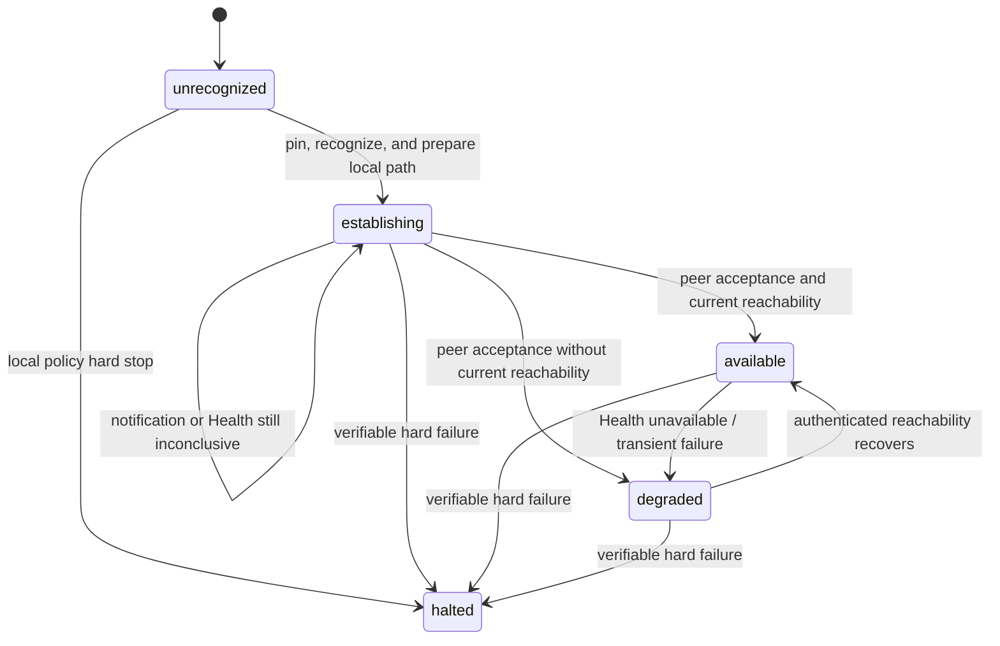

# Simple Open Messaging Federation Protocol v1 Peer Recognition

Status: `RELEASE CANDIDATE` (`v1.0.0-rc.0`)

Operations:

- `POST /s2s/v1/recognize`
- `GET /s2s/v1/health`

This document defines the directional semantics and bidirectional establishment timing of peer recognition, identity pinning, success confirmation, failure handling, and the privacy-preserving behavior of health queries. [Simple Open Messaging Federation Protocol v1](./protocol.md) defines shared Federation types and response envelopes; [Transport and Security](./transport-security.md) defines HTTPS, discovery, key certificates, and HTTP Message Signatures; the [Stable Error Registry](./errors.md) defines error classification.

The key words `MUST`, `MUST NOT`, `SHOULD`, `SHOULD NOT`, and `MAY` are to be interpreted as described in RFC 2119 and RFC 8174.

## 1. Core semantics

The protocol meaning of `A → B Recognize` is:

> A has validated and recognized B's current Federation identity through B's HTTPS well-known document and asks B to recognize A and prepare to receive A's traffic.

The sole protocol meaning of B returning `OK` is:

> B has authenticated A, recognized A's pinned identity, and prepared to receive A's Federation traffic.

Recognize is a prompt notification, not an indispensable proof channel. A
valid `OK` and a valid positive Health response from B provide A with the
same protocol evidence that B recognizes A and is prepared to receive from A.
Neither proves user, group, message, or operation-specific authorization.

For A to send ordinary data to B, two recognition decisions and current
reachability are required:

```text
A recognizes B  ── A validates and pins B's identity and prepares its local path
B recognizes A  ── A receives B's Recognize OK, B's Recognize, or positive Health
```

After A's local recognition decision commits but before B's acceptance is
known, A is `establishing`. Once B's acceptance is proven, A is `available`
while current authenticated reachability exists and `degraded` while it does
not. A lost Recognize `OK` does not require another Recognize if positive
Health supplies the same B-acceptance evidence. Recognize does not exchange
feed cursors or initialize business mirrors.

## 2. Operation overview

| Item                   | Recognize                                       | Health                                                                      |
| ---------------------- | ----------------------------------------------- | --------------------------------------------------------------------------- |
| Method                 | `POST`                                          | `GET`                                                                       |
| Path                   | `/s2s/v1/recognize`                             | `/s2s/v1/health`                                                            |
| Query                  | None; signed `@query` is `?`                    | None; signed `@query` is `?`                                                |
| Request                | Closed empty JSON object                        | Zero-byte body                                                              |
| Request auth           | bootstrap signed                                | status signed                                                               |
| Success                | HTTP `200`, bare `RecognizeOk`                  | HTTP `200`, bare `HealthResult`                                             |
| Idempotency coordinate | `(signerDomain, recipientDomain)`               | No new identity may be pinned by the query                                  |
| State effect           | Commits local recognition and receive readiness | A positive result confirms responder acceptance and may update reachability |

```ts
type EmptyRequest = Record<string, never>;

interface RecognizeOk {
  ok: true;
}

interface HealthResult {
  status: 'available' | 'degraded' | 'unavailable';
}
```

The objects listed here are closed. Every listed field is required; duplicate and unknown fields are forbidden.

## 3. Recognition and reachability state model

These are distinct protocol facts, regardless of how a node represents them
internally:

| Protocol fact        | Meaning                                                                                   | Valid evidence                                                                                           |
| -------------------- | ----------------------------------------------------------------------------------------- | -------------------------------------------------------------------------------------------------------- |
| Local recognition    | This node has validated and pinned the peer's root identity and prepared its receive path | A committed local recognition decision; never merely reading well-known                                  |
| Peer acceptance      | The peer recognizes this node and is prepared to receive its Federation traffic           | The peer's valid Recognize `OK`, its valid Recognize request, or its valid Health `available`/`degraded` |
| Current reachability | Authenticated communication with the pinned peer is currently possible                    | A valid authenticated request, positive Health, Recognize `OK`, or another definitive protocol response  |

The peer lifecycle is this closed abstract protocol model. Its labels state only
whether communication with the peer may continue automatically and do not
require an implementation to store one same-named enum or to duplicate every
failure cause as a lifecycle value:

| State          | Exact definition                                                                                                                                                           |
| -------------- | -------------------------------------------------------------------------------------------------------------------------------------------------------------------------- |
| `unrecognized` | No usable pinned/recognition identity exists.                                                                                                                              |
| `establishing` | Local recognition and receive-path preparation have committed, but peer acceptance has not yet been proven. Identity validation before that commit remains `unrecognized`. |
| `available`    | Local recognition and peer acceptance are both proven, and current authenticated reachability exists without unresolved transport degradation.                             |
| `degraded`     | Local recognition and peer acceptance are both proven, but current reachability is absent or a retryable transport or service failure occurred.                            |
| `halted`       | Verifiable hard-failure evidence exists; automatic Recognize, Health retries, and data-plane communication stop pending local administrator action.                        |

Recognize delivery is not a separate admission condition. Both nodes being
`degraded` means each has locally recognized the other and has evidence of the
other's acceptance; restoring authenticated reachability can make ordinary
traffic possible without repeating recognition.

A node MUST retain outside the lifecycle the original evidence and reason causing `halted`, such as a stable HTTP error from the target peer, a local policy block, pinned-root contradiction, or absence of a common version. Each cause retains its distinct wire error and security meaning but is not a lifecycle state. An implementation MAY use additional pending or diagnostic fields but MUST NOT persist Health's `unavailable` result as a same-named lifecycle state.

Health's `available | degraded | unavailable` is a privacy projection of the
responder's acceptance and receive readiness for the requester, not a copy of
either server's bilateral peer lifecycle. A valid `available` or `degraded` response supplies
peer-acceptance evidence equivalent to Recognize `OK` and current reachability
evidence. It MUST NOT cause the requester to enter `halted`. An ordinary
operation MUST NOT authorize solely from a lifecycle label. Admission also
requires valid identity, version, policy, and business authorization.

Local `available` is calculated as:

```text
available =
  local recognition and prepared receive path
  AND peer acceptance
  AND current authenticated reachability
  AND pinned identity is valid
  AND a common protocol version remains selected
  AND local policy permits federation traffic
  AND no unresolved transport degradation remains
```



Externally observable transitions MUST be equivalent to this table. A node
MUST make each fact change and resulting admission decision externally
indivisible; an intermediate state cannot authorize traffic.

| Event                                                 | Prior state                               | Protocol effect                                                                     | Next state                                                         |
| ----------------------------------------------------- | ----------------------------------------- | ----------------------------------------------------------------------------------- | ------------------------------------------------------------------ |
| Commit local recognition and receive-path preparation | `unrecognized`                            | Pin and recognize the peer; acceptance remains unknown                              | `establishing`                                                     |
| Process a valid inbound Recognize                     | Any non-`halted`                          | Recognize the signer locally and accept its explicit recognition of the recipient   | `available` when reachability is current                           |
| Receive valid Recognize `OK` or positive Health       | `establishing` / `degraded` / `available` | Accept the peer's recognition and receive-readiness assertion; refresh reachability | `available`                                                        |
| Health is `unavailable`, invalid, or unreachable      | `establishing` / `available` / `degraded` | Retain recognition evidence; mark reachability absent                               | `establishing` if peer acceptance is unknown, otherwise `degraded` |
| Authenticated protocol communication succeeds         | `establishing` / `available` / `degraded` | Refresh reachability without creating acceptance evidence                           | `establishing` if acceptance is unknown, otherwise `available`     |
| Network failure, timeout, or HTTP `503`               | `establishing` / `available` / `degraded` | Retain pins and acceptance evidence; mark reachability absent                       | `establishing` if acceptance is unknown, otherwise `degraded`      |
| Verifiable hard-security or policy failure            | Any non-`halted`                          | Retain the original security evidence and stop automatic communication              | `halted`                                                           |

Only an HTTP `409` carrying a fatal code in the Stable Error Registry from the target peer of this request, over the same hostname-verified TLS connection and authority, or a locally validated hard pinned-root, version, or policy conflict MAY trigger `halted`. An unauthenticated proxy response, TLS or connection failure, timeout, HTTP `503`, malformed response, or Health `unavailable` MUST NOT trigger `halted`; those failures preserve acceptance evidence and affect only reachability.

After entering `halted`, the protocol defines no automatic recovery path or administration, approval, reset, or recovery interface. When and how to leave `halted` is local administration. Before explicit administrator action, an implementation MUST NOT automatically retry Recognize or Health, resume the data plane, or replace the root pin. Health projects `halted` and every cause of it uniformly as `unavailable`.

Operation gates are calculated separately from lifecycle:

| Operation class                                     | Required gate                                                                                                                                                                                                                                                      |
| --------------------------------------------------- | ------------------------------------------------------------------------------------------------------------------------------------------------------------------------------------------------------------------------------------------------------------------ |
| `recognize`                                         | bootstrap signed and its admission rule; no existing lifecycle required                                                                                                                                                                                            |
| `health`                                            | status signed; failures uniformly project as `unavailable`                                                                                                                                                                                                         |
| `feed-heads`                                        | The recipient's local recognition and prepared lightweight receive path, with a valid signer identity                                                                                                                                                              |
| Ordinary recognized data sent by the local node     | Local recognition and prepared path, peer acceptance proven by valid Recognize `OK`, inbound Recognize, or positive Health, current authenticated reachability without unresolved degradation, compatible version and policy, and operation-specific authorization |
| Ordinary recognized data received from the peer     | The recipient's local recognition and prepared path, valid signer identity, compatible version and policy, and operation-specific authorization; the sender's earlier Recognize delivery is not a separate receive gate                                            |
| Termination convergence for an existing active call | Existing binding and tombstone rules in calls.md; health-cache degradation alone cannot block it                                                                                                                                                                   |

Sending Recognize, reading well-known, or merely validating a request signature MUST NOT create peer-acceptance evidence. A connected network socket is not a recognition fact. A transient disconnect MUST NOT delete an identity pin or acceptance evidence, although it MAY change current availability from `available` to `degraded`.

After Recognize is sent, a timeout, DNS/TLS/connect failure, interrupted
response, or retryable server failure retains local recognition and any
previously proven peer acceptance. With acceptance still unknown, the peer
remains `establishing`; with acceptance proven, it is `degraded` until
reachability recovers. Uncertain delivery does not itself prove acceptance.

Ordinary feed, call, user, media, and forward-bundle operations use the
`recognized signed` context from protocol.md. A sender MUST have local
recognition, peer acceptance, and current reachability. A receiver uses its
own local recognition decision and valid signer identity; it MUST NOT require
the requester's earlier Recognize notification before accepting otherwise
authorized traffic. A valid authenticated request refreshes reachability but
does not by itself prove peer acceptance to its recipient.

Local receive readiness is distinct from lifecycle `available`: the former
means this server can receive from a locally recognized signer; the latter
additionally requires peer acceptance and current reachability for its own
ordinary outbound traffic. Both positive Health results mean that the
requester's identity is pinned and locally recognized by the responder and
the responder's receive path is prepared.

## 4. Identity verification, recognition, and pinning

### 4.1 The initiator recognizes the recipient

Before sending Recognize to peer domain `B`, A MUST:

1. Locate B using the SRV, TLS, and authority rules in [Transport and Security, Section 2](./transport-security.md#2-network-discovery-transport-and-signature-security).
2. Fetch B's `/.well-known/somfp` over HTTPS with successful hostname verification.
3. Select the highest common major version and require the selected version to be `1`, matching the request path.
4. Strictly decode `rootKey.ed25519` to exactly 32 bytes.
5. Validate at least one currently valid, root-authorized signing-key certificate for B.
6. Atomically pin B's root public key, make the local recognition decision, and prepare the local receive path before constructing and sending the HTTP request. If B's acceptance is not yet proven, the committed lifecycle is `establishing`; an already accepted peer retains its `available` or `degraded` lifecycle according to current reachability.

Successfully reading well-known alone does not constitute recognition. The caller MAY send Recognize only after completing these checks and making the local recognition decision. For an already pinned peer, the newly read root MUST byte-for-byte match the pin.

Step 6 is the mandatory commit boundary for the initiator. Local recognition,
receive readiness, and the `establishing` state remain valid even if the subsequent
operation times out, the connection resets, or the server returns HTTP `503`.
Only a hard rejection or security failure defined in Section 8 can make this
recognition unavailable. An implementation MUST NOT misclassify ordinary
network uncertainty as rejection or identity loss.

### 4.2 The recipient validates the recognition claim

After receiving A's Recognize request, B MUST satisfy the following checks.
These are recognition-specific requirements, not an alternative validation
order; [Transport and Security, Section 3.5](./transport-security.md#35-validation-order-and-failure-boundaries)
governs request validation:

- Extract canonical signer domain A from the HTTP Message Signature `keyid`.
- Require the body to be the closed empty JSON object `{}`.
- Use A's hostname-verified HTTPS well-known document to validate A's root, certificate, and request signature.
- If a root pin or prior authenticated record exists for A, require the newly obtained root to match it byte for byte.
- Apply local admission policy and verify that B currently permits establishing this peer.

Validating A's well-known document and the request's HTTP signature proves
that the request was signed with A's currently authorized Federation signing key. B's subsequent atomic pinning,
policy decision, and receive-path preparation establish B's local recognition
of A. A learns that B accepts A from B's valid `OK`, B's Recognize, or B's
valid `available` or `degraded` Health result.

### 4.3 Root and signing-key continuity

`rootKey.ed25519` MUST be strictly decoded as RFC 4648 padded base64. Non-canonical base64, invalid padding, and trailing data MUST be rejected, and the result MUST be exactly 32 bytes. When first recognizing the signer, the recipient MUST atomically store the root with that recognition decision.

A later root mismatch is an identity contradiction, not signing-key rotation. The node MUST retain the old pin, record the identity-contradiction reason, enter `halted`, revoke `available`, and reject the ordinary data plane. Normal addition, overlap, expiration, and removal of root-authorized signing certificates MUST NOT clear recognition or acceptance evidence.

## 5. Recognize request and successful commit

### 5.1 Request body

For a request from A to B, the exact application body bytes used by the fixed vectors below are:

```text
{}
```

The body is a closed empty object. The signer domain is established by the
validated `keyid`, the recipient domain by the signed `@authority`, and the
protocol version by `/s2s/v1`; the body repeats none of them.

The request MUST be constructed in the common order defined in
[Transport and Security, Section 3](./transport-security.md#3-request-construction-overview):
final JSON UTF-8 bytes, `Content-Digest`, `Date` and signature parameters,
RFC 9421 signature base, then Ed25519 `Signature`. The protocol does not generally require compact serialization for JSON objects, but the digest and signature MUST cover the exact bytes sent. The body MUST NOT be serialized again after signing.

### 5.2 Recipient commit boundary and `OK`

After all validation and policy checks succeed, B MUST atomically complete the following before returning a response:

1. Pin or verify A's root identity.
2. Apply B's local admission policy and commit `recognizesPeer(A)`.
3. Prepare B's receive path and commit `localServiceAvailable`.
4. Accept A's explicit recognition of B in this request.
5. Prepare B's lightweight receive path.
6. Treat the authenticated request as current reachability evidence and set B's peer lifecycle to `available`.

The first bootstrap Recognize establishes B's local recognition of A and A's
recognition of B together. B therefore has both recognition decisions and
current reachability in the same externally indivisible commit. A later
duplicate MUST NOT reset the first recognition time or business state.

After a successful commit, return a closed `RecognizeOk` JSON object. The formatted JSON below is a complete valid response; whitespace and line breaks have no application semantics:

```http
HTTP/1.1 200 OK
Content-Type: application/json

{
  "ok": true
}
```

Requester A MUST parse B's response body as `application/json`, then require an object containing exactly one member, `ok`, whose JSON Boolean value is `true`. Thus `{"ok":true}` and the formatted representation above are valid; `{"ok":1}`, `{"ok":true,"extra":null}`, `[true]`, an empty body, and trailing non-whitespace data are invalid. An implementation MUST NOT determine success from the raw UTF-8 bytes, whitespace, or object-member layout.

B MUST NOT return `OK` before making all required effects durably recoverable as
one externally indivisible commit. A may adopt B's acceptance evidence only
after receiving HTTP `200`, strictly validating the `RecognizeOk` shape above,
and confirming that the response came from the same TLS connection and
authority as the request. A timeout or network error cannot substitute for
this evidence, but a later valid positive Health result can. A peer with
acceptance still unknown remains `establishing` and may retry recognition.

The response does not use an additional detached signature. Hostname-verified
HTTPS authenticates the responder, while B's indivisible durable commit and the
fixed response semantics confirm B's acceptance of A.

### 5.3 Optional reverse notification

B MAY send `B → A Recognize` as a prompt reverse notification after returning
the first `OK`, but MUST NOT wait for it before responding. Its absence or lost
response is not a separate admission failure. The first request and `OK`
already give both peers the reciprocal acceptance evidence needed for
ordinary traffic, subject to current reachability and business authorization.
Health can provide the same acceptance evidence after an uncertain response.

## 6. Complete sequence

```mermaid
sequenceDiagram
    participant A as Peer A
    participant B as Peer B

    A->>B: GET /.well-known/somfp
    B-->>A: B versions, root, signing certificates
    Note over A: Pin and recognize B; prepare receive path<br/>status = establishing
    A->>B: POST /s2s/v1/recognize {}
    Note over B: Authenticate A; pin and recognize A<br/>A's request asserts A recognizes B<br/>status = available
    B-->>A: 200 {ok: true}
    Note over A: OK proves B accepts A<br/>status = available
    Note over A,B: Ordinary signed traffic may start<br/>subject to authorization
```

B MAY reuse A's validated well-known document for an optional reverse request.
B MUST NOT wait for reverse Recognize before returning the first `OK`, because
two symmetric implementations could otherwise wait for each other.

### 6.1 Recovery after a lost first `OK`

```mermaid
sequenceDiagram
    participant A as Peer A
    participant B as Peer B

    A->>B: Recognize A → B
    Note over B: Recognize A and prepare receive path<br/>A's notification proves A recognizes B
    B--xA: 200 OK lost or timed out
    Note over A: B acceptance still unknown<br/>status = establishing
    A->>B: Authenticated Health
    B-->>A: 200 {status: available | degraded}
    Note over A: Positive Health proves B accepts A<br/>status = available; no Recognize retry needed
```

If A's first request never reached B, B does not initiate reverse Recognize
because of that request. If B has not independently recognized A, Health
returns `unavailable`; A remains `establishing` and MAY retry Recognize with
bounded backoff. If both parties independently initiate Recognize, the same
recognition decisions converge without requiring two `OK` responses.

## 7. Retries, duplicates, and concurrency

The application-level idempotency coordinate for Recognize is `(signerDomain, recipientDomain)`; no nonce is required. The short HTTP-signature time window limits replay of old requests, while operation idempotency prevents replays within that window from duplicating recognition side effects.

- First success: commit local recognition, receive readiness, and the requester's explicit recognition assertion before returning `OK`.
- Duplicate request with the same root identity: MUST NOT reset the first-recognition time, cursor, mirror, or application authorization; return the same `OK` semantics.
- Same domain with a different root: MUST fail as an identity mismatch and MUST NOT replace the pin.
- Concurrent Recognize and Health: MAY commit independently. A valid `OK` and a valid positive Health result are equivalent peer-acceptance evidence; the final recognition and reachability state MUST equal a valid serial ordering.
- Lost response: retain facts already committed by the recipient. The sender MAY obtain peer acceptance through positive Health or safely retry Recognize while acceptance remains unknown.

Each HTTP retry uses the same JSON application semantics but MUST regenerate `Date`, `created`, `expires`, and the HTTP signature. Because the body contains neither time nor nonce, its bytes and `Content-Digest` MAY remain unchanged.

## 8. Non-`OK` results and error handling

In this section, A is the Recognize requester and B is the recipient. B validates the request, commits or rejects reciprocal recognition, and generates the HTTP response. A may adopt B's acceptance only from a validated response or independently verified evidence.

### 8.1 Recipient B: validation, local state, and response

B validates A's Recognize under Section 4.2. When all validation and policy checks succeed, B MUST commit the recognition effects under Section 5.2 before returning HTTP `200` with `{"ok":true}`. Otherwise, Recognize uses the common error envelope:

| Condition observed by B                                                  | HTTP | Stable code                               | B's local action                                                                                          |
| ------------------------------------------------------------------------ | ---: | ----------------------------------------- | --------------------------------------------------------------------------------------------------------- |
| Malformed JSON, header, or type                                          |  400 | `FEDERATION_MALFORMED`                    | Do not commit new recognition effects                                                                     |
| Path version disabled or no common version                               |  409 | `FEDERATION_PROTOCOL_VERSION_UNSUPPORTED` | Record the version reason and enter `halted`; do not commit a new fact                                    |
| Invalid certificate or HTTP signature                                    |  401 | `FEDERATION_BAD_SIGNATURE`                | Do not commit recognition effects; do not replace a root pin merely because signature verification failed |
| Recognize body is not the closed empty object                            |  400 | `FEDERATION_MALFORMED`                    | Reject the malformed request without committing recognition effects                                       |
| Local policy blocks A                                                    |  409 | `FEDERATION_PEER_BLOCKED`                 | Record the policy reason and enter `halted`; do not commit a new fact                                     |
| A root obtained through hostname-verified HTTPS differs from its old pin |  409 | `FEDERATION_IDENTITY_MISMATCH`            | Retain the old pin, record an identity contradiction, and enter `halted`                                  |
| A is already halted for an identity contradiction                        |  409 | `FEDERATION_IDENTITY_MISMATCH`            | Remain `halted`                                                                                           |
| Request rate is too high                                                 |  503 | `RATE_LIMITED`                            | Do not commit recognition effects; apply rate-limit policy                                                |
| Well-known is temporarily unavailable                                    |  503 | `INTERNAL`                                | Retain any existing pin and lifecycle; do not infer identity loss                                         |
| B's local identity material is unavailable                               |  503 | `FEDERATION_LOCAL_IDENTITY_LOST`          | Do not commit new recognition effects                                                                     |
| Commit failure or transient internal error                               |  503 | `INTERNAL`                                | Do not expose uncommitted facts; retain previously committed state                                        |

When returning any error, B MUST NOT create acceptance evidence or open the
lightweight gate because of this request.
Facts committed by an earlier successful idempotent request are not rolled back
by a later failure. HTTP signature failure alone is not evidence that the root
identity changed. Only a root independently obtained through hostname-verified
HTTPS that conflicts with the existing pin MAY trigger identity mismatch.
Normal rotation of signing certificates authorized by the same pinned root is
not identity mismatch.

### 8.2 Requester A: consuming the response and updating local state

A has committed local recognition and is `establishing` if B's acceptance is not yet known. A MUST NOT infer that B accepted A merely because Recognize was sent. A MUST handle the result as follows:

| Result observed by A                                                  | Recognition and reachability effect                                                   | Required action                                                                 |
| --------------------------------------------------------------------- | ------------------------------------------------------------------------------------- | ------------------------------------------------------------------------------- |
| HTTP `200` with valid `{"ok":true}`                                   | Adopt B's acceptance and current reachability; become `available` if other gates hold | Ordinary traffic may begin subject to authorization                             |
| Timeout, DNS/connect failure, TLS interruption, or truncated response | Acceptance remains unknown unless already proven; reachability is absent              | Retain the pin; obtain a positive Health result or retry Recognize with backoff |
| HTTP `503`                                                            | Same as a retryable transport failure                                                 | Retain the pin and back off                                                     |
| HTTP `200` with an invalid body or non-`OK` result                    | Do not adopt acceptance from this response                                            | Record a protocol-response error; do not retry tightly                          |
| Malformed, bad signature, or binding violation                        | Retain pin and previously proven acceptance                                           | Stop identical automatic retries until corrected                                |
| HTTP `409` + `FEDERATION_PROTOCOL_VERSION_UNSUPPORTED`                | `halted`; retain version reason                                                       | Stop automatic communication; do not downgrade                                  |
| HTTP `409` + `FEDERATION_PEER_BLOCKED`                                | `halted`; retain remote-blocked reason                                                | Stop automatic communication                                                    |
| HTTP `409` + `FEDERATION_IDENTITY_MISMATCH`                           | `halted`; retain old pin                                                              | Fail closed and stop automatic communication                                    |
| A directly verifies that B's root differs from its pin                | `halted`; retain independent security evidence                                        | Do not treat the contradiction as a network error                               |

An authenticated HTTP error response does not always trigger `halted`; it MUST be classified by stable code. `FEDERATION_MALFORMED`, `FEDERATION_BAD_SIGNATURE`, `FEDERATION_BINDING_VIOLATION`, `RATE_LIMITED`, and generic `INTERNAL` reject or delay only the current request and do not independently halt the peer. Only the three fatal HTTP `409` and code combinations above, plus a pinned-root conflict directly verified by A, trigger `halted`. An unparseable proxy body, TLS or connection failure, timeout, or HTTP `503` MUST NOT trigger `halted`. For an unknown HTTP status or a status/code conflict, A MUST follow the classification rules in the [Stable Error Registry](./errors.md#http-layer), but MUST NOT replace or delete a root pin without an identity contradiction.

### 8.3 Lost responses and recognition convergence

If A's Recognize reached B but its `OK` was lost, B has already accepted A.
A remains `establishing` while B's acceptance is unknown to A. A valid
positive Health response from B supplies the same acceptance evidence as
the lost `OK`; no additional Recognize notification is required. An optional
reverse Recognize from B also supplies that evidence.

If the request never reached B and B has not independently recognized A,
Health returns `unavailable` and cannot manufacture acceptance. A MAY retry
the original Recognize with bounded backoff. Existing pins and acceptance
evidence MUST survive uncertain delivery and temporary network failures.

### 8.4 Blocklist

An implementation MAY allow an administrator to add a canonical peer domain to
a local blocklist. The blocklist MUST be checked before committing a new inbound
Recognize. On a match, return HTTP `409` with `FEDERATION_PEER_BLOCKED` and MUST
NOT create acceptance evidence, open the lightweight receive gate, or expose
service availability.

An initiator receiving this explicit error MUST record a remote-blocked reason, enter `halted`, and stop all automatic communication. Health still returns the uniform `unavailable` projection for a peer halted by blocking and MUST NOT expose the reason. The local administrator determines whether and how to remove the block; that decision is outside the Federation v1 wire protocol.

A complete blocklist rejection response is:

```http
HTTP/1.1 409 Conflict
Content-Type: application/json

{"code":50009,"message":"peer blocked","data":null}
```

`message` is diagnostic only. The caller MUST identify the explicit rejection by `code`, not by text. If well-known is temporarily unavailable while processing Recognize, fail the operation with generic `503 INTERNAL`; the caller retains its existing pin and retries with backoff.

## 9. Health query and privacy

Health queries the reachability and privacy-safe status of a known peer; it is not an application keepalive. Trigger timing, initial delay, cadence, and stopping conditions are local concerns. Automatic queries SHOULD use bounded, jittered backoff and MUST NOT create tight polling or traffic amplification.

When A queries B, its Health request has no query and exactly zero body bytes. It MUST NOT send
`Content-Type`; `Content-Digest` is the fixed digest of the empty byte string.
The authenticated `keyid` identifies signer A directly. A successful response
MUST include `Cache-Control: no-store`.

### 9.1 Recipient B: validating the request and producing the privacy projection

B MAY attempt to validate Health only with an existing pinned or recognized identity. For a completely unknown domain, B SHOULD NOT fetch well-known merely to answer the query, because that would turn the endpoint into an arbitrary DNS/HTTP fetch oracle. For A with an existing pinned identity, B MAY refresh well-known under the signing-key rotation rules, but MUST NOT replace the root pin because of the query.

B MUST return exactly one of the following three closed objects:

```json
{ "status": "available" }
```

```json
{ "status": "degraded" }
```

```json
{ "status": "unavailable" }
```

Only when the request validates against A's identity pinned and locally
recognized by B, B's ordinary and lightweight receive paths are prepared,
and query authorization is valid, MAY B return `available` or `degraded`. The response projects B's
readiness to receive A and B's reachability observation at request admission;
it does not require B to have already received A's reciprocal acceptance:

- Return `available` when B is prepared to receive from A and has current authenticated reachability evidence for A.
- Return `degraded` when B is prepared to receive from A but current reachability was absent at admission. The authenticated Health request itself may refresh B's reachability after this projection is captured.
- Both results prove B recognizes A's pinned identity and is prepared to receive A's traffic, including lightweight hints. A MUST consume either as peer-acceptance evidence equivalent to B's Recognize `OK`.

The following cases MUST uniformly return HTTP `200` with `{"status":"unavailable"}`:

- The peer or domain does not exist, or B has never pinned and recognized that identity.
- The signature cannot be validated by the existing identity or the current signing certificate needed for validation is unavailable.
- The requester lacks query authorization, or B has placed the peer in `halted` for any reason.
- A reset is in progress, or another identity or version state cannot safely be disclosed.
- Any other local connection state that cannot safely be disclosed.

For all cases above, the recipient MUST return exactly the same unavailable object and MUST NOT disclose the specific reason through HTTP status, error code, additional fields, or diagnostics. Implementations SHOULD minimize obvious response-timing differences and MUST rate-limit by source, domain, and globally. Temporary rate limiting MAY return generic `503 RATE_LIMITED`; an unparseable HTTP or JSON shape MAY return generic `400 FEDERATION_MALFORMED`. Neither response indicates whether a peer exists.

This `unavailable` result is only an external privacy projection; it does not erase B's handling of the actual local cause. For example, if B confirms a root conflict using independent hostname-verified HTTPS evidence, B still MUST retain the old pin, record the reason, and enter `halted`, while returning `200 unavailable` to A's Health query.

### 9.2 Requester A: consuming a Health result

| Result observed by A                                | Protocol action A MUST take                                                                                                                                      |
| --------------------------------------------------- | ---------------------------------------------------------------------------------------------------------------------------------------------------------------- |
| Valid `available` or `degraded`                     | Adopt B's acceptance and prepared receive path, refresh reachability, and become `available` if local recognition, version, and policy remain valid              |
| Valid `unavailable`                                 | Treat current reachability as absent; retain pins and acceptance evidence. Remain `establishing` if acceptance is unknown, otherwise become or remain `degraded` |
| Timeout, network error, HTTP `503`, or invalid body | Treat reachability like `unavailable`; adopt no assertion from the response                                                                                      |
| HTTP `400`, `401`, or another unexpected status     | Treat this query as failed; do not change peer lifecycle solely for this reason                                                                                  |

A receiving valid `available` or `degraded` MUST recognize that B accepts A
and is prepared to receive A's Federation traffic. This is the same
peer-acceptance evidence as valid Recognize `OK`; a previously lost `OK` does
not require an idempotent notification retry after this Health result.

A MUST NOT infer B's actual reason from `unavailable`, nor enter `halted` solely because of that result. `halted` requires either an authenticated, non-automatically-recoverable HTTP error from the target peer as defined in Section 8 or hard security evidence independently verified by A.

### 9.3 Other reachability evidence and convergence optimization

In addition to Health, every request whose signer is successfully authenticated
against a pinned, locally recognized, and receive-ready peer MUST serve as fresh
evidence of `remoteServiceReachable`, regardless of whether later shape or
operation-specific business authorization succeeds. Recognize, Health,
`feed-heads`, and ordinary operations all qualify. A first bootstrap Recognize
qualifies atomically once its identity validation, pinning, recognition
decision, and receive-path preparation succeed. A validated success or
definitive application response to
a locally initiated request also supplies reachability evidence. An
unauthenticated request, malformed or unverifiable response, network error, or
`5xx` provides no such evidence. This general reachability rule alone MUST NOT
invent peer acceptance. The positive Health assertion defined in Section 9.2
is the explicit acceptance path; ordinary authenticated communication supplies
reachability alone.

When B sends an optional reverse Recognize and receives A's valid `OK`, B MAY
omit an additional Health call: that `OK` already proves A's acceptance and
current reachability. When the first `OK` is lost, A MAY instead rely on B's
positive Health result for the same acceptance evidence.

## 10. Complete HTTP construction examples

The following vectors use the public test signing private key `ICEiIyQlJicoKSorLC0uLzAxMjM0NTY3ODk6Ozw9Pj8=`, which MUST NEVER be deployed as a production secret. Its Ed25519 public key is `Kay64UG8yvCyLhqU000LxzYeUm0L/hLIl5S8kyKWbdc=`. The corresponding `a.example` well-known v1 view is:

```json
{
  "protocolVersions": [1],
  "rootKey": {
    "ed25519": "A6EHv/POEL4dcN0Y50vAmWfk1jCbpQ1fHdyGZBJVMbg="
  },
  "keys": [
    {
      "keyId": "a.example/key-1",
      "ed25519": "Kay64UG8yvCyLhqU000LxzYeUm0L/hLIl5S8kyKWbdc=",
      "notBefore": 1699990000000,
      "notAfter": 1800000000000,
      "authorizationSignature": "mPwPCPikeeOi90FHS8cA/YhwWUYid11G8bQGOMMgidhOyW1/k9BbrK669CkBTlsDPyu/t4FDxqmZlrZZGSAkDA=="
    }
  ]
}
```

The exact certificate statement covered by `authorizationSignature` is defined in Section 1.3 of [Transport and Security](./transport-security.md). The root, certificate, and signature above jointly validate the root-to-signing-key authorization chain.

### 10.1 Recognize

```http
POST /s2s/v1/recognize HTTP/1.1
Host: b.example
Content-Type: application/json
Date: Tue, 14 Nov 2023 22:13:20 GMT
Content-Digest: sha-256=:RBNvo1WzZ4oRRq0W9+hknpT7T8If536DEMBg9hyq/4o=:
Signature-Input: sig1=("@method" "@path" "@query" "@authority" "date" "content-digest");created=1700000000;expires=1700000300;keyid="a.example/key-1";alg="ed25519"
Signature: sig1=:MOF5zofzJLLbgs7+YeV1dcKqDbyXOrOEgMMeTNU4Dob8dySVVT4uhIVxwvhMBOvsVEXZOgMrej4yjQw5QG3jCQ==:

{}
```

The signature base is:

```text
"@method": POST
"@path": /s2s/v1/recognize
"@query": ?
"@authority": b.example
"date": Tue, 14 Nov 2023 22:13:20 GMT
"content-digest": sha-256=:RBNvo1WzZ4oRRq0W9+hknpT7T8If536DEMBg9hyq/4o=:
"@signature-params": ("@method" "@path" "@query" "@authority" "date" "content-digest");created=1700000000;expires=1700000300;keyid="a.example/key-1";alg="ed25519"
```

### 10.2 Health

Health uses the empty-body digest and a method/path-specific signature:

```http
GET /s2s/v1/health HTTP/1.1
Host: b.example
Date: Tue, 14 Nov 2023 22:13:20 GMT
Content-Digest: sha-256=:47DEQpj8HBSa+/TImW+5JCeuQeRkm5NMpJWZG3hSuFU=:
Signature-Input: sig1=("@method" "@path" "@query" "@authority" "date" "content-digest");created=1700000000;expires=1700000300;keyid="a.example/key-1";alg="ed25519"
Signature: sig1=:fuvhDBclzxrAtoUsntLajbLeWY/mNQdtUIczb5jMYtmbz4r5qQlepQAWuGFGoANj1rf7s7fzRvJrDK1HZRXbDg==:

```

## 11. Administrative boundary

Ordinary network failure, service restart, SRV change, or signing-key rotation under the same pinned root MUST NOT place a peer in `halted` and MUST NOT delete pins, recognition or acceptance evidence, cursors, mirrors, or authorizations.

Diagnosis, approval, recovery, reset, and re-recognition after `halted` are local administrative actions. Federation v1 defines no endpoint, interaction, or automation policy for them. The protocol safety floor is that communication MUST NOT resume automatically before explicit administrative handling, and a new root MUST NOT automatically inherit the old identity's recognition facts or application authorizations.
