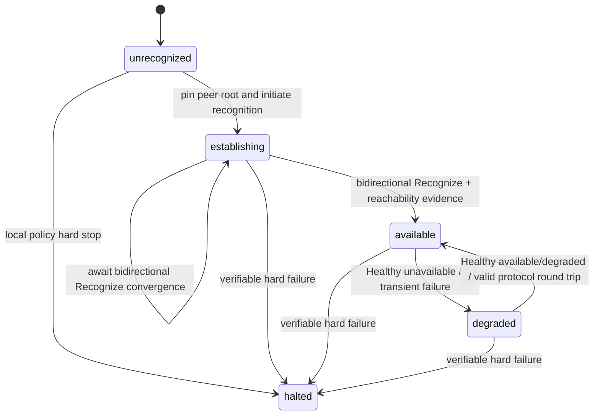
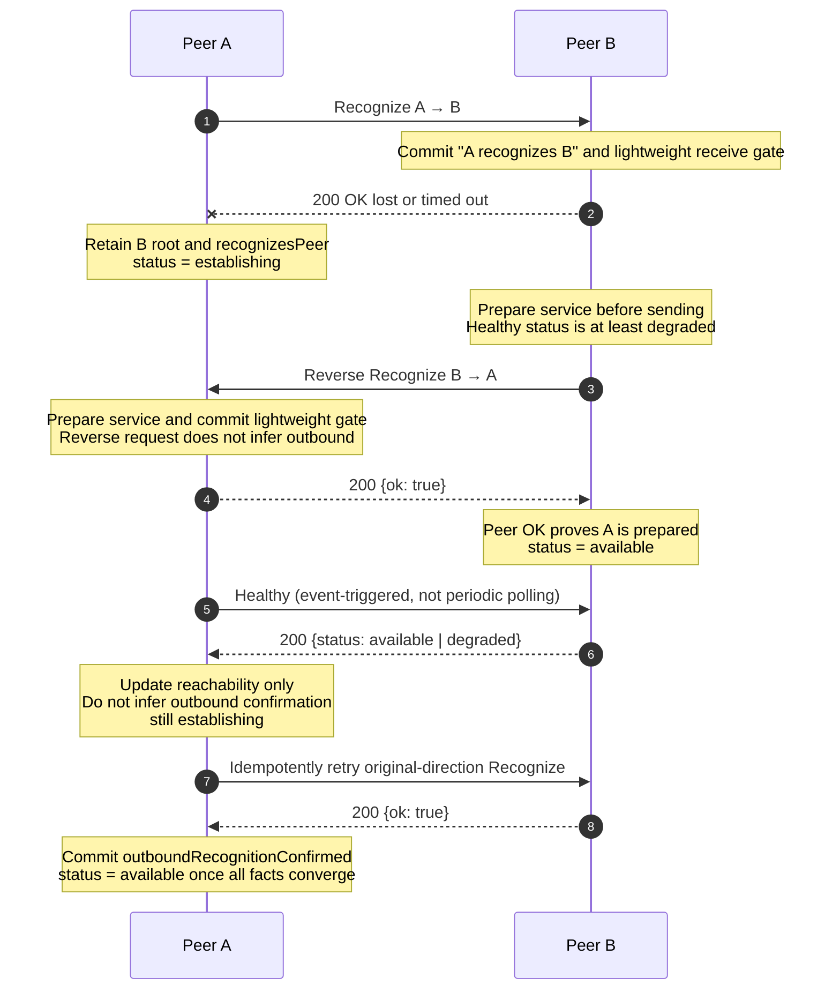

# Simple Open Messaging Federation Protocol v1 Peer Recognition

Status: `RELEASE CANDIDATE` (`v1.0.0-rc.0`)

Operations：

- `POST /s2s/v1/recognize`
- `POST /s2s/v1/healthy`

This document defines the directional semantics and bidirectional establishment timing of peer recognition, identity pinning, success confirmation, failure handling, and the privacy-preserving behavior of health queries. [Simple Open Messaging Federation Protocol v1](./protocol.md) defines shared Federation types and response envelopes; [Transport and Security](./transport-security.md) defines HTTPS, discovery, key certificates, and HTTP Message Signatures; the [Stable Error Registry](./errors.md) defines error classification.

The key words `MUST`, `MUST NOT`, `SHOULD`, `SHOULD NOT`, and `MAY` are to be interpreted as described in RFC 2119 and RFC 8174.

## 1. Core semantics

The sole protocol meaning of `A → B Recognize` is:

> A has validated and recognized B's current Federation identity through B's HTTPS well-known document and asks B to durably record “A recognizes B.”

The sole protocol meaning of B returning `OK` is:

> B has confirmed that the request came from A and durably committed the directional fact “A recognizes B.”

One Recognize completes only one direction. It does not mean B recognizes A or that the connection is healthy. B's retrieval of A's well-known document to validate A's request is authentication only. B MUST explicitly express recognition of A through reverse `B → A Recognize`.

Complete establishment consists of two opposite Recognize operations:

```text
A recognizes B  ── B returns OK
B recognizes A  ── A returns OK
```

The peer becomes `available` only after both directions of recognition, service readiness on both sides, and identity and policy requirements converge. The usual evidence is two Recognize `OK` responses. If the first `OK` is lost, the caller MAY idempotently retry the original direction. Healthy provides only reachability evidence and cannot replace a lost Recognize `OK`. Reverse Recognize does not provide that confirmation either because both sides may initiate concurrently and independently. The caller MUST idempotently retry its original Recognize until it receives a valid `OK` or an authenticated hard error. Recognize does not exchange feed cursors, initialize business mirrors, or prove user, group, or message permissions.

## 2. Operation overview

| Item | Recognize | Healthy |
| --- | --- | --- |
| Method | `POST` | `POST` |
| Path | `/s2s/v1/recognize` | `/s2s/v1/healthy` |
| Query | None; signed `@query` is `?` | None; signed `@query` is `?` |
| Request | Bare `DomainRequest` JSON | Bare `DomainRequest` JSON |
| Request auth | bootstrap signed | status signed |
| Success | HTTP `200`, bare `RecognizeOk` | HTTP `200`, bare `HealthResult` |
| Idempotency coordinate | `(signerDomain, recipientDomain)` | Side-effect-free query |
| State effect | Commits one recognition direction | Handler has no side effect; caller may update remote availability from the response |

```ts
interface DomainRequest {
  domain: Domain;
}

interface RecognizeOk {
  ok: true;
}

interface HealthResult {
  status: 'available' | 'degraded' | 'unavailable';
}
```

The objects listed here are closed. Every listed field is required; duplicate and unknown fields are forbidden.

## 3. Bidirectional state model

The following names describe protocol facts and do not require an implementation to use identically named database fields:

| Protocol fact | Meaning | Becomes true when |
| --- | --- | --- |
| `recognizesPeer` | The local node validated and recognizes the peer root identity | The local node atomically pins the peer root before sending Recognize |
| `outboundRecognitionConfirmed` | The peer committed “the local node recognizes the peer” | The local node receives valid `OK` for its original Recognize direction |
| `inboundRecognitionConfirmed` | The local node committed “the peer recognizes the local node” | The local node successfully processes inbound Recognize, before returning `OK` |
| `lightweightInboundReady` | The local node can safely accept the peer's lightweight requests | Atomically with inbound confirmation before returning `OK` |
| `localServiceAvailable` | The local node is ready to provide post-recognition service to the peer | Atomically before sending reverse Recognize; or before returning `OK` when receiving reverse Recognize |
| `remoteServiceReachable` | The peer's service and one valid protocol round trip have been observed | Valid Healthy `available`/`degraded`, reverse Recognize `OK`, or any normally authenticated and processed S2S request or response |

The peer lifecycle is this closed enum. It states only whether communication with the peer may continue automatically and does not duplicate every failure cause as a lifecycle value:

| State | Exact definition |
| --- | --- |
| `unrecognized` | No usable pinned/recognition identity exists. |
| `establishing` | The peer is pinned and recognized, but bidirectional Recognize or service-readiness facts have not converged; only handshake control operations and directionally opened lightweight requests are allowed. |
| `available` | Bidirectional recognition, service readiness, a valid round trip, identity, version, and policy are all valid, with no unresolved transport degradation. |
| `degraded` | Bidirectional recognition is established, but current reachability evidence is absent or a retryable transport or service failure occurred. |
| `halted` | Verifiable hard-failure evidence exists; automatic Recognize, Healthy retries, and data-plane communication stop pending local administrator action. |

A node MUST retain outside the lifecycle the original evidence and reason causing `halted`, such as a stable HTTP error from the target peer, a local policy block, pinned-root contradiction, or absence of a common version. Each cause retains its distinct wire error and security meaning but is not a lifecycle state. An implementation MAY use additional pending or diagnostic fields but MUST NOT persist Healthy's `unavailable` result as a same-named lifecycle state.

Healthy's `available | degraded | unavailable` is a privacy projection of local state and query permission, not the lifecycle enum. Healthy MAY provide reachability evidence for transitions between local `available` and `degraded`; it MUST NOT commit or invent a recognition-direction fact or cause the local peer to enter `halted`. An ordinary operation MUST NOT authorize solely from the `available` or `degraded` label. If complete bidirectional recognition facts, pinned identity, common version, policy, and operation-specific business authorization remain valid, a transport-only `degraded` peer MAY still send and receive the ordinary data plane. An `establishing` peer MAY use only `recognize`, `healthy`, and directionally opened `feed-heads`.

Local `available` is calculated as:

```text
available =
  outboundRecognitionConfirmed
  AND inboundRecognitionConfirmed
  AND localServiceAvailable
  AND remoteServiceReachable
  AND pinned identity is valid
  AND a common protocol version remains selected
  AND local policy permits federation traffic
  AND no unresolved transport degradation remains
```



State transitions MUST follow this table. “Recompute” means deriving the next state in the same transaction from the `available` formula above and the current facts.

| Event | Prior state | Local fact change | Next state and handling |
| --- | --- | --- | --- |
| Initiate recognition and pin peer root | `unrecognized` | Set `recognizesPeer`; retain pending Recognize work | `establishing` |
| Successfully process inbound Recognize | `establishing` / `available` / `degraded` | Set inbound confirmation and lightweight gate | Recompute; this request alone cannot supply outbound confirmation |
| Receive Recognize `OK` for the local direction | `establishing` | Set outbound confirmation | Recompute |
| Healthy returns `available` / `degraded` | `establishing` / `degraded` / `available` | Set only remote reachable and clear transport degradation; do not supply direction facts | Recompute |
| Healthy returns `unavailable`, times out, or is invalid | `available` / `degraded` | Clear remote reachable and record transport degradation | `degraded`; do not enter `halted` |
| Healthy returns `unavailable`, times out, or is invalid | `establishing` | Retain unconverged direction facts and record reachability failure | Remain `establishing` |
| Successfully authenticate and process a normal S2S request or definitive response | `available` / `degraded` | Set remote reachable and clear transport-only degradation; do not supply recognition direction facts | Recompute |
| Network failure, timeout, or HTTP `503` | `available` / `degraded` | Clear remote reachable; retain pin, direction facts, and business state | `degraded` |
| Retryable Recognize failure | `establishing` | Retain pin, committed direction facts, and retry work | Remain `establishing` |
| Authenticated hard-error response from the target peer, or independently validated hard-security evidence | Any non-`halted` | Retain original response or evidence and cause, clear runtime reachability, stop automatic communication | `halted` |
| Local administrative policy hard stop | Any non-`halted` | Record local policy cause and stop automatic communication | `halted` |

Only an HTTP `409` carrying a fatal code registered here from the target peer of this request, over the same hostname-verified TLS connection and authority, or a locally validated hard pinned-root, version, or policy conflict MAY trigger `halted`. An unauthenticated proxy response, TLS or connection failure, timeout, HTTP `503`, malformed response, or Healthy `unavailable` MUST NOT trigger `halted`; an established peer enters `degraded` for those availability failures.

After entering `halted`, the protocol defines no automatic recovery path or administration, approval, reset, or recovery interface. When and how to leave `halted` is local administration. Before explicit administrator action, an implementation MUST NOT automatically retry Recognize or Healthy, resume the data plane, or replace the root pin. Healthy projects `halted` and every cause of it uniformly as `unavailable`.

Operation gates are calculated separately from lifecycle:

| Operation class | Required gate |
| --- | --- |
| `recognize` | bootstrap signed and its admission rule; no existing lifecycle required |
| `healthy` | status signed; failures uniformly project as `unavailable` |
| `feed-heads` | `lightweightInboundReady` in that signer direction |
| Ordinary recognized data | Pinned identity, both direction confirmations, common version, policy, and operation-specific business authorization; transport-only `degraded` does not close the gate |
| Termination convergence for an existing active call | Existing binding and tombstone rules in calls.md; health-cache degradation alone cannot block it |

Sending Recognize, enqueuing a retry, reading well-known, or merely validating a request signature MUST NOT set the corresponding confirmed fact early. A connected network socket is not a recognition fact. A transient disconnect MUST NOT delete an identity pin or direction fact, although it MAY change current availability from `available` to `degraded`.

After Recognize is sent, a timeout, DNS/TLS/connect failure, interrupted response, or retryable server failure retains the already established `recognizesPeer` fact and remains `establishing`; it MUST NOT invent outbound confirmation. `degraded` applies only to a peer with completed bidirectional recognition and impaired current reachability. An unconverged handshake uses `establishing`.

Ordinary feed, call, user, media, and forward-bundle operations use the `recognized signed` context from protocol.md and do not use the cached `available` label as a protocol gate. The only lightweight request is `feed-heads`. Before sending Recognize `OK`, the receiver MUST be ready to accept it from that signer. The sender MAY send it in that direction only after receiving `OK`. Its lossy, non-durable payload does not open another data-plane operation before the handshake converges.

`localServiceAvailable` is distinct from local peer lifecycle `available`: the former means “this server is ready” and MAY become true before sending the reverse request, while the latter also requires successful confirmation of the remote peer. Healthy returns a privacy-safe view of the local lifecycle. Both Healthy `available` and `degraded` mean that a recognition relationship exists and the signed peer may query it.

## 4. Identity verification, recognition, and pinning

### 4.1 The initiator recognizes the recipient

Before sending Recognize to peer domain `B`, A MUST:

1. Locate B using the SRV, TLS, and authority rules in protocol.md.
2. Fetch B's `/.well-known/somfp` over HTTPS with successful hostname verification.
3. Select the highest common major version and require the selected version to be `1`, matching the request path.
4. Strictly decode `rootKey.ed25519` to exactly 32 bytes.
5. Validate at least one currently valid, root-authorized signing-key certificate for B.
6. Atomically pin B's root public key, record `recognizesPeer`, and set the peer lifecycle to `establishing` before constructing and sending the HTTP request.

Successfully reading well-known alone does not constitute recognition. The caller MAY send Recognize only after completing these checks and making the local recognition decision. For an already pinned peer, the newly read root MUST byte-for-byte match the pin.

Step 6 is the mandatory commit boundary for the initiator. The local recognition and `establishing` state remain valid even if the subsequent operation times out, the connection resets, or the server returns HTTP `503`. Only a hard rejection or security failure defined in Section 8 can make this recognition unavailable. An implementation MUST NOT misclassify ordinary network uncertainty as rejection or identity loss.

### 4.2 The recipient validates the recognition claim

After receiving A's Recognize request, B MUST:

1. Extract canonical signer domain A from the HTTP Message Signature `keyid`.
2. Require the body `domain` to equal A exactly. This field identifies the party making the recognition claim, not recipient B.
3. Use A's hostname-verified HTTPS well-known document to validate A's root, certificate, and request signature.
4. If a root pin or prior authenticated record exists for A, require the newly obtained root to match it byte for byte.
5. Apply local admission policy and verify that B currently permits establishing this peer.

Fetching and validating A's well-known document proves only that the request was made with A's current Federation signing key. Until B's reverse Recognize succeeds, this step MUST NOT be described as B having received A's reverse confirmation of B.

### 4.3 Root and signing-key continuity

`rootKey.ed25519` MUST be strictly decoded as RFC 4648 padded base64. Non-canonical base64, invalid padding, and trailing data MUST be rejected, and the result MUST be exactly 32 bytes. When committing the first direction fact, the recipient MUST atomically store the root with that fact.

A later root mismatch is an identity contradiction, not signing-key rotation. The node MUST retain the old pin, record the identity-contradiction reason, enter `halted`, revoke `available`, and reject the ordinary data plane. Normal addition, overlap, expiration, and removal of root-authorized signing certificates MUST NOT clear confirmed direction facts.

## 5. Recognize request and successful commit

### 5.1 Request body

For a request from A to B, the exact application body bytes used by the fixed vectors below are:

```text
{"domain":"a.example"}
```

`domain` MUST be a canonical `Domain` as defined in protocol.md and MUST equal the HTTP signer domain. The recipient domain is established by the signed `@authority`, and the protocol version by `/s2s/v1`, so the body does not repeat either value.

The request MUST be constructed in the common order defined in protocol.md: final compact JSON UTF-8 bytes, `Content-Digest`, `Date` and signature parameters, RFC 9421 signature base, then Ed25519 `Signature`. The protocol does not generally require compact serialization for JSON objects, but the digest and signature MUST cover the exact bytes sent. The body MUST NOT be serialized again after signing.

### 5.2 Recipient transaction and `OK`

After all validation and policy checks succeed, B MUST atomically complete the following before returning a response:

1. Pin or verify A's root identity.
2. Commit `inboundRecognitionConfirmed` while preserving the time of first confirmation.
3. Commit `lightweightInboundReady`, so a `feed-heads` sent by A immediately after receiving `OK` is not rejected by an unready admission gate.
4. Ensure that reverse `B → A Recognize` work will execute and can resume after crash recovery.
5. If `recognizesPeer(A)` existed before B began processing the request, B MUST set `localServiceAvailable` before returning `OK`. B MUST NOT set `outboundRecognitionConfirmed` merely because of this inbound request: it may be the reverse direction or an independently initiated concurrent request, and does not prove that A committed a Recognize previously sent by B.

After a successful commit, return a closed `RecognizeOk` JSON object. The formatted JSON below is a complete valid response; whitespace and line breaks have no application semantics:

```http
HTTP/1.1 200 OK
Content-Type: application/json

{
  "ok": true
}
```

The recipient MUST first parse the body as `application/json`, then require an object containing exactly one member, `ok`, whose JSON Boolean value is `true`. Thus `{"ok":true}` and the formatted representation above are valid; `{"ok":1}`, `{"ok":true,"extra":null}`, `[true]`, an empty body, and trailing non-whitespace data are invalid. An implementation MUST NOT determine success from the raw UTF-8 bytes, whitespace, or object-member layout.

B MUST NOT return `OK` before committing the transaction. A may atomically set `outboundRecognitionConfirmed` only after receiving HTTP `200`, strictly validating the `RecognizeOk` shape above, and confirming that the response came from the same TLS connection and authority as the request. A timeout or network error cannot substitute for this confirmation. A peer with an incomplete handshake remains `establishing`; only a peer that previously completed bidirectional recognition may enter `degraded`.

The response does not use an additional detached signature. Hostname-verified HTTPS authenticates the responder, while B's transaction and the fixed response semantics confirm the request direction fact.

### 5.3 Preflight before reverse Recognize

After successfully committing `A → B` and returning the first `OK`, B MUST complete local preparation before starting `B → A`. Before sending the HTTP request, B MUST perform the following in one transaction:

1. Make and persist `recognizesPeer(A)`; the A root used during validation becomes the pinned identity anchor.
2. Prepare to process authorized requests that A may subsequently send, including the state needed by both lightweight-hint receive paths.
3. Set `localServiceAvailable`, so A's subsequent valid Healthy query can return at least `degraded` rather than `unavailable`.
4. Durably record pending reverse-Recognize work, so a crash cannot leave the service prepared but the reverse recognition permanently unsent.

B MAY send the reverse HTTP Recognize only after this transaction commits. `localServiceAvailable` means B is ready; it does not mean A received the reverse request. B therefore MUST NOT assume `remoteServiceReachable` before receiving A's reverse `OK`.

## 6. Complete sequence

```mermaid
sequenceDiagram
    autonumber
    participant A as Peer A
    participant B as Peer B

    A->>B: GET /.well-known/somfp
    B-->>A: B versions, root, signing certificates
    Note over A: Validate and pin B root<br/>A recognizes B
    A->>B: POST /s2s/v1/recognize {domain: a.example}
    Note over B: Fetch A well-known and verify signature<br/>Atomically commit inboundRecognitionConfirmed<br/>and lightweightInboundReady
    B-->>A: 200 {ok: true}
    Note over A: Commit outboundRecognitionConfirmed<br/>feed-heads may now be sent to B

    Note over B: Pin A root and prepare service before sending<br/>Healthy can return at least degraded
    B->>A: POST /s2s/v1/recognize {domain: b.example}
    Note over A: Commit inbound fact, lightweight gate,<br/>and localServiceAvailable<br/>Do not infer outbound from reverse request
    A-->>B: 200 {ok: true}
    Note over B: Commit outboundRecognitionConfirmed<br/>and remoteServiceReachable; status = available

    A->>B: POST /s2s/v1/healthy {domain: a.example}
    B-->>A: 200 {status: available | degraded}
    Note over A: Healthy updates only remoteServiceReachable<br/>status = available once all facts converge

    Note over A,B: Both peers are available<br/>Ordinary signed S2S operations are allowed
```

B MAY reuse A's well-known document fetched to validate the first request while it remains valid in cache; the reverse request does not require another fetch. B MUST NOT wait for reverse Recognize to complete before returning the first `OK`, because two symmetric implementations could otherwise wait for each other.

### 6.1 Recovery after a lost first `OK`



If A's first request never reached B, B does not initiate reverse Recognize because of that request. A remains `establishing` and retries under Section 8. If both parties independently initiate Recognize, the same rules converge through the two idempotent direction facts.

## 7. Retries, duplicates, and concurrency

The application-level idempotency coordinate for Recognize is `(signerDomain, recipientDomain)`; no nonce is required. The short HTTP-signature time window limits replay of old requests, while operation idempotency prevents replays within that window from duplicating recognition side effects.

- First success in a direction: commit the direction fact and return `OK`.
- Duplicate request with the same root identity: MUST NOT reset the first-confirmation time, cursor, mirror, or application authorization; return the same `OK` semantics and ensure missing reverse-Recognize work can continue.
- Same domain with a different root: MUST fail as an identity mismatch and MUST NOT replace the pin.
- Concurrent directions: MAY commit independently. Each direction is confirmed only by its own valid `OK`; an implementation MUST NOT infer an outbound fact merely from an existing `recognizesPeer` fact or a Healthy result. The final result MUST equal either serial ordering.
- Lost response: retain direction facts already committed by the recipient; the sender keeps outbound unconfirmed and safely retries Recognize.

Each HTTP retry uses the same JSON application semantics but MUST regenerate `Date`, `created`, `expires`, and the HTTP signature. Because the body contains neither time nor nonce, its bytes and `Content-Digest` MAY remain unchanged.

## 8. Non-`OK` results and error handling

In this section, A is the Recognize requester and B is the recipient. B validates the request, commits or rejects the direction fact, and generates the HTTP response. A may update local state only from a validated response or security evidence obtained independently by A.

### 8.1 Recipient B: validation, local state, and response

B validates A's Recognize under Section 4.2. When all validation and policy checks succeed, B MUST commit the direction fact under Section 5.2 before returning HTTP `200` with `{"ok":true}`. Otherwise, Recognize uses the common error envelope:

| Condition observed by B | HTTP | Stable code | B's local action |
| -------------------------------------------------------- | ---: | ----------------------------------------- | ------------------------------------------------------- |
| Malformed JSON, header, or type | 400 | `FEDERATION_MALFORMED` | Do not commit a new direction fact |
| Path version disabled or no common version | 409 | `FEDERATION_PROTOCOL_VERSION_UNSUPPORTED` | Record the version reason and enter `halted`; do not commit a new fact |
| Invalid certificate or HTTP signature | 401 | `FEDERATION_BAD_SIGNATURE` | Do not commit a new direction fact; do not replace a root pin merely because signature verification failed |
| Signer domain differs from body `domain` | 401 | `FEDERATION_BINDING_VIOLATION` | Do not commit a new direction fact |
| Local policy blocks A | 409 | `FEDERATION_PEER_BLOCKED` | Record the policy reason and enter `halted`; do not commit a new fact |
| A root obtained through hostname-verified HTTPS differs from its old pin | 409 | `FEDERATION_IDENTITY_MISMATCH` | Retain the old pin, record an identity contradiction, and enter `halted` |
| A is already halted for an identity contradiction | 409 | `FEDERATION_IDENTITY_MISMATCH` | Remain `halted` |
| Request rate is too high | 503 | `RATE_LIMITED` | Do not commit a direction fact; apply rate-limit policy |
| Well-known is temporarily unavailable | 503 | `INTERNAL` | Retain any existing pin and lifecycle; do not infer identity loss |
| B's local identity material is unavailable | 503 | `FEDERATION_LOCAL_IDENTITY_LOST` | Do not commit a new direction fact |
| Commit failure or transient internal error | 503 | `INTERNAL` | Do not expose uncommitted facts; retain previously committed state |

When returning any error, B MUST NOT commit a new direction fact, lightweight gate, or reverse work because of this request. Facts committed by an earlier successful idempotent request are not rolled back by a later failure. HTTP signature failure alone is not evidence that the root identity changed. Only a root independently obtained through hostname-verified HTTPS that conflicts with the existing pin MAY trigger identity mismatch. Normal rotation of signing certificates authorized by the same pinned root is not identity mismatch.

### 8.2 Requester A: consuming the response and updating local state

A is already `establishing` before the HTTP request is sent, but MUST NOT infer that B committed merely because the request was sent. A MUST handle the result as follows:

| Result observed by A | A's local state | Required action by A |
| ------------------------------------------------------ | ---------------------------------------------- | ------------------------------------------------- |
| HTTP `200` with valid `{"ok":true}` | Set outbound confirmed; recompute from all facts | Await reverse Recognize; hints may be sent in the direction that returned `OK` |
| Timeout, DNS/connect failure, TLS interruption, or truncated response | Keep outbound unconfirmed and remain `establishing` | Retry with backoff; MUST NOT revoke the pinned root |
| HTTP `503` | Keep outbound unconfirmed and remain `establishing` | Retain the pin and back off using code retry information or local policy |
| HTTP `200` with an invalid body or non-`OK` result | Remain `establishing` | Record a protocol-response error; do not treat it as success or retry in a tight loop |
| Malformed, bad signature, or binding violation | Retain lifecycle, pin, and committed facts | Stop identical automatic retries; resume after fixing the request or implementation |
| HTTP `409` + `FEDERATION_PROTOCOL_VERSION_UNSUPPORTED` | `halted`; retain version reason | Stop automatic communication; do not transparently downgrade |
| HTTP `409` + `FEDERATION_PEER_BLOCKED` | `halted`; retain remote-blocked reason | Stop automatic communication |
| HTTP `409` + `FEDERATION_IDENTITY_MISMATCH` | `halted`; clear reachability and retain old pin | Fail closed and stop automatic communication |
| A directly verifies that B's root differs from its pin | `halted`; retain independent security evidence | MUST NOT continue the handshake as an ordinary network error |

An authenticated HTTP error response does not always trigger `halted`; it MUST be classified by stable code. `FEDERATION_MALFORMED`, `FEDERATION_BAD_SIGNATURE`, `FEDERATION_BINDING_VIOLATION`, `RATE_LIMITED`, and generic `INTERNAL` reject or delay only the current request and do not independently halt the peer. Only the three fatal HTTP `409` and code combinations above, plus a pinned-root conflict directly verified by A, trigger `halted`. An unparseable proxy body, TLS or connection failure, timeout, or HTTP `503` MUST NOT trigger `halted`. For an unknown HTTP status or a status/code conflict, A MUST take the safer action defined in protocol.md, but MUST NOT replace or delete a root pin without an identity contradiction.

### 8.3 Lost responses and reverse-Recognize convergence

Valid `OK` advances A's outbound confirmation. A subsequent valid reverse Recognize from B triggers only A's service preparation and Healthy convergence; it cannot independently prove that B committed the earlier direction. Healthy updates reachability only. Only a valid `OK` from an idempotent retry in the original direction MAY supply outbound confirmation missing because the response was lost.

If the first `A → B` attempt does not yield a valid `OK`, A remains `establishing` and MUST NOT become `available`. B can initiate reverse Recognize only after successfully validating and committing the request. If only the response was lost after commit, B MUST still continue the reverse flow. Reverse Recognize itself does not prove that B committed the first direction. A MUST retain the missing outbound confirmation and idempotently retry the original direction; no Healthy result may fill that fact.

If the first `OK` succeeds but reverse `B → A` fails, completed direction facts MUST be retained and both parties remain `establishing`. B retries the reverse request according to the error class or awaits administrator action. It MUST NOT roll back the first recognition or open the ordinary data plane as compensation.

### 8.4 Blocklist

An implementation MAY allow an administrator to add a canonical peer domain to a local blocklist. The blocklist MUST be checked before committing a new inbound Recognize. On a match, return HTTP `409` with `FEDERATION_PEER_BLOCKED` and MUST NOT commit a direction fact, lightweight receive gate, reverse work, or service availability.

An initiator receiving this explicit error MUST record a remote-blocked reason, enter `halted`, and stop all automatic communication. Healthy still returns the uniform `unavailable` projection for a peer halted by blocking and MUST NOT expose the reason. The local administrator determines whether and how to remove the block; that decision is outside the Federation v1 wire protocol.

A complete blocklist rejection response is:

```http
HTTP/1.1 409 Conflict
Content-Type: application/json

{"code":50009,"message":"peer blocked","data":null}
```

`message` is diagnostic only. The caller MUST identify the explicit rejection by `code`, not by text. If well-known is temporarily unavailable while processing Recognize, fail the operation with generic `503 INTERNAL`; the caller retains its existing pin and retries with backoff.

## 9. Health query and privacy

Healthy queries the reachability and privacy-safe status of a known peer; it is not an application keepalive. Trigger timing, initial delay, cadence, and stopping conditions are local concerns. Automatic queries SHOULD use bounded, jittered backoff and MUST NOT create tight polling or traffic amplification.

A sends the following when querying B:

```json
{ "domain": "a.example" }
```

The request uses the same HTTP Message Signature profile as Recognize. `domain` likewise MUST identify signer A.

### 9.1 Recipient B: validating the request and producing the privacy projection

B MAY attempt to validate Healthy only with an existing pinned or recognized identity. For a completely unknown domain, B SHOULD NOT fetch well-known merely to answer the query, because that would turn the endpoint into an arbitrary DNS/HTTP fetch oracle. For A with an existing pinned identity, B MAY refresh well-known under the signing-key rotation rules, but MUST NOT replace the root pin because of the query.

B MUST return exactly one of the following three closed objects:

```json
{ "status": "available" }
```

```json
{ "status": "degraded" }
```

```json
{ "status": "unavailable" }
```

Only when the request validates against A's identity pinned by B, and both body binding and query authorization are valid, MAY B return `available` or `degraded`:

- Return `available` when B's local peer lifecycle is `available`.
- Return `degraded` when B has committed `inboundRecognitionConfirmed(A)` and `localServiceAvailable=true`, but B's own outbound confirmation, remote round trip, or recoverable transport state has not converged. A reverse-Recognize sender MUST prepare its service before sending the HTTP request. If the original `A → B` was committed, A's subsequent Healthy receives at least `degraded`. If the parties only initiated concurrently and B has not committed `A → B`, B MUST return `unavailable`.
- Both `available` and `degraded` prove that B committed the inbound direction fact “A recognizes B,” recognizes A's pinned identity, and successfully completed this signed request round trip. They differ only in B's own view of connection state.

The following cases MUST uniformly return HTTP `200` with `{"status":"unavailable"}`:

- The peer or domain does not exist, or B has never pinned and recognized that identity.
- The signature cannot be validated by the existing identity, the current signing certificate needed for validation is unavailable, or the body domain differs from the signer.
- The requester lacks query authorization, or B has placed the peer in `halted` for any reason.
- A reset is in progress, or another identity or version state cannot safely be disclosed.
- Any other local connection state that cannot safely be disclosed.

For all cases above, the recipient MUST return exactly the same unavailable object and MUST NOT disclose the specific reason through HTTP status, error code, additional fields, or diagnostics. Implementations SHOULD minimize obvious response-timing differences and MUST rate-limit by source, domain, and globally. Temporary rate limiting MAY return generic `503 RATE_LIMITED`; an unparseable HTTP or JSON shape MAY return generic `400 FEDERATION_MALFORMED`. Neither response indicates whether a peer exists.

This `unavailable` result is only an external privacy projection; it does not erase B's handling of the actual local cause. For example, if B confirms a root conflict using independent hostname-verified HTTPS evidence, B still MUST retain the old pin, record the reason, and enter `halted`, while returning `200 unavailable` to A's Healthy query.

### 9.2 Requester A: consuming a Healthy result

| Result observed by A | Local action A MUST take |
| ----------------------------------------- | ---------------------------------------------------------------------------------------------------------- |
| Valid `available` or `degraded` | Set only remote reachable and clear transport-only degradation; do not set outbound confirmed or another direction fact |
| Valid `unavailable` | For an established peer, clear remote reachable and enter `degraded`; an `establishing` peer remains unchanged; retain pins and direction facts in both cases |
| Timeout, network error, HTTP `503`, or invalid body | Handle reachability like `unavailable`; accept no state assertion from the response |
| HTTP `400`, `401`, or another unexpected status | Treat only this query as failed; do not change peer lifecycle solely for this reason |

A receiving valid `available` or `degraded` atomically becomes `available` if its bidirectional recognition facts were independently completed and `localServiceAvailable`, identity, version, and policy are all valid. B returning `degraded` does not prevent this transition because the value describes B's own observation. If direction facts have not converged, A MUST remain `establishing` and continue Recognize; it MUST NOT use Healthy to bypass the handshake.

A MUST NOT infer B's actual reason from `unavailable`, nor enter `halted` solely because of that result. `halted` requires either an authenticated, non-automatically-recoverable HTTP error from the target peer as defined in Section 8 or hard security evidence independently verified by A.

### 9.3 Other reachability evidence and convergence optimization

In addition to Healthy, a normal S2S request initiated by a recognized peer that is successfully authenticated and processed, or a validated success or definitive application response to a locally initiated request, MAY serve as fresh evidence of `remoteServiceReachable` and clear transport-only degradation. An application rejection MAY also restore reachability when it proves that the peer processed the request normally. A malformed proxy response, network error, unverifiable response, or `5xx` provides no such evidence. This rule MUST NOT invent an unestablished recognition direction fact.

When B sends reverse Recognize and receives A's `OK`, B MAY omit an additional Healthy call to A: before returning that reverse `OK`, A completed `localServiceAvailable` under Section 5.2, so the `OK` also provides equivalent evidence of `remoteServiceReachable`. Because the first `OK` may have been lost, A MUST continue idempotently retrying the original-direction Recognize. No status returned by B's Healthy can supply A's missing outbound confirmation.

## 10. Complete HTTP construction examples

The following vectors use the public test signing private key `ICEiIyQlJicoKSorLC0uLzAxMjM0NTY3ODk6Ozw9Pj8=`, which MUST NEVER be deployed as a production secret. Its Ed25519 public key is `Kay64UG8yvCyLhqU000LxzYeUm0L/hLIl5S8kyKWbdc=`. The corresponding `a.example` well-known v1 view is:

```json
{
  "protocolVersions": [1],
  "rootKey": {
    "ed25519": "A6EHv/POEL4dcN0Y50vAmWfk1jCbpQ1fHdyGZBJVMbg="
  },
  "keys": [
    {
      "keyId": "a.example/key-1",
      "ed25519": "Kay64UG8yvCyLhqU000LxzYeUm0L/hLIl5S8kyKWbdc=",
      "notBefore": 1699990000000,
      "notAfter": 1800000000000,
      "authorizationSignature": "mPwPCPikeeOi90FHS8cA/YhwWUYid11G8bQGOMMgidhOyW1/k9BbrK669CkBTlsDPyu/t4FDxqmZlrZZGSAkDA=="
    }
  ]
}
```

The exact certificate statement covered by `authorizationSignature` is defined in Section 1.3 of [Transport and security](./transport-security.md). The root, certificate, and signature above jointly validate the root-to-signing-key authorization chain.

### 10.1 Recognize

```http
POST /s2s/v1/recognize HTTP/1.1
Host: b.example
Content-Type: application/json
Date: Tue, 14 Nov 2023 22:13:20 GMT
Content-Digest: sha-256=:ql6fZSpA6M1OvKXaGAiuIhRzFGk6kl4vbchCRwe8ZYw=:
Signature-Input: sig1=("@method" "@path" "@query" "@authority" "date" "content-digest");created=1700000000;expires=1700000300;keyid="a.example/key-1";alg="ed25519"
Signature: sig1=:PtsaJMgwkw7G0O9yU/x0v19BkUcWqG0I8Mvm14wWt447gZ9jgYLAjjgsaZg4WIRAQepmOVNvc84Omf9xee5hAg==:

{"domain":"a.example"}
```

The signature base is:

```text
"@method": POST
"@path": /s2s/v1/recognize
"@query": ?
"@authority": b.example
"date": Tue, 14 Nov 2023 22:13:20 GMT
"content-digest": sha-256=:ql6fZSpA6M1OvKXaGAiuIhRzFGk6kl4vbchCRwe8ZYw=:
"@signature-params": ("@method" "@path" "@query" "@authority" "date" "content-digest");created=1700000000;expires=1700000300;keyid="a.example/key-1";alg="ed25519"
```

### 10.2 Healthy

The same body produces the same `Content-Digest`, but changing the path produces a different signature:

```http
POST /s2s/v1/healthy HTTP/1.1
Host: b.example
Content-Type: application/json
Date: Tue, 14 Nov 2023 22:13:20 GMT
Content-Digest: sha-256=:ql6fZSpA6M1OvKXaGAiuIhRzFGk6kl4vbchCRwe8ZYw=:
Signature-Input: sig1=("@method" "@path" "@query" "@authority" "date" "content-digest");created=1700000000;expires=1700000300;keyid="a.example/key-1";alg="ed25519"
Signature: sig1=:Jv1eXss7aa+STTFpi1gXoyJWoF6gzWPutSQWxTPL6zkzD9uwF/HTxkPnLKlIJrjirq+Y4i7iUr5oEM/CN6/MDg==:

{"domain":"a.example"}
```

## 11. Administrative boundary

Ordinary network failure, service restart, SRV change, or signing-key rotation under the same pinned root MUST NOT place a peer in `halted` and MUST NOT delete pins, direction facts, cursors, mirrors, or authorizations.

Diagnosis, approval, recovery, reset, and re-recognition after `halted` are local administrative actions. Federation v1 defines no endpoint, interaction, or automation policy for them. The protocol safety floor is that communication MUST NOT resume automatically before explicit administrative handling, and a new root MUST NOT automatically inherit the old identity's recognition facts or application authorizations.
